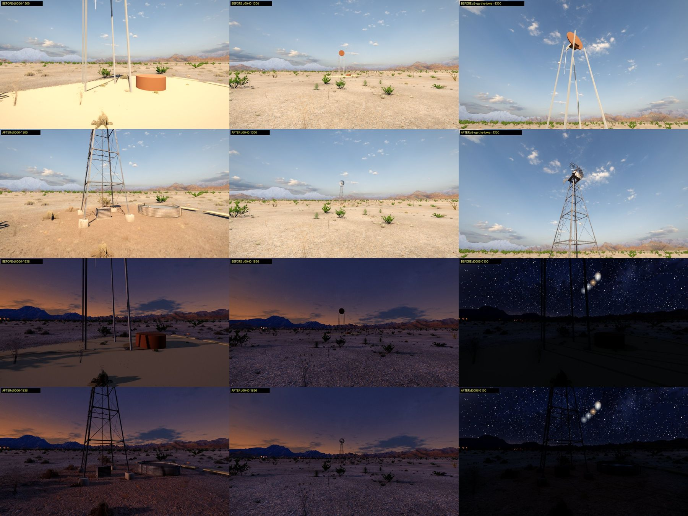
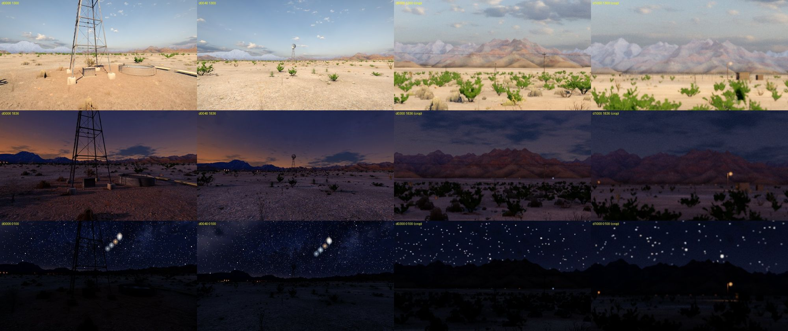
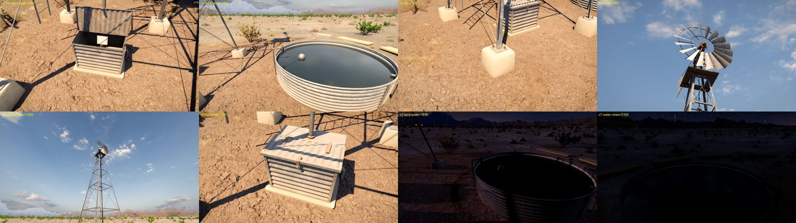
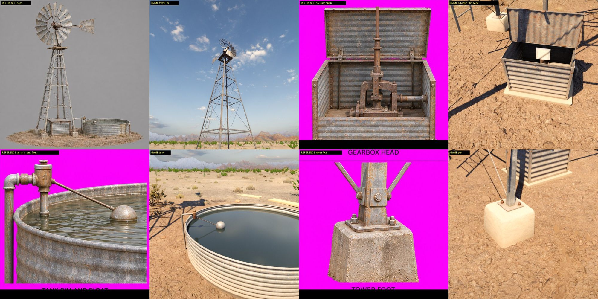

# Stedene ute på landet som modeller: vindmølla (LAND-PLACES-WINDMILL-20261114)

**Status:** Gjeldende for vindmølla; linjehytta, gruva og cairnet er ikke laget · **Gjelder:** vindmølla på Baca-leasen og gårdens vindmølle, Unreal-utgaven (`/Game/LandPlaces/Windmill`, `S47LandWindmill.cpp`) · **Sist kontrollert:** 14. november 2026

Tom bestilte 13. november fire steder ute på landet modellert etter referansepakker (heltebilde, firevinkelsark og detaljark per sted, laget med ChatGPTs bildeverktøy etter Toms brief). Vindmølla er den første. Regelen for viktige gjenstander er fulgt: én gjenstand, ekte form, bakte kart, kritikk i spillet. De oppgitte målene går foran bildene: referansens hjul er for stort, og stjerten er tegnet i hjulplanet. Verktøy og løype: [Tools/landplaces](../../../../unreal/Signal47/Tools/landplaces/README.md).

## Før og etter

Før var mølla åtte grunnformer fra koden (fire stenger, en plate, en skive, en stjert og en rusten sylinder som tank). Den hadde verken gangkollisjon eller bilhinder, og de to første dagene lå sporene på en lys plate. Nå står en galvanisert gittermast på fire betongpirer med hjul, girhode og stjert, en pumpestang ned til en pumpe i et knehøyt pumpehus med hengslet lokk, og en rund vanntank med flottørventil, overløp og vann. Bakken under er tråkket bar (gårdens slitte jord som decal).

## Mål

| Mål | Bestilt | Modellen |
|---|---|---|
| Navhøyde | ca. 9,5 m | 9,50 m |
| Hjul | ca. 2,4 m, 18 blader på to ringer | 2,40 m, 18 blader, ringer i radius 0,50 og 0,97 m |
| Tårnfot | ca. 2,5 m kvadrat på betongpirer | 2,50 m mellom beinas hjørner, pirer 0,40 m med 0,26 m over bakken og 0,70 m ned |
| Stjert | bom vinkelrett på hjulplanet | ryggrad og to stag rett bakover, vinge 1,02 × 0,94 m, 1,3 til 2,3 m bak aksen |
| Pumpehus | ca. 0,80 × 0,65 × 0,60 m, lokk som kan åpnes | 0,80 × 0,65 × 0,60 m (lokkets topp 0,63 m), lokket åpner 98 grader om hengsla |
| Tank | ca. 3 m bred, 0,6 m høy, flottørventil, overløp, vann | 3,00 m (3,03 over den rullede kanten), 0,60 m, vannspeil i 0,47 m |
| Stige | kort stige | på vestsida fra 0,5 til 5,6 m |

Gården bruker samme modell. Tårnet er likt; tanken er skalert til gårdens gamle mål (4,6 m bred, 0,72 m høy), slik at kjørehinderet og plassen er som før.

## Deler og hva som driver dem

Bevegelsen er kode, etter animasjonsregelen for mekanikk.

| Del | Drives av |
|---|---|
| Hjulet | Gården: vinden (`S47Weather::Live`), stille under 4,5 mph, aldri så fort at atten blader flimrer. Baca: står. Funnteksten, CB-en og Baca selv sier at mølla er surret og bremset og ikke går rundt. Den rykker så vidt når knirket høres, og går rundt uten vind bare mens nattas `windmill_knock` varer. |
| Hodet og stjerten | Gården: dreier sakte mot vinden. Baca: står dit det er surret, mot peilingen de to første dagene, som før. |
| Pumpestanga | Ett slag per omdreining: nede på banket, oppe på det lettere. |
| Lokket | Spilleren løfter og lukker det (E på pumpehuset). Når Reyes-siden fra 8. april venter, er lokket surret med blank tråd, og «Undo the wire» åpner det, både i stedets panel og på selve huset. Siden henger i posen sin på pumpa. |
| Flottøren | Vipper så vidt på vannet. |

## Det spillet henger på mølla, og hvordan det er bevart

- **Stedet** (`FS47Places`): plass, funntekst, kart, magnetometer, første natts linje og peilesirkel er urørt. De åtte gamle formene bygges fortsatt og skjules når modellen finnes. Mangler assetene, eller med `-S47LandMillOff`, vises de som før.
- **Første dagers spor:** hodet vris mot peilingen som før. Den blanke tråden går nå fra stjerten til nærmeste bein. Krattringen og hjulsporene er de samme; den lyse plata er byttet mot tråkket jord som alltid ligger der.
- **Lyd:** `MillReach` og `MillCreak` er uendret; knirket gir et lite rykk i hode og hjul.
- **`windmill_knock`:** banket flytter stanga, og hjulet går; det stopper når spilleren kommer nær, som teksten sier.
- **Reyes:** merket 6 m øst og 4 m sør står fritt. Siden «in the pump housing» finnes nå i pumpehuset.
- **Gange og kjøring:** pirene, pumpehuset og tanken er gangbokser (`landplace:windmill:`). Spilleren går mellom beina og rundt huset. Lastebilen stoppes av tårnfoten og tanken, og av ingenting annet. Rutene i HWY-WALL-prøven ender 13 m unna.
- **Planter:** bunndekket vokser ikke under tårn og tank (blokker i `S47GroundCover`), og spredte planter og steiner der trekkes inn mens spilleren er nær. På gården er tanken og tårnfoten rene; inne i Baca-tårnet står én busk fra en annen kilde igjen.

## Detaljnivåer og kart

| | LOD0 | LOD1 (30 m) | LOD2 (90 m) | LOD3 (220 m) | LOD4 (550 m) |
|---|---|---|---|---|---|
| Hele gruppa, trekanter | 25 240 | 12 140 | 3 506 | 2 004 | 1 272 |

På avstand tegnes beina tykkere, og over en halv kilometer er tårnet én slank pylon og hjulet en skive: et gitter er da tynnere enn en piksel. Tre bakte kartsett (farge, normal, ORM): tårn 4K, fot (pirer, pumpehus, tank) 4K, topp (hjul og hode) 2K, siden toppen aldri ses nærmere enn åtte meter. Vingen har «BACA LEASE NO. 2» som egen tekstur, nesten borte, og bare på Baca-mølla.

## Svakheter og åpne punkter

- Lokket har ingen lyd. Ny lyd skal rendres og høres av Tom først.
- Månen speiler seg ikke tydelig i vannet. Vannet er en blank, mørk flate uten egen bølgebevegelse.
- På 300 m er mølla en tynn mast med hjul; på én kilometer er den under en piksel bred (10,7 m høy er sju piksler ved spillets synsfelt) og går ikke å skille ut i bildene, verken dag eller natt. Fjernnivået er gjort mørkere og bredere (1,3 m), men et eget fjernmerke for landemerker bør avgjøres samlet for alle stedene.
- Fra sør-sørvest skjuler terrenget mølla fra 300 m og utover; fjernbildene er derfor tatt fra vest-nordvest.
- «Skumring» er tatt 18:36. Spillets sol går ned 18:27, og 19:30 er allerede natt.
- Posen med Reyes-siden leses som et hvitt kort fra ståhøyde.
- Mineralstripene under overløpet er svakere enn på referansearket.
