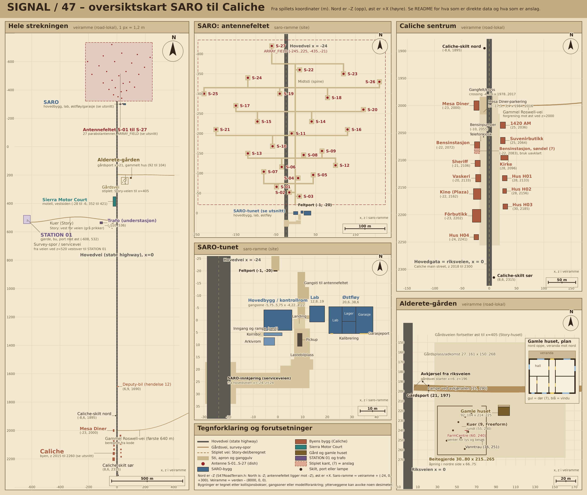

# Verdenskart: SARO til Caliche

**Status:** Referanse. **Gjelder:** Plassering av steder, bygninger og antenner i Unreal-utgavens spillkoordinater (Freeform-oppsettet for gården). Ikke et designløfte om nytt innhold. **Sist kontrollert:** 6. november 2026.

Kartet er tegnet av et engangsskript fra manifestet og C++-konstantene. Det er ikke generert av spillet og følger ikke automatisk senere endringer. Se også [SARO 1986](../SARO_1986.md) og [design-inngangen](../README.md).

## Orientering og koordinatrammer

- **Nord er -Z, øst er +X, sør er +Z.** Kilder: `S47RoadTerrain.h` ("North is -Z"), `S47OldRoadLayout.h` ("x is east, north is -z"), antennefeltet ligger mot -Z fra SARO-bygget. At kontrollrommets vinduer vender nord er ikke kontrollert i modellen; kartet bygger på at -Z er nord. STATION 01 har egen kompasskorreksjon (skyYaw), ikke tatt med.
- **Veiramme (road-lokal)** er hovedreferansen: riksveien går langs x = 0, diner/by ligger rundt z 2000 til 2300. Verden = veiramme + (8000, 0, 0) (`ORIGINS` i `S47Legs.cpp`).
- **Saro-ramme (site)** = veiramme + (-24, 0, +300) (`SARO_IN_ROAD` = (24, -300), `RoadToArea`). SARO-hovedbygget er origo, riksveien ligger på x = -24 her. Motell og antenner er oppgitt i saro-ramme.
- **STATION 01** har egen ramme (origo (0, 0, 8000)), vridd en kvart omdreining fra veirammen om `END` (-603, 532). Omregning: veiX = sz - 634,4, veiZ = 532 - (sx + 19,25).
- Z vokser nedover på kartet. Rutenettlinjene har koordinatene i panelets egen ramme.

## Direkte fra data eller kode

- Alle 27 antenner S-01 til S-27 (`dishes` i manifest, saro-ramme), antennefeltet `ARRAY_FIELD` (-245..225 x -435..-21), midtsti, tverrstier, spor og aprons (soner `fSpine`, `fRow1-6`, `fSpur`, `fApron`), feltporten (-1, -20).
- SARO-tunet: hovedbygg-gangsone, lab (12,8..19 x -5,8..0,8), arkivrom, korridor, landing, lastebilplass `SARO_PAD`, rampe, serviceveien og innkjøringen mot riksveien (`SARO_WAY`), pickup (`truck`-item), østfløyen (`S47EastWing.cpp`: x 20,6..38,6, z -5,5..5,5; rommene Lab, Lager, Kalibrering og Garasje fra lysarmaturenes navn).
- Sierra Motor Court (`MOTEL_RECT`, soner `lot` og `office`) og kuenes posisjoner (`COWS` i `S47Herd.cpp`, `HerdOffset` (92, 0, -316) i Freeform).
- Byens bygg: fotavtrykk fra `Tools/townbuildings/design.py`, `Content/CalicheAccess/assembly.json` og `Content/CalicheHomes/assembly.json`, bekreftet mot kollisjonsboksene i `walks.road.colliders`. 1420 AM, suvenirbutikk, bensinstasjon og pumper er tatt fra kollisjonsbokser og `town:*`-interaksjoner.
- Gården: `S47FarmHouse.cpp` (hus 92..104 x 214..225, veranda mot nord, veggplan), `S47FarmWorld.cpp` (gjerde 30..80 x 215..265 med åpning 66..75, vanntrau (76, 251), adkomstsone), `RanchZ`, gårdsporten (x = 21, `S47FarmAccessContract.cpp`), lampe (15, 190), `FarmCentre` (60, 240).
- Skilt Caliche nord (-8,6, 1895) og sør (8,6, 2315), deputy-bil (6,9, 1690), STATION 01-porten `GATE`, `STATION_FENCE`, `STATION_PAD`.
- Trafo-rot (-110, 536,2) fra `Tools/substation/README.md` (Three-rot 7890, 536,2, yaw 180) og `S47FarmNight.cpp`.

## Anslag eller tolkning

- **Bensinstasjon, søndel** (kollisjonsboks -27..-17,4 x 2078..2088): bruk er ukjent (garasje eller del av stasjonen?). Tegnet stiplet.
- **Trafoens tomt**: kartet bruker 20 x 16 m sentrert på roten. Grusflaten er oppgitt som 20 x 16 m, men forskyvningen fra roten er ikke lest ut.
- **Hovedbyggets yttervegger**: kartet viser gangsoner (innvendig gulv), ikke ytterkanter. Det gjelder lab, arkivrom og korridor også.
- **Survey-sporet** er en Catmull-Rom-kurve gjennom `KEYS` i `S47RoadTerrain.cpp`; kurven kan avvike noen meter fra den ferdige.
- **Gammel Roswell-vei** er beregnet fra `OldRoadBearing` (første 640 m). Avgreningen ligger ved z = 1999,95.
- **Story-huset** på gården ligger ved veiens ende (x om lag 402..414, z 216..225), utledet fra `HouseOffset` (-310). Ikke tegnet som egen figur.
- **Motellets innkjøring** er ikke eksplisitt i data. Lot-sonen grenser mot riksveien, men innkjøringsstedet er ikke funnet.
- **"Gate"** er tolket som gata: Caliches hovedgate er riksveien selv (`TOWN()`: z 2018 til 2300). Porter (felt, gård, STATION 01) står i tabellen.
- Bensinpumpene (-11,1..-9,4 x 2051,5..2058,5), telefonkioskens plassering (-15,5, 2064,6) og lyktestolper er tatt fra boksene, men ikke kontrollert mot modeller.
- Kart over gården følger **Freeform**. I Story står kuene vest for veien (-27..-52, 538..575) og det gamle huset ved veiens ende.

## Navngitte steder (senter)

| Sted | Veiramme x, z | Saro-ramme x, z | Kilde |
|---|---|---|---|
| SARO hovedbygg | 24, -300 | 0, 0 | data (gangsone) |
| Lab | 40, -302 | 16, -2,5 | data (gangsone) |
| Østfløy / garasje | 53,6, -300 | 29,6, 0 | data |
| Feltport | 23, -320 | -1, -20 | data |
| Antennefelt S-01 til S-27 | -221..249, -735..-321 | -245..225, -435..-21 | data |
| Sierra Motor Court | -17, 386 | -41, 686 (lot -43,5..-30,2 x 651,5..720,8) | data |
| Gårdsport | 21, 196,6 | -3, 496,6 | data |
| Alderete, gamle huset | 98, 219,5 | 74, 519,5 | data |
| Kuer (Freeform) | 55, 240 | 31, 540 | data |
| Trafo | -110, 536 | -134, 836 | data (rot), tomt anslag |
| STATION 01 (gjerde, midt) | -633, 513 | -657, 813 | data |
| STATION 01 port | -608,4, 532 | -632,4, 832 | data |
| Mesa Diner | -23,1, 2000 | -47,1, 2300 | data |
| Bensinstasjon | -22, 2072 | -46, 2372 | data |
| Sheriff | -21, 2106 | -45, 2406 | data |
| Vaskeri | -20, 2133 | -44, 2433 | data |
| Kino (Plaza) | -22, 2162 | -46, 2462 | data |
| Fôrbutikk | -23, 2202 | -47, 2502 | data |
| Hus H04 | -23,5, 2241 | -47,5, 2541 | data |
| 1420 AM | 25, 2036 | 1, 2336 | data |
| Suvenirbutikk | 25, 2064 | 1, 2364 | data |
| Kirke | 28, 2095,5 | 4, 2395,5 | data |
| Hus H01 / H02 / H03 | 28,5, 2133 / 28,2, 2156,5 / 29,5, 2185 | 4,5, 2433 / 4,2, 2456,5 / 5,5, 2485 | data |

Veiramme til verden: legg til 8000 på x. Saro-ramme for byen og gården er utledet med formelen over.
