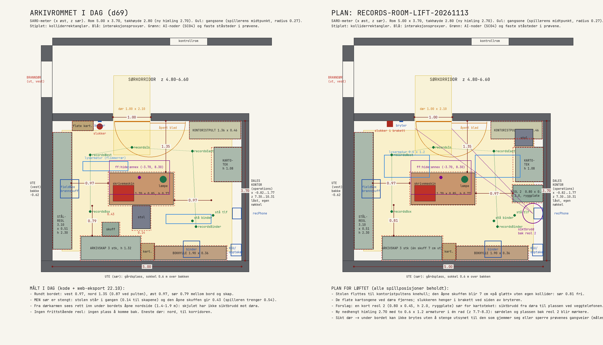
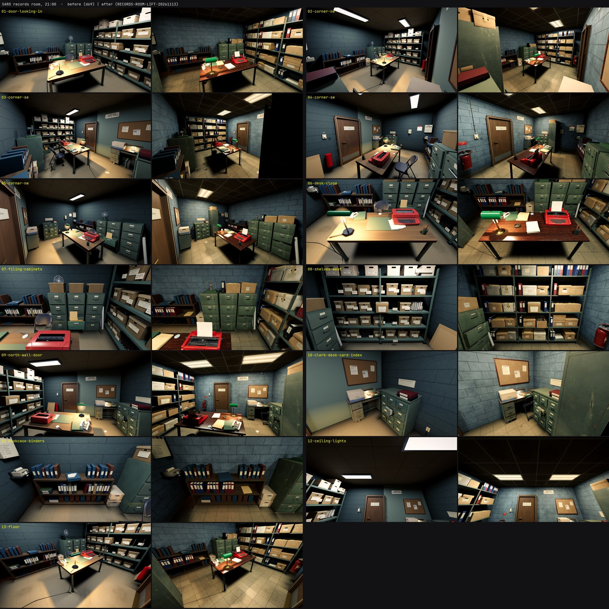
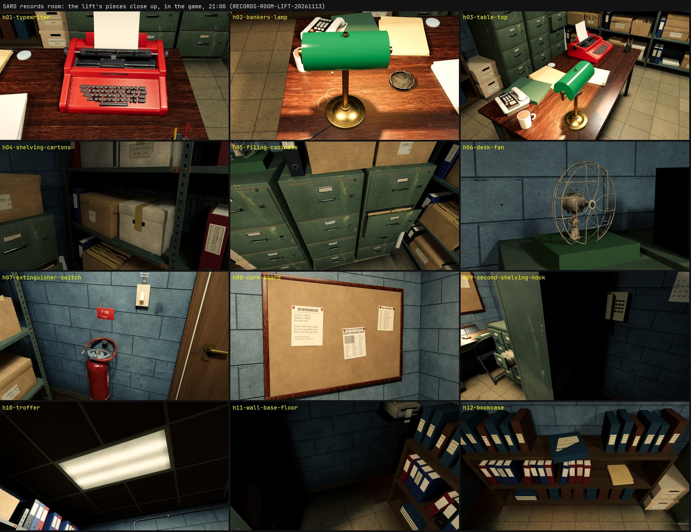

# SARO-arkivet: realismeløft (RECORDS-ROOM-LIFT-20261113)

**Status:** Gjeldende · **Gjelder:** arkivrommet («records room») i SARO-annekset, Unreal-utgaven · **Sist kontrollert:** 13. november 2026

Tom leverte 13. november et ark med seks fotorealistiske vinkler av arkivet og et notat: bruk arket til overflater, beslag og rekvisitter; mål dører, rom og passasjer i Unreal før møbler flyttes; bevar fungerende interaksjoner; sjekk at spilleren kan gå rundt hovedbordet og bryte sikt ved reolene; avklar en mulig alternativ utgang. Dette notatet er byggegrunnlaget og resultatet. Kode: `S47RecordsRoom.cpp`. Verktøy og kilder: [Tools/recordsroom](../../../../unreal/Signal47/Tools/recordsroom/README.md).

## Plan og mål

Rommet er 5,00 × 3,70 m (x −6,0 til −1,0, z 6,8 til 10,5 i SARO-meter), 2,80 m til dekket og 2,70 m til den nye himlingen. Eneste dør er i nordveggen (1,00 × 2,10 m, x −4,4 til −3,4) mot sørkorridoren; bladet slår inn og legger seg flatt mot veggen øst for åpningen.

| Mål | Før | Etter |
|---|---|---|
| Fri bredde vest for bordet (reol til bord) | 0,97 m | 0,97 m |
| Nord for bordet (vegg til bord / pult til bord) | 1,35 / 0,87 m | 1,35 / 0,87 m |
| Øst for bordet (bord til kartotek og reol 2) | 0,97 m | 0,97 / 0,95 m |
| Sør for bordet (bord til arkivskap) | 0,79 m, men stolen sto 0,14 m fra skapene og den åpne skuffen ga 0,43 m: **stengt** | **0,81 m fritt** |
| Runde rundt bordet for en spiller (radius 0,27 m) | stengt | åpen (selvtest) |
| Sikt fra døra til plassen under veggtelefonen | åpen | brutt av reol 2 (selvtest, 3 av 3 linjer) |
| Sikt fra døra til skjulet under bordet (1,41 m) | åpen | åpen, se under |

## Hva som er gjort

1. **Flater.** Veggene er malt betongblokk 40 × 20 cm med ekte fuger i normalkartet, gulvet er slitt vinylflis 30 cm. Begge ligger på web-eksportens egne flater etter verdensposisjon, med hvert sitt makrokart for rommets slitasje: skrubb i stol- og trallehøyde, fett rundt bryter og telefon, lekkasjen i sørvest, ganglinjer fra døra og noen nyere fliser. Den grønne pussflata øst for døra er blitt blokk som resten. Gulvlist i vinyl, rør fra bryteren opp og langs nordveggen til en koblingsboks.
2. **Himling og lys.** Nedhengt himling på 2,70 m med T-profiler, flekkede plater og to 0,6 × 1,2 m armaturer med prismelinse i én rad (z 7,7 til 8,3). Det vestre røret er det gamle flimmerrøret og står der det sto; det østre er flyttet fra (−2,4, 9,4) til (−2,2, 8,0), så sørdelen og plassen bak reol 2 blir mørkere. Rørene har ulik farge og alder. Banklampa lyser fra en liten kilde inne i skjermen: varm pøl på bordplata, ingen hard kjegle på gulvet. Strøm, flimmer, mørke og veggbryteren virker som før (de samme driverne).
3. **Rekvisitter**, modellert én om gangen i Blender med bakte kart: rød kontorskrivemaskin «CALDERA 210» med løse taster, valse og ark; banklampe i messing med grønn glasskjerm; arbeidsbord med slitt lakkert plate på stålramme; stålreol med hullede stolper, rust og nedbøyde hyller; åtte kartongvarianter, tre permer, mapper og papirbunker med egne etikettkort; tre arkivskap med bulker, etikettholdere og én skuff på gløtt; korktavle; brakett og skilt til brannslukkeren. Vifta og brannslukkeren er Toms Cosmos-kjøp (bare lokalt, aldri i Git).
4. **Plassering.** Stolen står inntil kontoristpulten, den åpne skuffen er 7 cm på gløtt i det vestre skapet uten egen sperreboks, de flate kartongene ved døra er borte, og en kort reol 2 (0,80 × 0,45 × 2,00 m, plate i rygg og sider) står sør for kartoteket.

## Det spillet henger på, og hvordan det er bevart

Ingen proxy, sone, hengsel eller node er flyttet eller slettet. Gamle synlige deler er skjult, ikke fjernet, så kollisjonen de ga AI-en og siktsporene står. Alt nytt er uten kollisjon og utenfor interaksjonskanalen; reol 2 har én boks som bare stopper sikt.

| Ting | Hvor | Bevart slik |
|---|---|---|
| Permen og panelet (RECORDS ROOM: PLACE … IN THE BINDER, UNKNOWNS, aprilhullet, utlånskortet) | `binder` på bokhylla (−2,32, 10,2), ståsted (−2,3, 9,45) | urørt; selvtesten sjekker ståsted og sikt forbi reol 2 |
| Veggtelefonen `recPhone` | østveggen (−1,12, 1,42, 9,25), ståsted (−1,75, 9,3) | urørt; reol 2 slutter 13 cm nord for den |
| Skjulet `ff:hide:annex` | under bordet, (−3,70, 8,30) | ny bordramme har ingenting lavere enn 0,69 m |
| Bordet `workTable`, kartoteket `lineage`, STATION 01-boksen `fieldBox`, brannskuffen, sentralbordet, opptakeren | som før | nye hyller har samme høyder; hyllefeltet ved boksen (z 8,36 til 8,84) står tomt |
| Døra og «CLOSE RECORDS ROOM DOOR», lysbryteren | nordveggen | urørt |
| Jakta (SC04), prøvenes ganger og ståsteder | ti punkter og åtte ganger | selvtesten går dem mot de nye boksene |

## Skjul og sikt

Reol 2 gir en plass til: ved veggtelefonen står en ute av syne fra døra, i halvmørke. Skjulet under bordet er derimot synlig fra døråpningen (1,41 m, spillet ser en som gjemmer seg fra 3,0 m). Det kan ikke skjermes uten enten å stenge utsynet til den som ligger der (en plate på bordets nordside) eller sperre gangene prøvene bruker (esker på gulvet foran). Det er målt og meldt i selvtesten, ikke endret.

## Alternativ utgang

Nord: sørkorridoren, med branndør ut mot vest tre meter fra arkivdøra. Vest og sør: yttervegg, sokkel 0,6 m over bakken. Øst: Dales kontor (Operations, x −0,82 til 1,77, z 7,30 til 10,31), låst med egen nøkkel.

| Mulighet | For | Mot |
|---|---|---|
| A. Dør østover til Dales kontor | Naturlig naborom, gir rundløype korridor – arkiv – kontor – korridor | Går rundt nøkkelgåten hvis den ikke låses fra kontorsiden; veggtelefonen (z 9,1 til 9,4) og Dales bokhylle (z 8,29 til 9,71) står i veien, fri vegg er 0,6 m |
| B. Ytterdør i sørveggen | Ekte flukt ut på en annen side enn branndøra | Krever trapp, ytterdør og lys ute, og tar plassen til ett arkivskap |
| C. Ytterdør i vestveggen | Enkel å forklare | Samme fasade som branndøra tre meter unna; reolen og brannskuffen står der |

**Anbefaling:** A i en egen runde, låst fra kontorsiden til kontoret er åpnet, med veggtelefonen flyttet 0,3 m sørover og Dales hylle kortet inn. B hvis Tom vil ha en flukt ut. Ingen dør er skåret i denne runden.

## Før og etter

Bildene tas med `-S47FreeformTest -S47RecordsShotTest` (13 vinkler, 21:00 og 13:00). Rommet har ingen vinduer; dag og natt er like.

Tolv nærbilder (`h01` til `h12`) tas i samme kjøring, bare kl. 21:00.

## Gjenstår

Kontoristpulten, kartoteket, bokhyllas øvre og nedre rad og dørbladet er de gamle modellene. Reol 2 dekker deler av tre av de faste vinklene (02, 03 og 10), og plassen bak den er nesten svart i bildene. Lampeskjermen leser som farget plast mer enn glass. Rommet er ikke sett fra korridoren med døra åpen (eksponering mot gangen er ikke sammenlignet).
