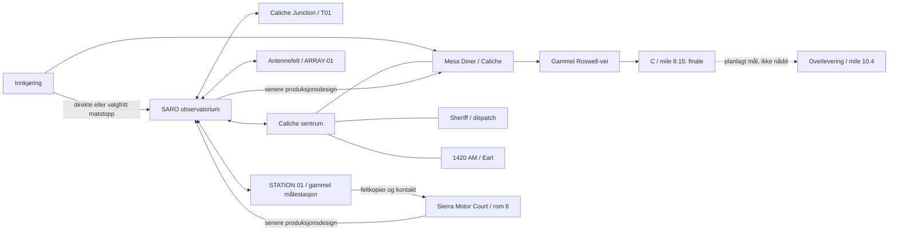
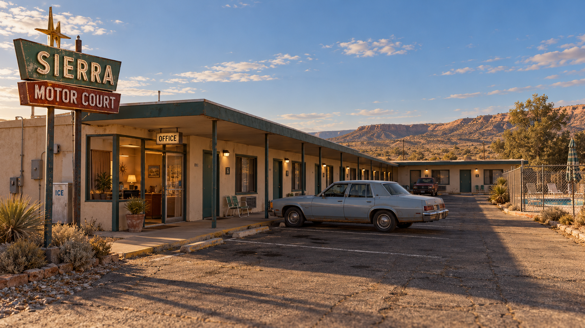
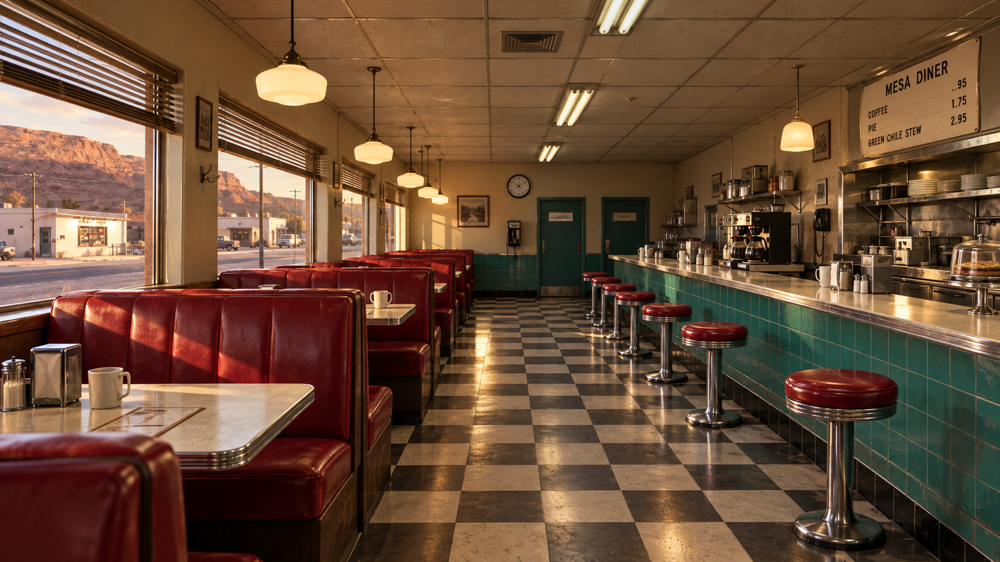

# SIGNAL / 47 — designbibel

**Arbeidsversjon 1.0 · 27. oktober 2026 · full historie og spoilere**

Dette er en samlet designmal for spillets Unreal-versjon: verden, miljøer, visuell retning, personer, oppdrag, trusler og produksjon. Den skal gjøre det mulig for en designer, forfatter eller 3D-artist å forstå hva som skal bygges og hvorfor. Spilltekst er på engelsk; denne bibelen er på norsk.

**Les status før du bygger:** «Eksisterende» viser til dokumentert kildestatus, ikke nødvendigvis en ny test av installert spill. «Produksjonsdesign» er den nyere planlagte historien, ikke ferdig funksjonalitet. «Åpent» trenger beslutning eller kontroll. Eldre Unity-kart og den gamle designbibelen brukes som historikk, ikke som fasit for dagens Unreal-verden.

## Innhold

1. [Spillets identitet](#1-spillets-identitet)
2. [Verdenskart og steder](#2-verdenskart-og-steder)
3. [Visuell bibel og bilder](#3-visuell-bibel-og-bilder)
4. [Historien og personene](#4-historien-og-personene)
5. [Hele hovedreisen](#5-hele-hovedreisen)
6. [Oppdrag og valgfrie spor](#6-oppdrag-og-valgfrie-spor)
7. [Aliens og andre trusler](#7-aliens-og-andre-trusler)
8. [Gameplay, lyd og grensesnitt](#8-gameplay-lyd-og-grensesnitt)
9. [Produksjonsmal og åpne spørsmål](#9-produksjonsmal-og-åpne-spørsmål)
10. [Kilder](#10-kilder)

## 1. Spillets identitet

SIGNAL / 47 er kosmisk etterforskning med psykologisk skrekk og skjul/flukt, i New Mexico våren 1986. Spilleren er Reyes, på nattevakt ved radioobservatoriet SARO. Et ordinært arbeidssted og en levende småby blir gradvis utrygge når registreringer, et gammelt fotografi og observasjoner peker mot en større ankomst.

**Spillerløkken:** Oppdag noe → foreslå en forklaring → gjør en fysisk kontroll → bevar spor → endre neste handling → håndter fare → få tid til å forstå hva som skjedde. Foto, faktiske instrumenter, papir, steder og vitner er verktøyene. Ingen våpen- eller ammunisjonsøkonomi skal bære opplevelsen.

**Følelse:** Troverdig hverdagsliv først; uro gjennom avstand, uoverensstemmelser og oppmerksomhet; senere tydelige fysiske møter. Skrekk bygges med rom, konsekvenser og pauser, ikke bare høy lyd eller konstant jakt.

**Konstanter:** 27 antenner; 1420.405 MHz; retning 026; pulsgrupper 4 og 7; THE EVENT varer 47 sekunder. Fortellervinduet går fra 13. april kl. 18:00 til 14. april 1986 kl. 05:29:47. Hendelser og bilder fra 1947 er sentrale. Historietid er ikke målt spilletid.

## 2. Verdenskart og steder

**Nye kart:** [Dagens Caliche og SARO, med forslag til naturligere layout](KART.md). Kartene er basert på kildekoordinater og er grunnlag for senere justering i Unreal.

**Begreper:** Caliche er småbyen. SARO er observatorieanlegget utenfor byen. Dette er et **topologisk oversiktskart**, ikke målestokk, fast nordretning eller en oppmålt plan. Piler viser sammenheng, ikke avstand eller entydig kjørestrekk. Fysisk plassering må kontrolleres i Unreal før modellering.



**SARO:** ankomst og besøksparkering, inngang, kontrollrom/receiver, servicearealer, fotolab, arkiv, Dales kontor, S-03, B-12, gjerde og veien ut til arrayet. Før et rom forbindes med et annet må dører, vegger, faktisk spillbar rute og siktlinjer måles i den gjeldende scenen. Tidligere ankomstmateriale beskriver østinngang; nyere arbeid med sørinngang er pågående i referansetråden. Inngangsplassering er derfor **åpen for kontroll**, ikke fastslått her.

**Caliche:** Mesa Diner er et sosialt, opplyst tilfluktssted og et viktig sted for E15/P13. Sheriff/dispatch mottar meldinger. 1420 AM og Earl gir kildekontroll av et eldre opptak; AM-stasjonen er ikke samme frekvens som observatoriets 1420.405 MHz. Suvenirbutikk, vaskeri, kino, fôrbutikk og kirke gir bykarakter og mulige valgfrie observasjoner. Konseptenes interiør er ikke et løfte om åpne rom. Bensinstasjonen er møtested i den nyere planen. Eksakt bygningsrekkefølge og kartkoordinater er ikke bekreftet her.

**Caliche Junction:** liten servicestasjon og lokal lampe/indikator for T01. Gjerdet rundt høyspentområdet er en grense, ikke en påkrevd fluktrute. **ARRAY-01:** separate A/B-ståsteder og fast lokal referanse i planlagt kontroll; disse er ikke Dales T02-kulvertpunkt. **STATION 01:** feltbygning, transit, A/B-oppstilling, tom fot, lokal lampe, kabelbrudd og receiver. **Sierra Motor Court:** beskjed/kontor, parkering, dekket gangvei og rom 6 med Nora. **Roswell-veien:** C ligger ved 8.15 miles; foreslått overlevering ved 10.4 er et mål finalen avbryter, utenfor dagens dokumenterte spillbare strekning.

**Plantegninger som mangler:** målrettet SARO-plan med faktiske innganger og rømningsruter; Caliche med virkelig rekkefølge og dører; målestasjonens oppstilling; motell med rom 6. Ingen av disse skal tegnes som målsatt kart uten oppmåling.

## 3. Visuell bibel og bilder

**Utvidet visuelt grunnlag:** [Visuell designbibel med nye miljøbilder, materialer og fargepalett](visuell-retning/VISUELL-BIBEL.md).

Arkitekturen er lav og praktisk: slitt stucco, malt metall, glass med dybde, flate tak, asfalt, grus, strømstolper og stedegen sparsom vegetasjon. Miljøene er vedlikeholdt og i bruk, ikke apokalyptiske ruiner. 1986 betyr analoge telefoner, skrivere, bånd, papir og tidsriktige biler. Materialer skal ha fysisk tykkelse, skjøter, naturlig slitasje og realistisk størrelse.

Farge og lys: varm sand og bleket krem utendørs; grønnblått, burgunder og krom i diner; institusjonsgrønt og papir i SARO; varme lokale lamper mot kjølig ørkennatt. Døråpninger, fluktruter og silhuetter skal kunne leses også når fremmed lys blir sterkt. Ingen tilfeldig dekor som stenger navigasjon.

### Motell: ny referanse fra den oppgitte tråden



**Konsept, ikke spillskjermbilde.** Bruk en helhetlig én-etasjes fløy, gjenkjennelig resepsjon, sammenhengende overdekket gangvei, parkering som ikke sperrer dører, troverdig tidsriktig bil og diskret slitasje. Mål og endelig romrekkefølge må bindes til spillverdenen.

### Mesa Diner: ny referanse fra den oppgitte tråden



**Konsept, ikke spillskjermbilde.** Vinduer og røde båser til venstre, disk og krakker til høyre, fri sentral gangakse. Turkis flis, kremvegger, rutegulv, troverdig kaffestasjon og praktisk varmt lys. Bevar eksisterende interaksjoner når geometrien forbedres.

### Flere visuelle kilder

- [Caliche: åtte konseptark for bygg og interiører](../../unreal/Concepts/Caliche-2026-10-23/README.md). Bildene er designmål, ikke bevis på ferdige åpne bygg.
- [Tidligere by- og dinerbilder](assets/konseptbilder/2026-10-23), [UI-galleri](assets/konseptbilder/2026-10-24-ui/GALLERI.html), [levende og bortført ku](../../unreal/ArtSource/Cows/Concepts).
- [Ankomst, inngang og Dale-kontor: arbeidsbilder](assets/resultater/ankomst-og-kontor). Modell/render og pågående endringer må kontrolleres mot nåværende scene.
- [31 dokumentrekvisitter med katalog](../../unreal/ArtSource/Documents/GALLERI.html) og [miljøgrafikk](../../unreal/ArtSource/EnvironmentGraphics/GALLERI.html). Rekvisitter er bilder, ikke automatisk integrerte spilldokumenter.
- [Historisk konseptkart](../WorldCase22/Visuals/world-map-final.png): viser en eldre trestedsplan. Bruk bare som illustrasjon, ikke dagens fasit.

## 4. Historien og personene

### Forfatterfasit

En hendelse i 1947 etterlot målinger, en oppstilling og et fotografi. Mennesker oppdaget en forbindelse og prøvde senere å avbryte den; de skapte ikke fenomenet. Originale og endrede dokumenter viser at en linje ble utelatt, men endringen alene beviser ikke motiv. Nora kuttet kabelen og mistet broren Tomás. Hans stemme som høres nå er et bevart, uendret fragment, ikke en levende rådgiver.

I 1986 finner Reyes instrumentavvik, fysiske referanser, historiske kilder og tegn på en reaktiv tilstedeværelse. Forskjellige stasjoner registrerer uavhengig ordnede hendelser og innkommende spor. Dette støtter en kommende samordnet ankomst; hensikt, eksakt ankomsttid og hele mekanismen forblir ukjent. Varslingen når Ward og andre stasjoner. Reisen for å overlevere originaler avbrytes ved C. Under den faste 47-sekundersfinalen forsvinner Reyes fra bilen; hele 1947-fotografiet viser Reyes som den tredje silhuetten. Dette er forfatterkunnskap, ikke noe hver person vet.

### Personkort

| Person | Rolle og hva personen faktisk kan vite | Bruk i spillet |
|---|---|---|
| Reyes | Spilleren og nattevakt; lærer gjennom egne kontroller. | Undersøker, dokumenterer, varsler, gjemmer seg og reiser. |
| Dale | Kollega via telefon/radio; kjenner egne notater og observasjoner, ikke hele sannheten. | Overlevering, arbeidssteder, feltmappe, privat samling. Ingen fysisk Dale er etablert av dette manuset. |
| Ward | Kontakt for sikkerhet, dispatch, suspensjon og senere varsel. | Skal kvittere konkret for måledata og begrensninger. |
| Nora | Kjenner eget kabelkutt, den endrede linjen og tapet av Tomás. | Rom 6 gir personlig konsekvens og avgrenset advarsel. |
| Tomás | Noras bror; hans eksisterende fragment gjentas. | Et nytt spørsmål må ikke skape et nytt svar. |
| Earl | Radioperson som kjenner identifisert 1981-spole og egne kilder. | Faktisk kildekontroll før avgang kl. 04:00; sen rute krever datert kopi. |
| Mara Ortiz | Foreslått regional servicetekniker i vogn 23. | Avtalt hjelp som møtes før synlig bortføring; ny figur og scene må produseres. |
| Sheriff/dispatch | Kjenner faktiske meldinger og egne observasjoner. | Ta imot fare-/savnmelding uten å vite fremmed hensikt. |

## 5. Hele hovedreisen

Dette er den nyere **produksjonsdesignen**, ikke en påstand om at 13 nye sekvenser er integrert. Tidene er fortellervinduer. Ingen skjult stoppeklokke eller ubekreftet spilletid.

| ID | Sted og mål | Handling, bevis og endring |
|---|---|---|
| SC01 | SARO, ca. 18:00: overta vakten | Lær utstyr, utganger og normalreferanse. Ett lys over mesaen; en blek hånd på utsiden etterlater merker. Direkte ankomst fungerer også uten matstopp. |
| SC02 | Caliche Junction: kontroller lampen | Utfør T01 og få normalreferanse. En blek inntrenger står mellom Reyes og bilen; bruk faktisk skjerming og alternativ rute. Fullført arbeid beholdes ved lokal retry. |
| SC03 | Caliche: meld fare og møt hjelp | Dispatch får faktisk melding; Ortiz ankommer. En svart form kan sees. Hjelperen løftes/forsvinner i lys; fysiske etterspor og egen savnetsak følger. Ward stanser lokal 06:00-serie. |
| SC04 | SARO: sikre plan og originaler | Sperr den menneskelige automatiske planen, ikke all passiv mottaking. To ulike flukter: inntrenger i annex og fare ved bilen. Begrunnet trygg retur til kontrollrommet. |
| SC05 | SARO etter 00:13:47: residual | Passiv mottaking gir 4/7-signal. Telefonfragment og faktisk romhendelse sammenlignes over 47 sekunder. S-03 viser 026 i stedet for planlagt 042 uten normal kommando. |
| SC06 | S-03, B-12 og lab | Ta FRAME 01/02, velg aktiv eller passiv fysisk kontroll og fremkall. Sammenlign virkelig bilde og motiv. Et avvik som overlever kontroll leder mot arkivet. |
| SC07 | Arkiv og Dales kontor | E07 original og E06 endring viser utelatt C. E08 og stedmerke peker mot STATION 01. Dales mappe gir feltspor; privat UFO-materiale og eventuell VHS er fordypning. |
| SC08 | 1420 AM og antennefelt | Isoler datert bånd fra live monitor; nytt spørsmål gir samme fragment. Sammenlign operatørens A/B/retur med fast referanse og separat driftslogg. Reaktiv inntrenger gir ny flukt. |
| SC09 | STATION 01 og SARO-lab | Fotografer tom fot og flyttet A; gjør lokal nullprøve; følg og fotografer kuttet kabel; sammenlign E10 med receiver. Fremkall FRAME 03/04. T02 kan være uavklart uten å sperre hovedruten. |
| SC10 | Sierra Motor Court, rom 6 | Bruk feltkopier og rapporter i samtale med Nora om endring, kabel og Tomás. Still nytt spørsmål til fragmentet; samme svar viser begrensningen. Gi samtalen ro. |
| SC11 | SARO etter at fjernark er ferdige kl. 04:04 | Sikre originaler; eksternt lys avsøker åpninger mens inntrenger søker. Les reelle ruter og dekning. Flukt bevares; fangst gir lokalt sjekkpunkt. |
| SC12 | Mesa Diner: sammenstill og varsle | Sammenlign SARO, Hondo og Site 11 som uavhengige kilder. Ward skriver og leser tilbake verdier; bilder sendes ikke over telefon. E15/E09A/E14 gir P13 og C ved 8.15. Vurder ferske rutedata og bud ved 10.4. |
| SC13 | Gammel Roswell-vei: lever originalene | Planen er å passere C uten ny avlesning. Bilen stanser ufrivillig ved C; THE EVENT 05:29:00–05:29:47. Originalene når ikke budet; varselet er allerede gitt. |

[Fullstendig regi, porter og dialoggrunnlag](../../unreal/MISSION_FLOW_1800_ROSWELL.md) · [H01–H10 med handling, kontroll, gjenoppretting og avhengigheter](../../unreal/Narrative/HorrorStory/generated/MISSION_CARDS.md) · [79 sceners lesemanus](../../unreal/Narrative/HorrorStory/generated/SCRIPT.md).

## 6. Oppdrag og valgfrie spor

SC-numrene er den overordnede rekkefølgen; H-numre er produksjonskort. E-, P-, T- og NATT-ID-er skal beholdes når samme innhold implementeres. De 32 arbeidskortene under er et sekundært, eldre detaljoppslag og må leses sammen med SC01–SC13 ved motstrid. De er ikke 32 ekstra oppdrag etter hovedreisen. Kortene gir konkrete løsninger og avhengigheter.

### 32 arbeidskort og seks valgfrie undersøkelser

Nedenfor er bevart detaljtekst fra prosjektets sekundære løsningsoppslag. Enkelte eldre formuleringer er erstattet av den nyere SC-rekkefølgen over.

### NATT-01: Ta over ansvaret

**H01. Fra 18:00. Mål:** `Take the handover and identify the open service job.`

**Forløp og løsning:** Svar Dale på den eksisterende telefonen. Legg skiftlogg, arbeidsordre og service-/sendemappen ved hverandre. Finn hva som er gjort, hva som skal kontrolleres og hvilken mottakerkrets som har gitt problemer. Dales to gule indikatorer på Bank Three er normal informasjon, ikke bevis på et angrep. Avslutt med en konkret forståelse: normal drift må bekreftes før 06:00-serien kan overlates til neste skift.

**Fare og utvei:** Ingen aktiv trussel. La vanlig viftelyd, telefon og skumringslys etablere normaltilstanden. Tidlig matstopp er ikke et krav. Hvis spilleren avbryter, behold stedet i samtalen og papirene i mappen.

**Hint og ferdig:** Først «se hva som fortsatt står åpent», deretter servicekortets merking. Fullført ved avsluttet overlevering og tilgjengelige kilder, ikke når spilleren klikker alle sidene én gang. Behold `EV_HANDOVER`, `EV_SERVICE_LOG` og `EV_RADIO_SCHEDULE`.

### NATT-02: Lær utsynet og veien ut

**H01. Etter overlevering. Mål:** `Check the exits and make a normal reference photograph.`

**Forløp og løsning:** Hent kameraet, gå en faktisk tilgjengelig utgang fra innsiden og tilbake, og finn servicebilen. Ta et oversiktsbilde med en navngitt stolpe, vinduet og et fast bygningshjørne. Se den vanlige lampen direkte og gjennom glass; gå sidelengs for å skille refleksjon fra fast objekt. Prøv en opak skjerm først når en fysisk fungerende variant er produsert.

**Fare og utvei:** Lamperefleksjonen kan forklares når vinkelen endres. KVELD-01s fysiske nærvær og ferske merker utenfor glasset er en egen hovedhendelse og skal ikke forklares bort av samme kontroll. Kartlagte dører skal samsvare med kollisjon og tilgang. Et rom tegnet på et kart er ikke automatisk en åpen fluktvei.

**Hint og ferdig:** «Se fra en annen vinkel» → finn lampen → prøv døren fysisk. Journalen registrerer bare utgangen som faktisk er prøvd. H07 kan ikke bruke to ruter som lært kunnskap før begge finnes og er vist. Fotoet beholder virkelig tid, sted og piksler; feil utsnitt kan tas om uten filmstraff.

### NATT-03: Få en kjent mottakerreferanse

**H01/H02. Før serviceturen eller etter retur. Mål:** `Restore Bank Three and log a normal calibration.`

**Løsningsfasit:** Bruk rackspaken dersom RX bank 3 er ute. Ett gyldig profilsett er **1419.900 MHz, azimut 042, gain 55 og båndbredde 48 kHz**. Sammenlign med det teipede referansekortet og velg `LOG CALIBRATION`. Dette er et gyldig midtpunkt i intervallene, ikke eneste mulige numeriske kombinasjon.

**Kontroll:** Spilleren kan endre én verdi, se responsen svekkes og gjenopprette den. Høy gain kan ikke kompensere for feil retning eller frekvens. Kalibrering er ikke samme handling som å starte den ubetjente surveyen.

**Fare og utvei:** Reléklikk er vanlig maskinrespons her. Ingen jumpscare ved korrekt knapp. Feil innstilling viser hvilken kontroll som fortsatt mangler. Hint: referansekort → frekvens og retning → resten av verdiene. Kalibreringen kan gjøres før T01, men neste Survey-port krever fullført, fysisk arkivert T01 i en ny sak.

### NATT-04: Lampen ved Caliche Junction

**H02/T01. Kveldens feltreise. Mål:** `Inspect the marked local circuit and compare the lamp with the test.`

**Løsningsfasit:** Ta SARO 07 til den merkede grusavkjørselen. Parker og gå til servicefronten utenfor gjerdet. Les journalen og kretsmerkingen. Start den eksisterende tresekunderskontrollen. Lampen slukker under prøven og lyser stabilt når den er fullført. Undersøk den faktiske lampen og sammenlign med panelresultatet. Behold inspeksjonskortet med sakens virkelige tid.

**Fare og utvei:** Selve servicehandlingen er normal. Spilleren skal ikke inn i høyspenningsgården. Etter fullført kontroll overtar KVELD-02 som en nødvendig fysisk unnslippelse med en reaktiv enhet mellom spilleren og bilen. Dette er ikke lenger bare en valgfri, ufarlig fjern skikkelse. T01-resultatet bevares ved lokal gjenopptakelse.

**Feil og hint:** En lest journal er ikke en utført prøve. En grønn indikator er ikke observasjon av lampen. Hint: finn kretsmerket → kjør prøven helt → se på lampen etterpå. Avbrutt prøve kan tas igjen. R2s T01-kjede er implementert; nye atmosfære- og oppdragskoblinger her er fortsatt design.

### NATT-05: En normal by å huske

**H01/H02, valgfri avstikker på samme tur. Mål:** `Record what Caliche looks and sounds like before midnight.`

**Løsning:** Ved vaskeriet fotograferes den bleke formen. Gå sidelengs, undersøk lampens brakett og ta kontrollbilde. Sammenlign de fremkalte bildene: den ordinære formen kan forklares av vinkel og lampe. Ved suvenirvinduet fotograferes pappfiguren med **gul $3.50-etikett og splitt nederst til venstre**, sammen med en fast bakgrunn. Registrer en vanlig kveldssending og studioets normale aktivitet.

**Fare og utvei:** Bevar en faktisk normal by. Ikke start P01s stengte studio eller sen bortføring her. Et senere uavklart omriss på film opphever ikke den konkrete forklaringen på kveldens lampe.

**Feil og ferdig:** «Uavklart» er lov. Ingen hovedport avhenger av dette besøket. Den som kjører direkte tilbake får senere bruke den eksisterende, merkede arkivfilmen fra 17:10, aldri et oppdiktet eget kveldsfoto. Fremkallingens vanlige tid kan gå under gange; spilleren trenger ikke stirre på albumet.

Dette gjelder de valgfrie byreferansene. Kveldens nødvendige beats, særlig bortføringen og unnslippelsene, kan ikke gjøres avhengige av om dette sidesporet ble valgt.

### NATT-06: Arkiver arbeidet og slipp nattsurveyen løs

**H02. Siste bemannede kveldsarbeid, deretter komprimering til 00:13. Mål:** `File the inspection, suppress the known interference and begin the survey.`

**Løsningsfasit:** Returner til SARO og bruk den fysiske skiftmappen én gang med T01-journal, fullført kontroll og faktisk lampesammenligning. Fullfør eventuell uferdig kalibrering. Still så kjent highway-interferens på **1420.110 MHz, gain 55, båndbredde 12 kHz** og velg `NOTCH INTERFERENCE`; retningen er ikke kritisk i denne profilen. Den lokale toppen undertrykkes og Survey starter.

**Fare og kontroll:** K3 faller ut før den korte lysdippen, ikke som følge av den. Logg rekkefølgen; ikke erklær den kosmiske årsaken kjent. Den fysiske lampetesten sier noe om sin lokale krets på prøvetidspunktet, ikke hele byens senere strøm.

**Feil og port:** Ufullført T01 lar spilleren kalibrere, men sperrer Survey-overgangen i nye saker til kontroll og filing er gjort. Ingen ny gate på gamle saker. Skrekkrevisjonen legger i tillegg en ny hovedreise over seks kveldsbeats før overgangen til 00:13. Dagens ene rutinefade må omarbeides til korte, lagrede fremoveroverganger mellom avsluttede aktiviteter; den kan ikke hoppe over den nye akten. Etter inntrengermeldingen motiveres mottakerarbeidet som passiv overvåking og dokumentasjon. Ingen seks timers virkelig venting.

## 3. Etter midnatt: noe tåler en kontroll

### NATT-07: Det uregistrerte signalet

**H03. Residual 00:13:47. Mål:** `Isolate the residual and preserve the direction solution.`

**Løsningsfasit:** Ett gyldig søkeprofilsett er **1420.405 MHz, gain 82, båndbredde 12 kHz, søkeazimut 083**. Isoler mønsteret, identifiser **fire pulser, pause, sju pulser**, og gjennomfør eksisterende retningsløsning. Riv den virkelige utskriften med **-39 LY / CHECK SOLVE INPUTS**.

**Viktig skille:** Konsollens søkeinnstilling 083 er ikke den senere, ukommanderte antenneretningen 026. Ikke instruer spilleren til å stille alle disse retningene likt. Begge anbefalte oppsett bruker BW 12; ved residualen endres frekvens, gain og søkeazimut. Den gamle notch-profilen er derfor ingen fasit selv om båndbredden allerede er smal nok.

**Fare og utvei:** Dette er første store instrumentelle residual og nye forløpsbrudd, ikke første fremmede tilstedeværelse. Spilleren har allerede unnsluppet fare. Målingen undersøker hva prosessen gjør. Hint: sammenlign med kjent relé → øk gain og snevre inn → søk til signalet låser. Bank 3 kan gjenopprettes med den lærte spaken. Fullført når signal og utskrift er bevart, ikke bare når spekteret åpnes.

### NATT-08: Telefonen ligger foran rommet

**H03. Etter utskriften. Mål:** `Listen, then check what actually happened.`

**Løsning:** Ta telefonen og hør hendelsesforløpet. Når linjen dør begynner de etablerte **47 spillsekundene**. Etterpå kontrolleres kruset, loggen og antennene. Utskriften og den senere klokkesvikten har en faktisk rekkefølge; en klokke som faller ut etterpå forklarer ikke automatisk målingen som kom først.

**Fare og utvei:** Spilleren kan bevege seg og undersøke. Ingen tilfeldig dødelig posisjon, krav om å se på riktig vegg eller skjult redningskode. Pauser og paneler stanser det pauserbare hendelsesforløpet. Smellet er en stor topp; ikke legg monster eller ny bortføring oppå den.

**Hint og ferdig:** Be om én nøktern sammenligning: «What played before the line went dead?» Registrer observerte forhold og usikkerheten. Ikke gi hele 1947-forklaringen. Neste mål peker mot motorloggen ved S-03, fordi antennene faktisk beveget seg uten en forstått kommando.

### NATT-09: Ingen ba antennen snu

**H03. Fra omtrent 00:16. Mål:** `Check the S-03 controller before blaming the motor.`

**Løsningsfasit:** Les enkoderen og kommandologgen ved S-03: faktisk **026**, planlagt **042**, ingen bevegelseskommando for hendelsen. Noter disse tre forholdene hver for seg. Stå ved det eksisterende fotopunktet, identifiser forgrunnen og ta FRAME 01.

**Fare og utvei:** En isolert mekanisk lyd eller kort lokalt bortfall kan brukes etter at loggpanelet er lukket. Ikke la et angrep presse spilleren til å gjette fra et uleselig panel. En fjern skikkelse kan inngå i NATT-12 i stedet for enda en topp her.

**Feil og hint:** Å lese planlagt 042 som faktisk stilling er feil; pek tilbake til feltnavnene. En ny kommando er ikke støttet av null kommandoer i loggen. Foto uten relevant forgrunn kan tas om. Fullført når logg og riktig eksponering er bevart. Støtt spilleren med et motivhint, ikke en automatisk bekreftelse på hva som er overnaturlig.

### NATT-10: Den andre stripen

**H03/P01 og P02. Mål:** `Identify the extra reference and choose a test.`

**Løsningsfasit:** Fremkall FRAME 01 i fotolaben, fikser og hent kopien. Marker den ekstra referansen. Koble bildedetaljen til referansearkets **B-12: én elfenbensfarget stripe på en bevegelig vinge langs S-03-siktlinjen**. R-07 har tre horisontale stenger ved vestgjerdet og er feil form/sted. Velg deretter én prøvbar hypotese: arbeidslampens refleksjon, eller lokal referanse-/enkoderdrift.

**Fare og recovery:** Åpnes mørkeromsdøren under kritisk fremkalling, kan kopien bli tåket. Negativet bevares. Lukk døren og lag ny kopi; ingen ny feltreise, kjemijakt eller sletting av bevis. Ingen skremmehendelse mens spilleren prøver å se en liten bildedetalj.

**Hintstige:** Tell striper/stenger → følg siktlinjen → sammenlign B-12 mot R-07. P01 identifiserer motivet. P02 velger en kontroll; ingen av de to gyldige hypotesene regnes som feil bare fordi spilleren valgte den andre først.

### NATT-11: Kontrollen som ikke rydder opp

**H03/P03. Mål:** `Change one local condition and compare the exposures.`

**To gyldige løsninger:** Passiv kontroll folder vingen inn i skjermstoppet, skjermer lampen og beholder motoren isolert. Aktiv kontroll kommanderer vingen til **042 grader** mens lampen er på. La kontrollen bli stabil. Observer **én fysisk stripe** direkte, ta FRAME 02 og fremkall.

**Fasit på sammenstillingen:** Koble den ekstra referansen i FRAME 01 til den i FRAME 02. Koble deretter direkte observasjon av én stripe til kontrollbildets detalj. Den lokale tilstanden er endret, men filmen beholder den ekstra referansen. Den passive testen svekker lampeteorien; den aktive svekker enkel drift. Ett valgt forsøk utelukker ikke alle tenkelige årsaker.

**Fare og utvei:** Eventuelt ett miljøbrudd på returen, med kjent vei til SARO. Ikke både blackout, skyggemann og bortføring på samme tur. Feil kontroll, ustabil tilstand eller manglende direkte observasjon gir konkret beskjed om hva som må prøves igjen. Negativer bevares. Arkiver to bilder og den begrensede lokale rapporten før Ward åpner arkivsporet.

### NATT-12: Personen som står når du ser

**Overgang H03/H04, valgfri oppfølging av kveldens skyggemann. Mål ved oppfølging:** `Check whether the position changed.`

**Løsning:** En helt svart skikkelse står ved en kjent stolpe med lesbar bakgrunn. Se med vanlig blikk, zoom, lykt eller aktiv fotosøker; den blir stående. Vend deg mot et fysisk instrument under vanlig spilling og se tilbake. Én usett flytting kan vise den ved neste kontrollerte ståsted. Ekte foto fra samme bakgrunn kan støtte at plasseringen endret seg.

**Fare og utvei:** Ingen skade i introduksjonen. Figuren kan overses eller forlates. Den skal ikke forsvinne fordi lykt eller zoom brukes, flytte seg i periferien, bytte side gjennom et gjerde eller få en ny posisjon mens et dokument er åpent. Et stillbilde i albumet er dokumentasjon, ikke evig observasjon av en fjern figur.

**Hint og ferdig:** Noter først bare en posisjonsobservasjon. Sammenligning kan bekrefte ulikt ståsted, ikke identitet eller hensikt. Avslutt etter få mulige flyttinger; en tom retur er tilstrekkelig etterspill. Hovedhistorien fortsetter uten at spilleren må se den.

## 4. Arkiv og kollega: en feil som noen bevarte

### NATT-13: Den bortredigerte linjen

**H04/P04 og P05. Fra omtrent 00:55. Mål:** `Compare the original with the amended service copy.`

**Fysisk løsning:** E07-originalen finnes i STATION 01-boksen på vestre hyller, E06-servicekopien i sørpermen, linjekortet i østlig kartotek og E08-konvolutten med originalen. Legg E06 og E07 sammen. Originalen har **A, B og C**; kopien utelater **C, closing sight line**. Originalen beskriver bevart merke etter isolert lampe; kopien kaller dette fremkallingsfeil. Dette beviser omskriving, ikke motiv.

**Veien videre:** Sammenhold linjekort og konvolutt: **STATION 01**, trekant med kort vannrett strek under og navnet **OLD SURVEY STATION**. En ren trekant er høydesymbol; -39 er ikke survey-ID. Adgangsarket gir N. Vega ved Sierra Motor Court, **(505) 555-0119**. Ring fra arkivtelefonen; hun ber om kabelkontrollen før møtet.

**Fare og utvei:** Etter lukket panel kan takskritt følge spillerens tidligere rute og stanse ved feil dør. En fysisk låskontroll gir en handling uten jakt. Hint går fra tekstforskjell til manglende C og deretter symbolenes strek. Ingen nødvendige ark ligger bak et tilfeldig angrep.

### NATT-14: Sju toner, et eldre bånd

**H04, valgfritt eksisterende særspor. Mål:** `Use the numbered return order to open the older recording.`

**Løsningsfasit:** Prosessoren trenger bank 3, låst opptak og aktiv lyd. Finn Tomás' nummererte side under ekstraspolen. Den viste returordenen gir **7, 5, 3, 2, 1, 4, 6** på tastene. De siste sju tastene vurderes; tidligere forsøk ødelegger ikke båndet. Svaret åpner `TAPE A / 1947` forbi TAPE Bs slutt.

**Betydning:** Båndet viser den gamle lampen, C, kuttet og et forløp som ikke er en samtale med dagens spiller. Dets **02:17:00 og 02:17:47 er historiske 1947-tider**, ikke klokkeslett som skal flyttes til 00:13. Et sterkt frempek får være ufullstendig; ikke identifiser Reyes her.

**Fare og recovery:** Ingen fiende mens spilleren lytter eller bruker prosessorpanelet. Oppgaven må kunne løses fra den synlige nummersiden; hørsel eller absolutt gehør kreves ikke. Hint: det er returorden, ikke stigende eller synkende skala. Hovedruten får sin nødvendige timing fra E10 uavhengig av dette sporet.

### NATT-15: Det Dale beholdt for seg selv

**H04. Før avreise til STATION 01. Mål:** `Find the field folder and check one of Dale's observations.`

**Løsning:** Følg det begrunnede serviceskuffsporet til reservenøkkel og kontordør. Nøkkelen ligger ikke tilfeldig. Hent den navngitte feltmappen. Legg Dales daterte ståstedsnotat ved eget vindusfoto og fast referansestolpe. Det gir et fysisk spørsmål på feltreisen: stemmer to nåtidige plasseringer med notatet og surveymerkene?

**Valgfri fordypning:** Se den planlagte, bevegelige 72-sekunders VHS-filmen. Bruk en navngitt stedsdetalj fra filmen til oppfølging, ikke et tilfeldig skjult frame-nummer. Dale finnes bare på telefon/radio/walkie; VHS har ingen allvitende Kinski-forteller. Mappen bærer hovedsporet selv om strømmen er av eller filmen avbrytes.

**Fare og utvei:** Et kjent vindusutsyn kan avvike etter undersøkelsen, først når panelet er lukket. Ikke angrep for hver skuff. Hint: servicehenvisning → skuff → merket nøkkel. Avbrutt film lagrer avspillingssted og føres usett der den ikke er sett. Kontor, nøkkel, filmtransport og ny oppdragskobling krever fortsatt produksjon; de er ikke bevist av en ferdig bygning.

## 5. Feltreisen: lær forskjellen mellom lys og spor

### NATT-16: Punktet som har flyttet seg

**H05/P06. Fra 02:20. Mål:** `Locate A from the transit card and photograph the change.`

**Løsning:** Kjør til STATION 01 via eksisterende rute og surveyspor. Les E09A ved transitten. Finn den tomme betongfoten på siktlinjen, A-posten utenfor linjen og B i opprinnelig stilling. Ta **FRAME 03 med både tom fot og merket post**. Koble E09As A-plassering til bildet og registrer at A er flyttet.

**Avgrensning:** C er en siktlinje, ikke enda en flyttet stolpe. B står fortsatt vest for transitten. En endret plassering sier ikke hvem som flyttet noe. Dales kartleggingsspor kontrolleres mot de fysiske punktene, ikke godkjennes bare fordi en notatbok nevner dem.

**Fare og utvei:** En eventuell svart figur blir på sin side av gjerdet og flytter seg bare usett. Den skal ikke tvinge en dødelig blikkkonkurranse mens spilleren bruker transitten. Hint: finn transit → sammenlign tom fot og post → få begge i samme bilde. Feil utsnitt kan tas om. Eventuell refleksbåndfigur i filmen er et eget frempek, ikke automatisk skyggemannen.

### NATT-17: Prøven som fungerer normalt

**H05/P07. Mål:** `Mask the local lamp and observe the null test.`

**Løsningsfasit:** Gå til den lokale feltlampen, legg metallhetten over og observer nullprøven fra det tilgjengelige kontrollstedet. Resultatet er normalt: denne lampen er en lokal kilde som lar seg skjerme. Fullfør den fysiske kontrollen og registrer P07.

**Hvorfor oppgaven trengs:** Den gir en normal sammenligning til både kabelundersøkelsen og senere fremmed lys. Vi skal ikke skrive at P07-lampen fortsatt lyser gjennom hetten. Da ville den viktigste kontrollprøven miste funksjonen.

**Fare og utvei:** Første gjennomføring får være rolig. Et nytt eksternt lys kan senere krysse terrenget, men det er en annen kilde. Ingen elektrisk arbeidssimulator eller farlig høyspenningsbetjening. Hint: identifiser lokal lyskilde → bruk den eksisterende hetten → observer fra riktig sted. Avbrutt kontroll kan gjentas. Å ha lest kortet eller funnet hetten er ikke det samme som å ha gjort prøven.

### NATT-18: Kabelen tok ikke kvelden av seg selv

**H05/P08. Mål:** `Follow the cable and document the cut ends.`

**Løsningsfasit:** Følg kabelen fra hytta til transitfoten og videre til bruddet. Undersøk nært: to rene, motstående snittflater. Ta **FRAME 04 av selve endene**. Med P06 og P07 tilgjengelig kobles bildet til nullprøven og konklusjonen **deliberate-cut**.

**Avgrensning:** Et bevisst kutt sier ikke hvem som gjorde det eller hvorfor. Noras signatur på et annet papir er ikke nok til å tilskrive handlingen. Ikke gi spillerens journal en fasit som først skal komme i Rom 6.

**Fare og utvei:** Etter dokumentasjon og lukket panel kan en kort avsøkning avskjære den enkle returen. Les passeringen og bruk hyttas opake sidevegg eller tidligere skjerming. Aktivt trusselmøte4 er allerede gjort i ARRAY-01; STATION01 får ikke enda en lang jakt. Bevar utført kabelarbeid ved avbrudd. Hint: følg kabel fysisk → undersøk flatene → sammenlign brudd med kutt.

### NATT-19: Den samme korreksjonen

**H05/P09. Mål:** `Compare the receiver fragment with the 1947 timing sheet.`

**Løsningsfasit:** Les E10 i hytta og lytt til mottakeren: **“Reference west. No. East. Hold the last reading.”** Koble fragmentet til E10s bærebølge. Riktig dokumentert reléslag er **02:17:47**, **47 sekunder etter 02:17:00**. Det er 1947-opptaket som sammenlignes, ikke en nåtidig venteprøve.

**Fare og utvei:** Ingen aktiv jakt under E10 eller felttelefonsamtalen. Etter P09 kan dagens eksisterende telefonringing koble Nora videre. Et kaldt, tomt rom og en uendret dør kan være hele etterspillet selv om lyden ga forventning om noe mer.

**Feil og hint:** 02:17:00 er bærebølgens stopp, ikke reléslaget. Et nytt signal er ikke bevist av identiske ord. Hint: finn to merkede tidspunkter → sammenlign hendelsestypene → tell differansen. Fullført når den historiske sammenhengen er registrert. Ikke la fragmentet svare på et nytt spørsmål eller gi nye ruteinstruksjoner.

### NATT-20: Lyset som ikke følger den lokale kursen

**H05/T02. På samme feltreise, med uavklart utfall tillatt. Mål:** `Check the indicator, the source and the backup separately.`

**Løsningsrekkefølge for senere produksjon:** Bruk T01s faktiske normalreferanse eller ta en ny lokal baseline for eldre saker. Gjenta navngitt indikatorprøve. Kontroller den relevante servicekursens resultat. Observer selve lyskilden eller lysflaten fra to avklarte ståsteder. Kontroller om en lokal backup eller en annen fysisk lampe kan forklare tilstanden. Først når disse kontrollene støtter det, kan et kildeuavhengig lysforløp føres som avvik.

**Fare og utvei:** Bruk samme lærte avsøkning som ved STATION 01, med opake flater og en retrerbar rute. Ikke la lys eller skikkelse gå gjennom gjerdet. Ingen skjult inntrenger fanger spilleren inne i servicepanelet. Fjernformen får være uavklart og holdes adskilt fra den svarte figuren.

**Recovery og status:** Mangler en av de faktiske kontrollene, er resultatet **uavklart**, ikke bekreftet. Behold utførte handlinger og fortsett hovedreisen; SAROs senere lyskildekontroll bærer nødvendig hovedbevis. Ikke få spilleren til å gjenta hele T01. T02 er under separat utvikling; eksakte kontrollnavn og geometri avstemmes mot levert kode før integrasjon, uten å endre kontrakten om faktisk etterprøving.

### NATT-21: Ta med bilder, ikke bare historien om dem

**H05. Retur til SARO før Nora. Mål:** `Develop the field roll and preserve both contact prints.`

**Løsningsfasit:** Ta feltrollen med FRAME 03 og FRAME 04 til SARO. Bruk forseglet tank, lag kontaktkopier, fikser og hent begge ved benken. Kontroller at motivene faktisk kan leses: tom fot og flyttet post i ett bilde, kabelendene i det andre. Arkiver med sakens eksponeringstid og sted.

**Viktig skille:** Denne ruten er historiens mørkeromsarbeid, ikke anomaly-albumets 90-sekunders instantfremkalling. Den ene prosedyren skal ikke fullføres bare fordi den andre timeren har gått.

**Fare og recovery:** Gi returen ro. Et dårlig print kan lages på nytt fra negativet; et manglende eksponeringsmotiv krever tydelig fysisk oppfølging, ikke automatisk godkjent erstatningskort. Ingen fangst i mørkeromspanelet. Hint peker på hvilken fase som mangler: tank, kontaktkopi, fiksering eller henting. Fullført når begge bilder er bevart og kapittel 3 faktisk kan avsluttes. Eventuelle fotografiske frempek får være uten identitetstekst.

## 6. Rom 6: en person som vet hva det kostet

### NATT-22: Tre spørsmål til Nora

**H06/P10, P11 og P12. Fra 03:20. Mål:** `Show what you tested, establish the cut and test the voice.`

**P10, presis løsning:** Legg **PHOTO 01, PHOTO 02 og E07-originalen** på bordet. To av tre er ikke nok; E06 erstatter ikke originalen. Beskriv din faktiske kontroll. Passiv vei fjernet/skjermet lampen. Aktiv vei flyttet vingen mens lampen var på, altså **ingen fjernet lyskilde**. «Receiver» er feil svar og skal kunne korrigeres.

**P11, presis løsning:** Ta alle tre emner: omskrevet rapport, Tomás og kabel. Koble **E12s motiv til P04**, og **E12s kutt til P08**. Nora fjernet C for å hindre gjentakelse og brøt forbindelsen mens broren sto i referansen. Mild eller anklagende formulering gir sentrale bevis uansett.

**P12, presis løsning:** Undersøk nattbordtelefonen. Nora stiller nøkkelspørsmålet; returlinjen gir samme gamle korreksjon. Koble den til E10 eller feltmottakeren. Brevet sier at nøkkelen lå i kruset og viser hva et virkelig svar ville vært. Stemmen er et avtrykk.

**Fare, hint og ferdig:** Ingen aktiv fare under samtalen, brevet eller saksbrettet. Manglende print peker til konkret bilde, manglende motiv til rettelsen, manglende stemmekontroll til telefonen. E11, E12 og E13 følger saken. Nytt videre mål er å sikre originalene og varsle, ikke å gjenta Tomás' forsøk. Eventuell parkeringfigur er valgfri, fjern og blokkerer ikke bilen.

## 7. SARO: arbeidsstedet blir undersøkt fra utsiden

### NATT-23: Sikre grunnlaget før fronten lukkes

**H07. Etter Nora, ferdige fjernark tidligst 04:04. Mål:** `Secure the records and find how the search is coordinated.`

**Forløp og løsning:** På et kjent SARO-sted kontrolleres den opprinnelige mottakerregistreringens identitet mot nattens logg. Legg denne måleoriginalen, et tomt eller påbegynt hendelsesark og de ferdige, daterte Hondo-/Site 11-arkene i én transportmappe. Arket inneholder ennå ingen reaksjon fra en inntrenger. Prøv kjent serviceutgang og fungerende avskjerming. Først når nødvendig materiale er sikret og begge fluktmuligheter fysisk finnes, reserverer nattkurven beleiringen.

**Lyskontroll og eskalering:** Ventilasjon og vanlig radio faller bort. Bruk lært lokal lampe og opak skjerming som kontroll. Denne gangen flytter avsøkningen seg mellom flere åpninger i sammenheng med inntrengerens søk og stenger en tidligere enkel passasje. Grunnreglene beholdes, men samordningen er ny. H07 skal ikke undervise fra null som om kveldens møter aldri hendte.

**Fare og utvei:** Fronten er ubrukelig fordi gårdsplassen avsøkes, vist gjennom vindu og fysisk adkomst. Ingen uforklart deaktivert dør. Skjermen skal bevare lesbare kanter og dørkarmer, ikke blende alt hvitt. Mangler et fjernark før 04:04, fullføres tilgjengelig arbeid og et uttrykkelig rutineintervall kan komprimeres fremover før scenen; spilleren venter ikke på fremtidspapir under angrep.

### NATT-24: Det som svarer på deg

**H07. Rett etter lyskontrollen. Mål:** `Break contact and get the records to the service truck.`

**To løsninger:** Rute A går bak opake flater, stanser før en eksponert åpning og krysser når avsøkningen flytter seg. Rute B bruker en ordinær, allerede kjent lydkilde fra et beskyttet sted; observer at inntrengeren faktisk vender seg og undersøker den, og bruk den mer direkte passasjen. Begge ruter må ha vært gjennomførbare under normal befaring. Ett nødvendig demonstrasjonsøyeblikk viser reaktiv lydatferd også for den som velger rute A, uten å kreve et risikofylt foto.

**Fare og utvei:** Varslet innkomst fra én side. Huking påvirker reell eksponering. Hvis oppdaget: bryt sikt rundt solid hjørne, lukk tilgjengelig dør for tid og skift til skjermet rute. Fienden søker siste kjente sted, ikke spillerens skjulte koordinater. Skjul kan lykkes og avslutte søket; ingen evig skapventing.

**Recovery og ferdig:** Første kontakt får en prøvbar reaksjonsmargin. Fangst gir kort skrekkovergang og lokal gjenopptakelse fra sjekkpunkt før beleiringen, uten ny tapt-tid-gren. Sikrede bevis før møtet bevares. Flukt er fullført ved faktisk servicebil/utgang og avstand fra søkeområdet, ikke bare en knapp. Ingen ny obligatorisk bortføring etter suksess. Mappen er allerede med; ingen returtur inn for å hente en glemt hovedgjenstand. Først etter faktisk lyskontroll og reaktivt møte fylles hendelsesarket på trygg plass; den komplette kilden HR_SARO_ORIGINAL tildeles da, ikke før angrepet.

## 8. Etterpå: forstå hva flere steder måler

### NATT-25: Tre kilder, ikke tre kopier

**H08. Etter flukt, på trygg plass, gjerne dineren. Mål:** `Verify the three local records before combining them.`

**Løsningsfasit:** Legg `HR_SARO_ORIGINAL`, `HR_HONDO_LOCAL` og `HR_SITE11_LOCAL` sammen. SARO har lokal romobservasjon og mottakerrun. Hondo har egen batteristøttet hendelseslogger og to optiske hoder. Site 11 har egne optiske observasjoner og lydmating som var frakoblet under kontrollen. Match kildeidentitet, instrumenttype og kontroll, ikke bare lik ordlyd.

**Kontrollpunkter:** Fjernarkene gjelder **03:56 til 04:04**. Første fasegrenser er 03:56:08, siste 03:57:42. Den midterste er **03:56:55 ved Hondo og 03:56:56 ved Site 11**, innen oppgitt klokkeoppløsning. Behold forskjellen. Ikke gjør fullstendig identiske kopier til et styrkebevis.

**Fare og recovery:** En rolig sammenstilling etter beleiringen. Ingen ny trussel mens spilleren leser tabeller. Feil svar «samme radiosending» peker til optikk/frakoblet mating; «samme strømbrudd» til Hondos separate strømopplysning. Uverifisert proveniens kan kontrolleres med Ward og bevarte ark. Resultatet er uavhengig samordnet aktivitet, ikke ennå hele hensikten.

### NATT-26: Noe er på vei

**H08. Etter kildekontroll. Mål:** `Compare the approach trend without inventing an arrival time.`

**Løsningsfasit fra det allerede skrevne, fiktive råmaterialet:** Hondo-spor H-A går **18.4 → 18.3 → 18.2 km**, H-B **21.1 → 21.0 → 20.9 km**. Site 11 viser S-A **22.6 → 22.5 → 22.4 km**, S-B **24.0 → 23.9 → 23.8 km**. Avlesningene er 04:00:00, 04:00:30 og 04:01:00, med oppgitt usikkerhet **0.04 km per avlesning**. Den samlede endringen er større enn usikkerheten. Stedene har forskjellige lokale avstander og retninger, men samme faseorden før sporene kommer inn.

**Riktig slutning:** Støttet arbeidsvarsel om koordinert forberedelse og kommende ankomst. Identitet, hensikt og eksakt ankomstminutt er ukjent. Tallene er manusets fiktive målinger, ikke utført spilltest eller en virkelig astronomisk beregning.

**Fare og hjelp:** Kosmisk uro gjennom forståelse. Tilby en enkel graf/retningsoverlegg fra de samme verdiene; hoderegning skal ikke være port. Hint: sammenlign hvert spor med seg selv → se fullintervallet → skill trend fra identitet. Ingen «invasjon klokken 05:29» konkluderes fra disse tallene.

### NATT-27: Få varselet lest tilbake

**H08. Før kart- og avreisefasen avsluttes. Mål:** `Get Ward's acknowledgement and suspend the morning series.`

**Løsning:** Ring fra en trygg, eksisterende telefon, for eksempel dinerens. Oppgi identiteten til SARO-originalen, skillet mellom gjentatt avtrykk og nåtidig reaksjon, de to kontrollerte fjernkildene og usikkerheten. Velg de relevante kildearkene og dikter deres markerte måletabeller. Ward skriver kilde-ID-er, observasjon og tabellverdier i sin daterte samtalelogg og leser dem tilbake. Dette er den konkrete eksterne sikringen av varsel og måleavskrifter; foto, negative og komplette originalark er fortsatt i transportmappen. Ward bekrefter at **06:00-serien fortsatt er suspendert etter kveldens sikkerhetsmelding**, og at andre stasjoner nå har kvittert for tilsvarende tiltak. Først nå tildeles `HR_WARNING_RECEIPT`.

**Recovery:** Et avbrutt anrop beholder utkast og funn, men gir ingen falsk kvittering. Mangler kildekontroll, kan et begrenset lokalt farevarsel sendes straks; den sterke nettverksslutningen ferdigstilles når underlaget foreligger. Ingen tilfeldig dødslinje eller ringetone som krever ti gjentatte oppringninger.

**Integrasjonskrav:** Dagens Ward-replikk om å komme tilbake før seks og motviljen mot å snakke på telefonautomaten må omskrives uttrykkelig når den nye reisen innføres. Den gamle arbeidsordren kan ikke stå ved siden av bekreftet suspensjon. Spillerens varsling lykkes og har verdi selv om det fremmede ikke stanser.

## 9. All Night: et sted som fortsatt er menneskelig

### NATT-28: Kjente steder etter stengetid

**H09, valgfri sløyfe før eller etter dineren. Mål:** `Follow up one observation while the evidence is still available.`

**Valg:** Gjør A02/P01-oppfølgingen, kontroller telefonsporet, snakk med sheriffen eller følg opp et tidligere vitne. Velg høyst ett slikt løp som anbefalt fremhevet sidespor i en vanlig gjennomspilling. Flere er fordypning, ikke en obligatorisk anomaliliste.

**Tidsløsning:** Earl er slutt 04:00, suvenirmannen går 04:10, sheriffen er tilbake 04:30 og vaskerikvinnen går 04:50. Sen ankomst bruker tidligere avskrift, datert bevis eller fører sporet som uavklart. Hovedhistorien trenger ikke en samtale som allerede er borte. Dagens avis kommer 04:45; det er en annen gjenstand enn dinerens E15.

**Fare og utvei:** P01s lyd fra tomt studio får en faktisk fasadeoppfølging etter fire. Ingen ny lang jakt etter SARO. Eventuell lysbølge velges bare dersom den ikke bryter ro eller andre topper; siste eksisterende mulighet er 04:55. Dinerens kartarbeid er beskyttet. Ingen sidespor må avsluttes før avreise.

### NATT-29: Finn hvor C krysser veien

**H09/P13. Mål:** `Place the tracing and locate the crossing.`

**Løsningsfasit:** Hent E14 fra servicebilen og legg E09A-kalken over kartet i båsen. **Transitten på STATION 01, nord mot nord.** Følg C **rett øst**, uavhengig av hvordan veien svinger. Linjen krysser ved bolten **rett etter åttemilsstolpen**, presisert som **8.15 miles**. Seks- og timilsalternativene er feil. Riktig svar før faktisk kartjustering er fortsatt gjetning og godkjennes ikke som løst oppgave.

**Bildets rolle:** Les **E15, det innrammede utklippet fra juli 1947**, og sammenlign med det beskårne arkivbildet. Det er tilgjengelig i dineren fra før og skal ikke vente på dagens 04:45-avis. Avisbildet utdyper motivet, men har ingen survey-skala og løser ikke C alene.

**Fare, hint og ferdig:** Varm kaffe, radio og mennesker gir reell ro. Hint: plasser transit → rett nordpil → følg C, ikke veien. Seks mile får «sør for linjen», ti mile «krysset ligger før dette». Etter kartet bekrefter sjåføren at messingbolten stemmer med oktoberstoppet. Han kjenner sitt stopp, ikke kosmologien.

### NATT-30: To bolter og én risikovurdering

**H09. Frem mot avreise 05:20. Mål:** `Prepare the originals for the mile 10.4 handover.`

**Løsning:** Merk **C ved 8.15** og det separate **overleveringspunktet ved 10.4**. Kontroller transportmappens kildeark, foto-ID-er og originalidentitet ved bilen. Ward har kvittert og budet har kartet. Varsel og dikterte måleavskrifter er allerede sikret i hennes daterte logg; ingen telefonsamtale har kopiert fotografiene automatisk. Formålet er å overlevere originaler med kilderekke, ikke avslutte den gamle observasjonen.

**Risiko:** Sjåførens nye opplysning om nylig gjennomkjøring er et begrenset nåtidsvitnemål; oktoberstoppet er fortsatt en reell advarsel. Den gamle veien er en praktisk direkte møtevei, ikke eneste eksisterende utvei eller bevist trygg passasje. Planen er å passere C uten stopp og uten måling. Ingen usynlig sperre eller straffende tidsfrist tvinger valget.

**Feil og lagring:** Manglende varsel peker til telefonen, manglende kartløsning til båsen, manglende originalidentitet til mappen som allerede er med. Ingen tur tilbake inn i beleiret SARO. Lag et tydelig siste trygt sjekkpunkt ved dineren. 10.4 ligger på servicekartet, utenfor dagens nådde veikorridor; finalen avbryter reisen før ment destinasjon.

## 10. Siste veien mot Roswell

### NATT-31: Passer C, fortsett mot overleveringen

**H10. 05:20 til 05:29. Mål:** `Stay on the road to the handover. Do not take a reading at C.`

**Løsning:** Kjør fra dineren øst-nordøst og videre nordøst langs eksisterende vei. Milemerker og servicekart gir orientering. Kessler-avkjørselen ved 3.2 og bolten ved seks mile er landemerker, ikke nye pliktoppdrag. Ingen nøkkel ved ranchen eller skjult pumpe skal gjøre finalen til en ny hentejakt.

**Fare:** Motor, dekk og svak radio bærer turen. CB-fragmentet rundt 05:28:13 lar en motor hoste før spillerens egen stopper. Det kan gjenkjennes som forløp i forkant, ikke en levende stemme som gir redningskode. Ingen separat monsterjakt legges oppå dette.

**Kontroll og recovery:** Kjøringens fremdriftsklokke holder ved stopp og går ikke bakover ved rygging. Spilleren trenger ikke holde en skjult gjennomsnittsfart. Ny måltekst må erstatte «Ward can wait. The bolt is ahead», slik at overlevering fortsatt er hensikten. Vanlig gjenopptakelse går til det oppgitte siste trygge sjekkpunktet. Å stanse tidligere av nysgjerrighet utløser ingen skjult «dårlig slutt»; det finnes én finale.

### NATT-32: Registreringen fullføres

**H10. THE EVENT 05:29:00 til 05:29:47. Ingen ny løsningsgåte.**

**Forløp:** Ved C hoster motoren, instrumentene dør og bilen stanser ufrivillig. De etablerte fire/sju-blinkene, frontlysenes fargeskift, nattens lydfragmenter, FLASH og stillheten leder til uttrekket. Tenningsnøkkel og dør kan beholde sine eksisterende reaksjoner; de er ikke en skjult vinn-kombinasjon.

**Hvorfor slutten virker etter de nye oppdragene:** Spilleren har selv undersøkt, lært regler, unnsluppet SARO og sendt et nyttig varsel. Reisen har et annet formål enn å bli fanget. Den endelige registreringen viser hvor begrenset den lokale kontrollen var. Ikke legg skyldtekst på et feil svar, et mistet valgfritt bilde eller mislykket stealth.

**Avsløring og tilgjengelighet:** Én slutt, tom bil og det samme fullstendige 1947-bildet, der Reyes' lærte silhuett nå kan gjenkjennes. Bildet endrer seg ikke; utsnittene avdekkes. Ingen redd-Tomás-gren eller spilt overleveringsankomst. Redusert blinking og bevegelse beholder informasjonen med roligere bilder. Pause følger hendelsesklokken; ingen ny meny- eller FPS-regel kan forkorte de 47 spillsekundene.

## 11. Seks valgfrie undersøkelser med egne løsninger

Disse kan gi særpreg og variasjon, men er ikke kvoter for å åpne hovedhistorien. En vanlig gjennomspilling bør finne noen og kunne overse resten.

| Spor | Tilgang og løsning | Fare, usikkerhet og følge |
|---|---|---|
| S01: Vaskeriets form | Første vinkel, sidevinkel, brakett og to faktiske bilder. Konklusjon: den vanlige lampesilhuetten er forklart. | Senere uavklart filmomriss føres separat. Ikke omskriv riktig normalforklaring til feil. Et godt sted å lære at spilleren kan avkrefte noe. |
| S02: Den flyttede pappfiguren | Samme prismerke/splitt og kjent bakgrunn i to faktiske bilder viser samme figur på nytt sted. Følg opp detaljene fysisk; deretter kan printerrytmen fra tomt 1420 AM undersøkes utenfra. | Hvem som flyttet den er ukjent. Behold A02/P01s eksisterende usette variasjonsregel. Ingen plutselig «pappmonster»-kamp eller obligatorisk adgang til studioet. |
| S03: Telefonen på gaten | Etter faktisk telefonhendelse: bevar observert lyd/gjenstand og legg den frem for relevant vitne. Sammenlign avskrift og egne spor. | Ikke alt kan fullføres ved sen ankomst. Første eksisterende vindu slutter 04:45, senere oppfølging har egne vilkår. Bevar uavklart resultat; ingen er eneste kilde til invasjonen. |
| S04: Den tomme patruljebilen | Etter faktisk observasjon, beskriv hvor bil/person/lys var, og spør sheriffen når han er tilbake etter 04:30. Skill det han så fra egen teori. | Ikke skap en sheriffdialog fra en hendelse spilleren aldri opplevde. Sen oppfølging fører et vitneutsagn, ikke et universelt bevis på bortføring. |
| S05: Gamle negative avstander | Sammenlign daterte logger: -32 i 1979, -34 i 1981, -36 i 1983, -38 i 1985 og -39 i 1986. Hold årstall og måleformat atskilt før mønsteret føres. | Gir bakgrunnsforbindelsen til 1947. Ikke port til å stille mottakeren på en årskode eller løfte om fri tidsreise. Nye data og historiske kopier skal beholde sine stempler. |
| S06: Himmelen i det eldre bildet | Sammenlign beskåret arkivbilde, E15s bredere utsnitt og den lærte komet-/himmelreferansen. Den samme scenen viser mer ved større utsnitt. | Ikke endre selve bildet når spilleren ser bort. Ingen obligatorisk pikseljakt eller forhåndsidentifikasjon av tredje person. Full avsløring beholdes til slutten. |


## 7. Aliens og andre trusler

Skill **utseende, spillerregel og produksjonsstatus**. Det finnes ikke dokumentasjon her for en ferdig biologisk artsliste. Ikke kall alle UFO-observasjoner samme art eller finn på en sikker fremmed agenda.

| Type | Utseende og rolle | Regel spilleren kan lære | Status / behov |
|---|---|---|---|
| Skyggemannen | Helt svart menneskeform, stille og uavklart opphav. | Står stille når den sees, også perifert, i zoom, lykt og aktiv søker. Flytter seg bare når avgang og ankomst er usett. Ingen bevegelse gjennom panel/pause. | Eget planlagt atferdssystem; visuell referanse og integrert spillprøve må avklares. Ikke samme regel som inntrengeren. |
| Reaktiv inntrenger | Blek, høy, fysisk humanoid med egen silhuett, kroppsholdning og lyd. | Kan bevege seg i direkte blikk; reagerer på faktisk lyd/sikt, undersøker siste kjente sted og mister kontakt bak dekning. Lukket dør gir tid. | Egen Blender-alien er laget og Unreal-importprøvd ifølge prosjektets todo, men ikke dokumentert integrert som ferdig fiende. Modellens egnethet, bevegelse og AI må prøves. |
| Fremmed lys / fartøy | Sterk ytre avsøkning og lys på himmelen; skala og avsender kan forbli uavklart. | Lys kan leses gjennom åpninger; opak skjerming virker. Fortsetter når en lokal lampe slås av. | Miljøsystem, ikke automatisk en tredje fiende eller dokumentert art. |
| Stemmeavtrykk | Fast gammelt lydfragment, også Tomás' stemme. | Et nytt spørsmål gir samme gamle fragment; lyd alene viser ikke retning. | Kilde- og avspillingskontroller i nyere manus er planlagte. |
| Andre fenomener | Uforklarte lyder, lys, spor, tilfeldige hendelser og dyr. | Et normalt svar må kunne være riktig; uavklart skal forbli uavklart. | Eksisterende hendelser skal samordnes med ny rekkefølge, ikke slettes eller alle gis samme forklaring. |

**Skrekkregi:** fem planlagte aktive møter, hvorav tre før midnatt, samt vitnebortføring og fast finale. Spilleren får faktisk reaksjonstid, kjente skjul og alternative ruter. Fotografering er ikke obligatorisk midt i en jakt. Når spilleren lykkes med å unnslippe, skal ikke umiddelbar tvungen fangst oppheve resultatet. Skapningens eksakte anatomi, variasjoner og endelige lydbibliotek er åpne designbeslutninger.

## 8. Gameplay, lyd og grensesnitt

**Undersøkelse:** Gjenstander og bevis har kilde, tidspunkt og kontekst. Original og kopi er forskjellige. En markering i grensesnittet kan ikke erstatte faktisk fotografering, måling, bevegelse eller kildekontroll. Dårlige kopier kan lages på nytt fra negativet. Feil svar gir konkret tilbakemelding uten å ødelegge saken.

**Fremdrift og lagring:** Lagre kunnskap, sikrede originaler, bilder, faktisk utført kontroll og relevant transport. Lokal retry tar spilleren til et kjent trygt punkt og bevarer gjennomført arbeid. Nye historiegater må ikke retroaktivt ødelegge gamle lagringer. Den nye horrorpakken har kildekontrakter; den er ikke i seg selv runtime-integrasjon.

**Lyd:** Miljølyd og stillhet gir avstand og varsler endringer. Konkrete lyder kan avlede den reaktive inntrengeren, men ikke gi den allvitende posisjon. Kjente fragmenter får ikke nye replikker. Telefon, radio og bånd må høres som egne kilder. Jumpscare skal ha en romlig årsak og gi plass til respons.

**UI:** Notatbok samler oppgaver, kart, bilder og funn uten å røpe fremtidige konklusjoner. Dokumenter skal være lesbare og kunne åpnes igjen. Bilde, tekst eller farge alene skal ikke være eneste måte å skille vesentlige symboler på. Se [UI-galleriet](assets/konseptbilder/2026-10-24-ui/GALLERI.html): konseptbilder demonstrerer utseende, ikke fungerende navigasjon.

## 9. Produksjonsmal og åpne spørsmål

Bruk dette kortet for hvert nytt område, oppdrag, person eller objekt. Behold samme ID og oppdater eksisterende kort fremfor å opprette parallelle sannheter.

```text
ID / navn:
Ansvarlig og dato:
Status: eksisterende kilde / konsept / produksjonsdesign / integrert og testet / åpent
Formål og spillerens handling:
Plassering, inngang, utgang og forbindelser:
Historisk kontekst og hva spilleren kan vite nå:
Bevis, fysisk kontroll og resultat:
Fare, varsling, ruter og trygg gjenopptakelse:
Forutsetninger og hva som åpnes etterpå:
Visuelt mål, bilde, materialer, lys og skala:
Objekter, lyd, dialog, animasjon og andre avhengigheter:
Kilde / versjon / lisens:
Hvordan kontrolleres det i faktisk spill:
Åpne valg og kjente begrensninger:
```

**Første produksjonskontroller:**

1. Mål opp faktisk SARO og Caliche i gjeldende Unreal-scene; identifiser inngangene, ganglinjer, dører og bygningsrekkefølge. Lag deretter et merket, målsatt kart og separate plantegninger. Kontroller spesielt forskjellen mellom tidligere østinngang og pågående sørinngang.
2. Bekreft hvilke av de 13 scenarioene og eksisterende P-/E-/T-oppdragene som faktisk kan spilles i dagens bygg. Marker integrasjon per handling, ikke bare per fil eller generert manus.
3. Prøv én fullstendig sekvens med normal undersøkelse, fare, tydelige fluktalternativer, lagring og gjenopptakelse. Spesielt krever SARO-beleiringen to fysisk mulige ruter og menneskelig forståelsestest.
4. Fastsett egen visuell referanse for skyggemann og inntrenger; kontroller rigg, animasjon, lys, skala og gjenkjennelighet i faktisk spill. Ikke lov flere arter før de er designet.
5. Verifiser dokumenters lesbarhet, kildefølge og at hver nødvendig slutning har tilgjengelig bevis. Test sen ankomst og avbrudd. Mål spilletid og skrekkrytme med en førstegangsspiller; gamle 5–6 timer er et historisk estimat, ikke målt varighet.

**Åpne designvalg:** målestokk og endelig bykart; endelig inngangsløsning; utseende og antall fremmede varianter; hvilke foreslåtte byinteriører som faktisk åpnes; menneskelig troverdighet for retur til SARO og siste bilreise; spillbarhet, replikker og pacing for den nye historien. De nye Hondo/Site 11-arkene er forfatterdata og må produseres og prøves før de er spillfunn.

## 10. Kilder

- [Gjeldende hovedscenario SC01–SC13](../../unreal/MISSION_FLOW_1800_ROSWELL.md), [oppdragsdetaljer NATT-01–32 og S01–06](../../unreal/MISSION_DETAILS_REFERENCE.md), [historie- og skrekkplan](../../unreal/HORROR_STORY_PLAN.md).
- [Eksisterende rute og eksplisitte målehull](../../unreal/Narrative/HorrorStory/CURRENT_ROUTE.md), [bevis og personkunnskap](../../unreal/Narrative/HorrorStory/EVIDENCE_AND_ROUTE.md), [HorrorStory-pakkens status](../../unreal/Narrative/HorrorStory/README.md).
- [Eldre designbibel v0.1](../DesignBible13/design-bible.md) og [historisk områdeplan](../WorldCase22/WORLD_DESIGN.md): beholdt for historikk; eldre Unity-begrensninger og eldre avslutningsforslag overstyrer ikke nyere Unreal-plan.
- [Bildeproveniens for motel og diner](assets/konseptbilder-2026-10-27/prompts-and-manifest.json), fra oppgitt referansetråd `01a17837-cbb2-7a03-9f07-374f984d752a`.
- Prosjektbibliotek: [Game Studios-profilen](https://github.com/Tombonator3000/prosjektbibliotek/blob/main/repoer/prosjekter/Donchitos--Claude-Code-Game-Studios.md) ble vurdert som generell, UNVERIFIED inspirasjon for designmal; ingen kode eller tredjepartsarbeidsflyt er installert eller gjenbrukt. Prosjektets egen [game-production](../../Automation/Skills/game-production/SKILL.md) og [gauntlet-loop](../../Automation/Skills/gauntlet-loop/SKILL.md) styrte kilde- og statusinndelingen.
