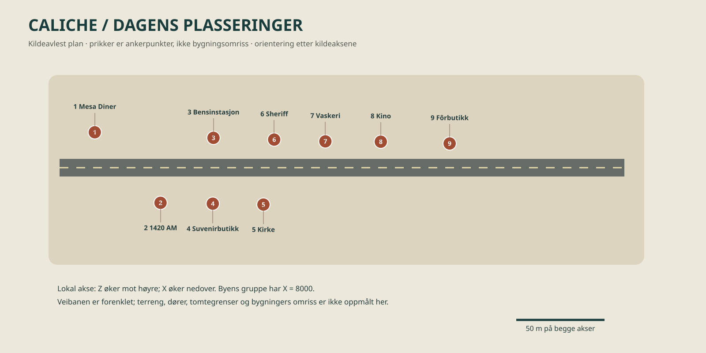
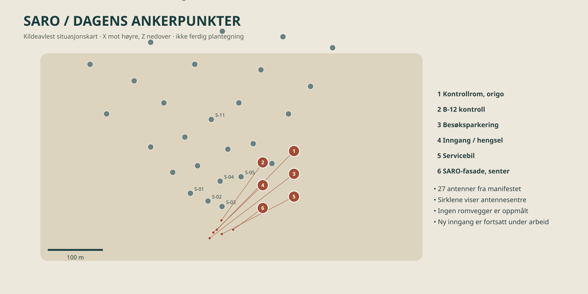
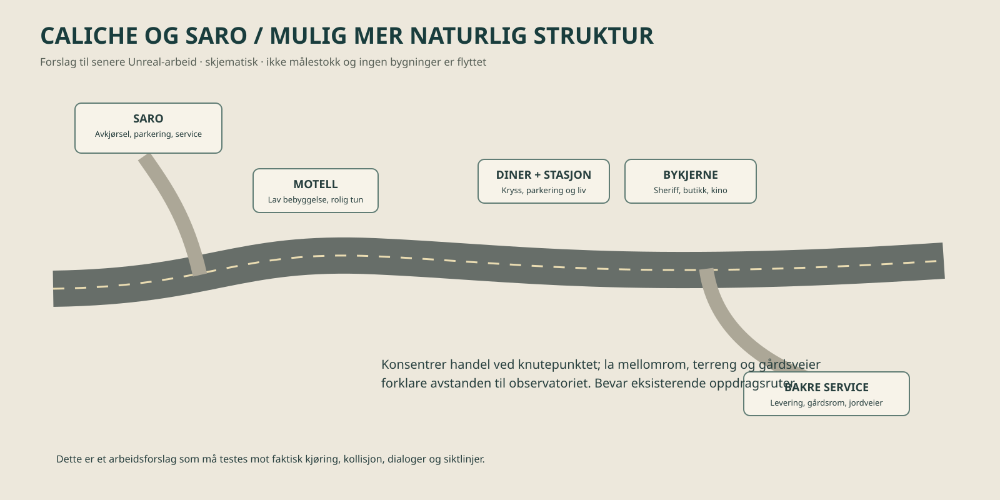

# SIGNAL / 47: kartgrunnlag for dagens layout og senere endring

27. oktober 2026. Disse kartene er laget fra prosjektets eksporterte scene og gjeldende Unreal-kilde. De viser **kjent kildeplassering**, ikke en ny oppmåling i en kjørende Unreal-scene. Arbeid i en annen samtale på SARO-inngang og Dale-kontor kan endre detaljer mens dette kartet brukes.

## 1. Caliche slik den ligger i kilden

Punktene viser scenens dinergruppe og navngitte interaksjonsankre; de er ikke fasader eller dørenes komplette geometri. Hovedveien er tegnet forenklet. Steder som ikke har et sikkert avlest anker er utelatt. Lokal akse Z øker mot høyre, X nedover; dette er ikke en påstått nordpil. Diner ligger ved Z 1999,95 og byområdet begynner omtrent Z 2018. Sheriff, vaskeri, kino og fôrbutikk ligger på samme side; radiostudio, suvenirbutikk og kirke på motsatt side. Avstander i figuren følger de to kildeaksene i samme skala.

## 2. SARO slik det ligger i kilden

Sirklene er alle de 27 antenneposisjonene fra manifestet; S-03 er spesielt merket. Punkt 1–6 viser kontrollrommets origo, B-12-kontrollen, besøksparkeringen, inngangens hengsel, servicebilen og fasadens referansesenter. Inngangspunktet viser eksisterende referanse i kilden, ikke en godkjent endelig løsning. Romvegger, gjerder, detaljerte gårdsflater og gangveier er ikke tegnet inn, fordi de ikke er kontrollert som komplette konturer her. Ledelinjene til numrene er bare for lesbarhet.

## 3. Forslag til en mer naturlig struktur

Dette er en **idé for senere arbeid**, med bevisst skjematiske plasseringer. Ikke bruk den som koordinatkart eller anta at nye veier er bygget.

- Gi SARO en tydelig avkjørsel med sammenheng mellom besøksparkering, inngang, serviceadkomst og antenneområdet. Hold publikums- og serviceflater forståelige, men knytt dem til faktiske dører.
- Gi motellet en egen innkjøring og et brukbart gårdsrom mellom bygning og parkering, som i konseptreferansen. La omgivelsene forklare at det ligger utenfor bykjernen.
- Samle diner, bensinstasjon og et tydelig kryss til et lesbart knutepunkt. Varier tilbaketrekning fra veien og plass til parkering fremfor en helt jevn fasaderekke.
- Gi bykjernen små gårdsrom, serviceadkomster, gangforbindelser og ulike tomtedybder. Behold lav ørkenbebyggelse, åpne tomter og stedegen vegetasjon; byen skal fortsatt føles liten og bebodd.
- La ørkenterreng, vasker, skrenter og stikkveier gi naturlige overganger. Ikke fyll alle tomrom med bygg eller objekter.

## 4. Når dette skal overføres til Unreal

1. Ta en fersk oversiktsmåling av bygg, trafikkflater, dører, terreng og høyder fra den faktiske aktive scenen; sammenlign med kartene. Kartlegg samtidige endringer først.
2. Lag en separat blockout med flytteforslag og mål før endelig modellering. Behold originalen som sammenligningsgrunnlag. Mål snuradius, parkering og fri ganglinje ved dører.
3. Kontroller alle avhengigheter ved flytting: kollisjon, kjøreruter, inn- og utstigning, dørhengsler, NPC- og interaksjonspunkter, oppdrag, foto- og siktlinjer, belysning, lagring og områdeoverganger.
4. Prøv spillerens rute til fots og med bil, både direkte til SARO og via diner, og kontroller ved dag og natt. Oppdater kartet med endelige koordinater etter godkjent sceneendring.

## Kilder og kontroll

- `unreal/Signal47/Content/WebData/manifest.json`: hierarkiske scenetransformer for diner og byens interaksjonsankre; 27 antenner; SARO-rom, B-12 og servicebil.
- `unreal/Signal47/Source/Signal47/Private/S47RoadShape.cpp`: dinerens og byområdets veikoordinater. `S47SaroArrival.cpp`: besøksparkeringens sentrum. `S47SaroSite`-modellkontrakt: fasadens referansesenter.
- Utregningen og generering kan gjentas med [lag_kart.py](lag_kart.py). Kartet er laget av kildedata, ikke ved å starte Unreal eller teste faktisk bevegelse. Punktplasseringer er ikke bygningsomriss, terrengmåling eller verifisering av gjeldende pakket bygg.
- Prosjektbiblioteket ble søkt. Treffet om Unreal world building var rettet mot implementering og ble ikke gjenbrukt for dette kildebaserte kartarbeidet.

[Tilbake til designbibelen](DESIGNBIBEL.md)
