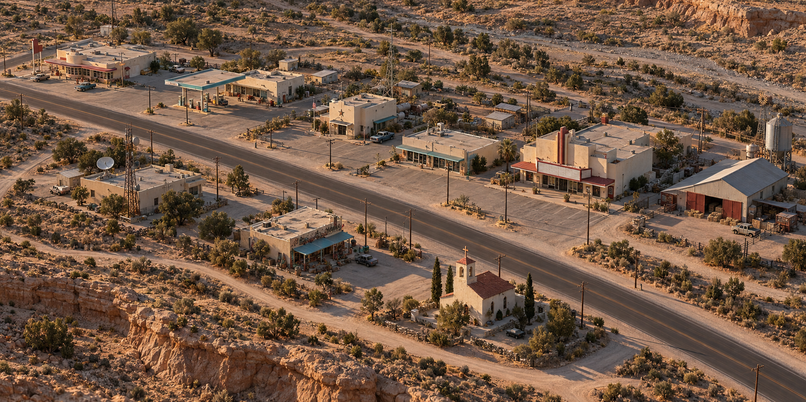
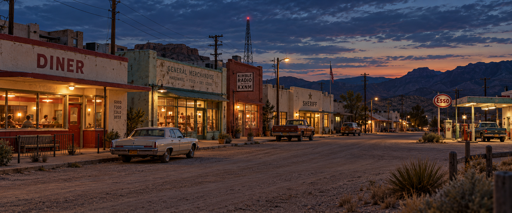
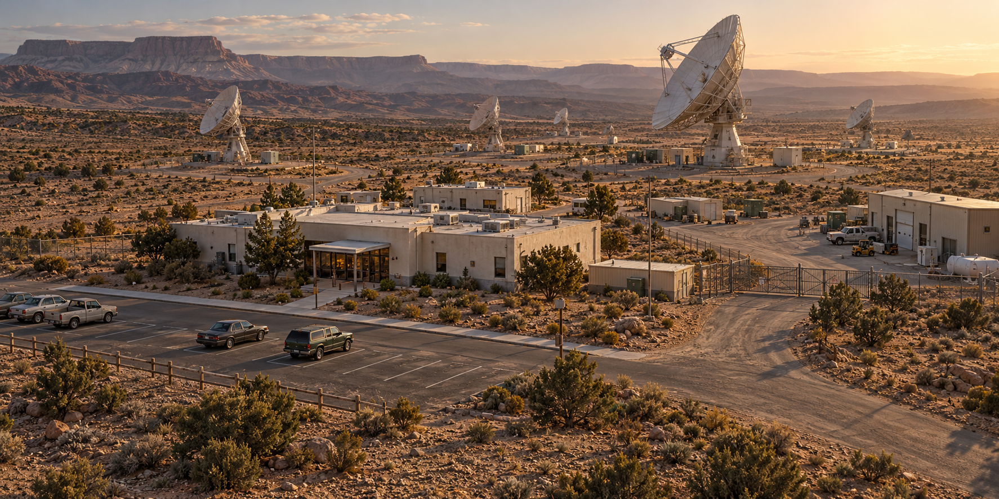
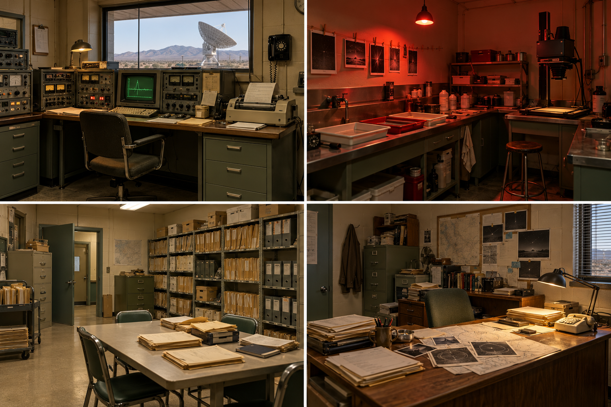
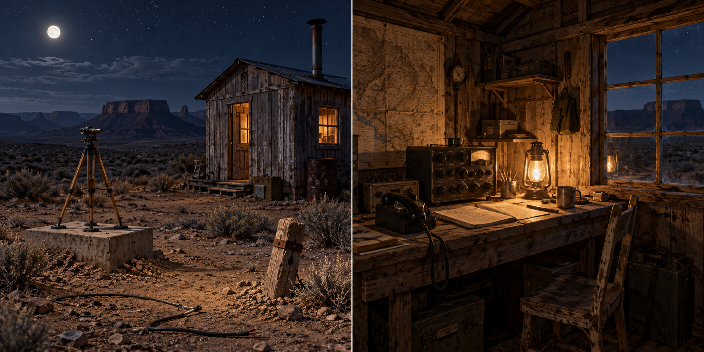
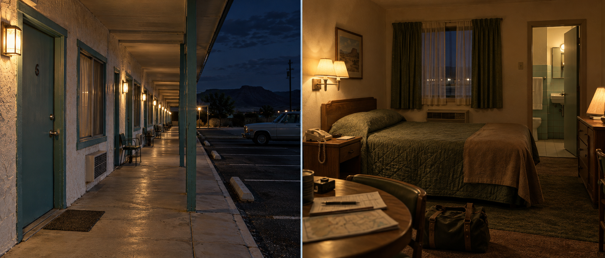
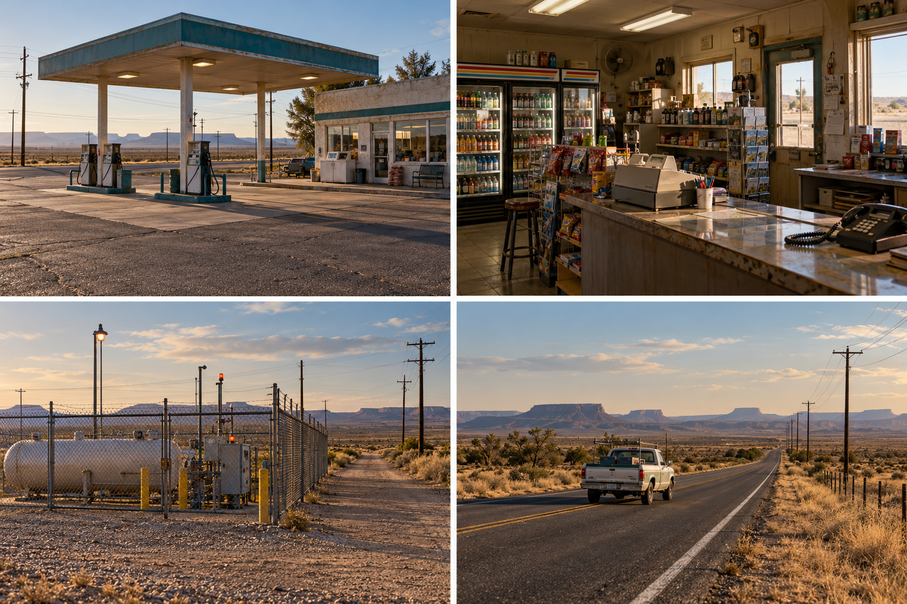
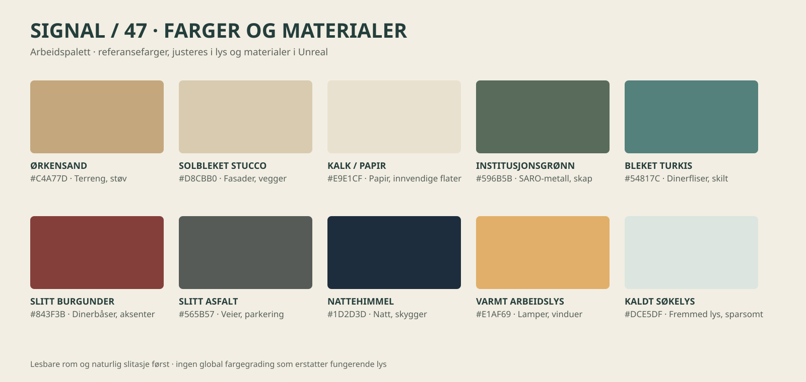

# SIGNAL / 47: visuell designbibel

Arbeidsgrunnlag for miljødesign og senere justering i Unreal. **Konseptbilder er forslag**, ikke dokumentasjon av ferdige spillområder. Kartenes kildebaserte plasseringer styrer hva som finnes i dagens layout; bildene viser hvordan et mer naturlig miljø kan oppleves. Endelige tomter, innganger, siktlinjer og mål bestemmes etter kontroll i Unreal.

## Grunntone

1986, New Mexico: en ørkenby og et observatorium som fortsatt er i bruk. Lav bebyggelse, nøktern arkitektur, tørre jordfarger, skiftende terreng og perioderiktig teknologi. Hverdagen må være troverdig lenge nok til at det fremmede føles som et brudd. Miljøene er slitne av sol og bruk, men ikke forlatte eller postapokalyptiske.

## Caliche: foreslått miljø og layout

*Konsept: forslag til en mer naturlig by. Perspektiv, plasseringer, veier og antall bygg er ikke oppmålt eller endelig.*

Byen utvikles rundt hovedveien. Hold de eksisterende landemerkene lette å kjenne igjen: diner, bensinstasjon, sheriff, vaskeri, kino, fôrbutikk, 1420 AM, suvenirbutikk og kirke. Bruk ulike tilbaketrekninger fra veien, beskjedne parkeringslommer, servicegårder, grusflater, kraftlinjer og stikkveier. Gi gående en sammenhengende og lesbar rute. Terreng og vegetasjon skal bryte opp tomrom uten å blokkere interaksjonspunkter.

*Konsept: gateplan, materialer og lys. Bygg og skilt må tilpasses de faktiske modellene.*

### Byggespråk

- **Diner:** bleket krem, turkis flis, rød vinyl, krom og varm belysning. Bygget skal oppleves som et menneskelig tilfluktssted. Se [dinerens eksisterende interiørmål](../assets/konseptbilder-2026-10-27/02-mesa-diner-interior.png).
- **Bensinstasjon:** enkel funksjonell pumpeflate, tydelig innkjøring og plass til bilen utenfor ganglinjen. Skilt og utstyr skal passe perioden.
- **Sheriff og radio:** beskjedne lokale bygg med gjenkjennelige innganger og forståelig forskjell mellom publikumsfront og arbeidsområder.
- **Kino, butikk og kirke:** ulike volum og fasader gir variasjon. Konseptinteriør betyr ikke at rommet automatisk skal være tilgjengelig.
- **Motell:** eget innkjøringstun, sammenhengende overdekket gangvei og parkering som ikke sperrer romdører. Se [Sierra Motor Court](../assets/konseptbilder-2026-10-27/01-sierra-motor-court-eksterior.png).

Se [åtte eksisterende ark med byggreferanser](../../../unreal/Concepts/Caliche-2026-10-23/README.md) og [kart for Caliche](../KART.md).

## SARO: observatorium og arbeidssted

*Konsept: forslag til plass, landskap og forbindelser. Antenneantall og plassering, dører og eksakt geometri styres av kildekart og Unreal, ikke av bildet.*

SARO skal føles som en liten fungerende institusjon, med et tydelig skille mellom offentlig ankomst og servicearbeid. Besøksparkering trenger en sammenhengende, fysisk ganglinje til en lesbar inngang. Servicebil, varelevering, gårdsrom og antennefelt må kunne forstås uten store kunstige skilt. Behold de 27 antennene, S-03 og B-12s oppdragsfunksjon. Endelig inngang er under arbeid; ikke lås den etter dette bildet alene.

**Eksteriør:** lys slitt stucco, malt metall, betongkanter, glass med faktisk dybde, tekniske skap, diskrete rør og armaturer. Tilpass slitasje etter sol, støv, regnavrenning og daglig bruk. **Interiør:** institusjonsgrønt, stål, kremfarget papir, eldre tastaturer, telefon, opptaker og lys med praktisk begrunnelse. Det skal finnes nok lys til at verktøy, dører og fluktruter kan leses.

[Se kildebasert SARO-kart](../KART.md) · [Ankomst og Dale-kontor, eksisterende arbeidsbilder](../assets/resultater/ankomst-og-kontor).

## Nye konseptark for flere steder og interiører

Konsept for de fire rommene; plasseringer og rekvisitter må kontrolleres mot spillets faktiske rom.

Konsept for atmosfære og feltutstyr. Den viste trekledningen er et designforslag og avviker fra eksisterende stucco-referanse; bruk faktisk modell som grunnlag ved ombygging.

Konsept for rom 6 og gangvei. Bevar faktiske interaksjoner og Noras bevis.

Konsepter for bensinstasjonens ute- og inneområde, Junction og gammel vei. Geografi og rekvisitter må tilpasses eksisterende scene.

## Farger og materialer

Dette er **foreslåtte startverdier i sRGB**, ikke ferdige Unreal-materialer. Lys, eksponering og overflate påvirker faktisk utseende. Bruk dem som samkjøring av fargefamilier og juster med skjermbilder fra riktig tid på døgnet.

| Farge | Hex | Primær bruk |
|---|---|---|
| Ørkensand | `#C4A77D` | Støv, jord og grus. |
| Solbleket stucco | `#D8CBB0` | Utsidevegger og lav småbyarkitektur. |
| Kalk/papir | `#E9E1CF` | Dokumenter, innvendige flater og lysere detaljer. |
| Institusjonsgrønn | `#596B5B` | SARO-skap, dører og eldre teknisk utstyr. |
| Bleket turkis | `#54817C` | Dinerflis, enkelte skilt og tidsriktige detaljer. |
| Slitt burgunder | `#843F3B` | Dinerens vinylbåser og begrensede aksenter. |
| Slitt asfalt | `#565B57` | Vei, parkering og overflater med variasjon. |
| Nattehimmel | `#1D2D3D` | Kjølig natt og skygge, med lesbare verdier. |
| Varmt arbeidslys | `#E1AF69` | Lamper, opplyste vinduer og menneskelig aktivitet. |
| Kaldt søkelys | `#DCE5DF` | Fremmed lys i målrettede sekvenser. |

**Prioritering:** store flater i sand, krem og asfalt; grønn/turkis og burgunder som lokale identiteter; varmt lys på menneskelige steder. Det fremmede lyset brukes kontrollert, slik at kontrast og lesbarhet overlever.

## Lys og stemning gjennom natten

| Tid / situasjon | Lys og rom | Spillerens lesbarhet |
|---|---|---|
| Sen ettermiddag / ankomst | Varmt skrålys, bleke flater og åpne avstander. | Vis innkjøring, inngang, landemerker og en normal verden. |
| Skumring / by | Kjølig himmel og varme vinduer, bensinstasjon og diner. | Gjenkjenn dører, veikanter og menneskelige møteplasser. |
| Natt / SARO og felt | Mørk blågrå himmel, begrenset praktisk lys, lave kontraster i terreng. | Se faktisk dekning og åpninger; mørke er ikke ensbetydende med usynlighet. |
| Fremmed avsøkning | Sterkere, kald ekstern flate med tydelig bevegelse over omgivelser. | Silhuetter, dørkarmer og skjerming må fortsatt kunne leses. |
| Før soloppgang | Gradvis kaldt gråblått og varmere horisont. | Behold kontinuitet i den etablerte natt- og himmelretningen. |

## Overføring til produksjon

1. Mål og fotografer eksisterende scene i Unreal. Marker hva som er låst av dører, oppdrag, kjøring, NPC-er og siktlinjer.
2. Lag en reversibel blockout av ønsket by- og SARO-layout. Prøv realistisk biladkomst, parkering og tilgjengelige gangveier før detaljering.
3. Lag én representativ fasade, gatebit og SARO-overgang i korrekt skala. Sammenlign faktiske dag- og nattbilder med konseptene.
4. Utvid med beslektede materialer og modeller; bevar perioderiktighet, menneskelig bruk og variasjon i tomtestørrelser.
5. Verifiser i spill, med faktiske interaksjoner, lagring og relevante lysforhold. Konseptene viser mål, men beviser ikke funksjon, ytelse eller ferdig grafikk.

## Bildekilder og avgrensning

De tre nye konseptene er laget med innebygd imagegen til denne bibelen. De bygger på prosjektets eksisterende beskrivelse av Caliche og SARO, kartoppslag og tidligere motell-/dinerkonsepter. De er ikke kartdata og de innfører ingen nye kanoniske bygninger eller plasseringer. Fargepaletten er utarbeidet for dette dokumentet. De eksisterende konseptarkene og dokumentgalleriene er lenket, ikke erstattet.

Prosjektbibliotekets [konseptbildeprofil](https://github.com/Tombonator3000/prosjektbibliotek/blob/main/ressurser/x-2096101381925114327.md) ble lest: kun prinsippet om konsept som visuelt mål er brukt; kilden er merket UNVERIFIED og dens tekniske arbeidsflyt er ikke innført.

[Tilbake til designbibelen](../DESIGNBIBEL.md)
