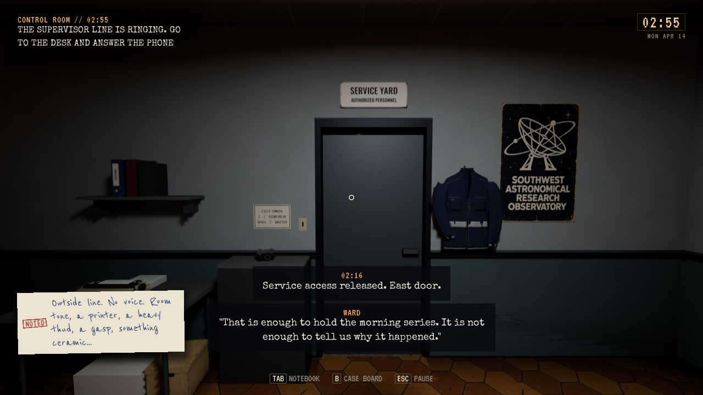
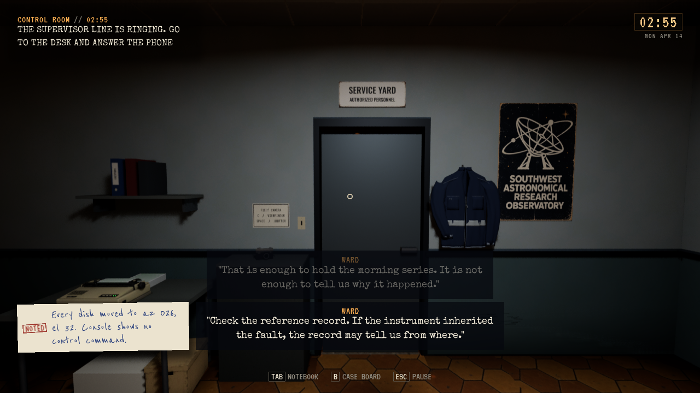
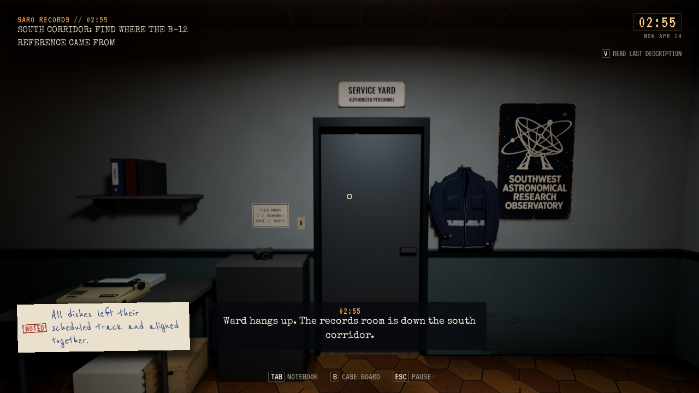

# Ward og musikken etter dekoding

**Status:** Referanse. **Gjelder:** installert Unreal-kilde `40b2fc92`, Linux/Vulkan. **Sist kontrollert:** 3. november 2026 kl. 03:36 CET.

Ward bruker egen stemmebank eller tekst, i tråd med avtalen om samlet stemmeopptak senere. WARD kan ikke lenger falle tilbake til Dale-/fortellerbanken. Rolle, manus, normal samtaleprogresjon og de andre telefonstemmene beholdes.

Førprøven viste at bakgrunnssporet `longNote` startet under decoderens ekte svar og fortsatte over 20 sekunder etter TAPE A. Ny avgrensning holder tilfeldig bakgrunnsmusikk under decoderavspilling/svar og etter det allerede lagrede TAPE A-faktumet ved SARO. Et aktivt bakgrunnsspor får den eksisterende 2,5-sekunders uttoningen. Motell, kjøring og andre områder beholder egne regler. Dekoderens frase, tale, radio og romlyd endres ikke.

## Kontroller

Editorbygg, pakking, 2147 installerte selvtester og kort installert oppstart består. Alle 126 personlige Saved-filer er uendret. [Installasjon](Audio-2026-11-03/installed.json).

Ward består 15 native kontroller med begge stemmevalg på: faktisk samtalestart, begge tekstintervaller, ingen lånt opptakssesjon, notat og normal avslutning. De tre bildene er visuelt gjennomsett. [Resultat](Audio-2026-11-03/result.json).

Musikkens før/etter-prøve bruker faktisk sjutoners svar og ferdig TAPE A. Etter rettingen er aktiv Score tom og holdt også over 20 sekunder etter at dekoderen er ferdig. Editor og ferdig pakke består hver 12 kontroller av pause/resume/stopp, JSON-rundtur med full Flow-retur, ny natt og avgrensning mot motell/kjøring/Station01. [Før/etter-data](Audio-2026-11-03/music-comparison.json), [samlet kildekontroll](Audio-2026-11-03/source-verification.json). Midlertidig sporingskode er fjernet før pakking.

## Prøvegrenser

Dette er native API- og lydgrafkontroller, ikke menneskelig lytting eller fysisk telefon-/menyinput. Flow-prøven gjenoppretter JSON i samme prosess; den er ikke en nyprosess- eller disk-Continue-test. Ward-tilbakeringingen bruker samme rettede ruting, men tidsforløpet er ikke separat kjørt. Egen Ward-innspilling hører fortsatt til avtalt senere opptakspass.

Forrige verifiserte meteor-kandidat beholdes for tilbakeføring. Ferdige eldre kandidater kan avvikles ved neste samlede rydding; ingen ny rydderunde er kjørt. Offentlig spillnedlasting er ikke oppdatert.
