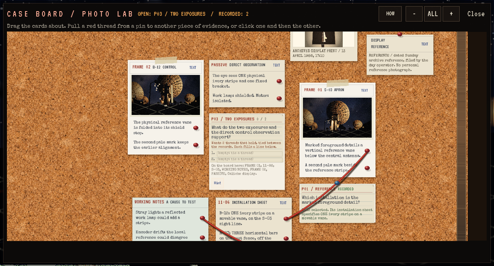
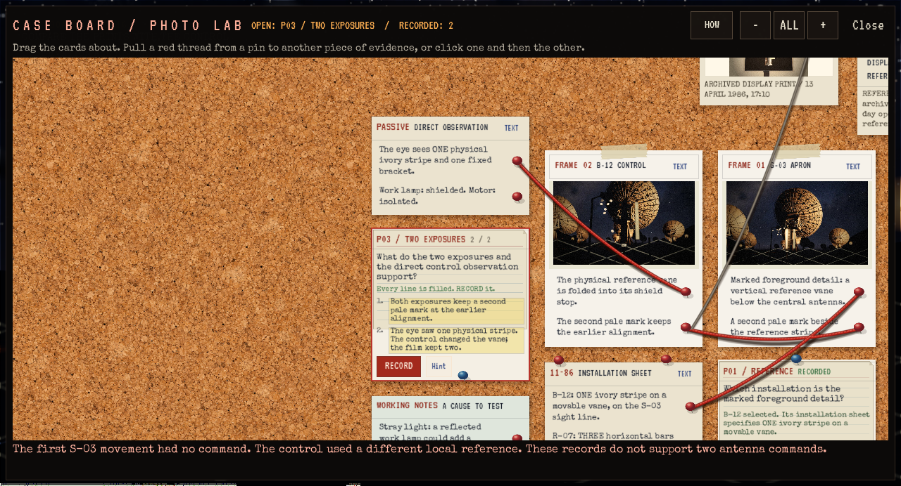
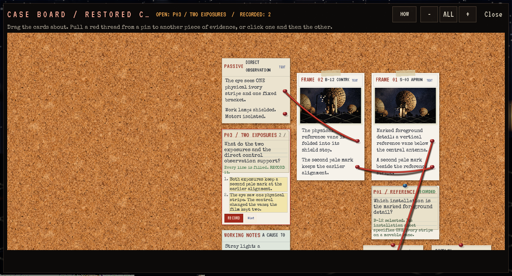

# Automatisk gruppering på bevistavlen

**Status:** Gjeldende leveringsbevis, lokalt installert. **Gjelder:** Linux/Vulkan, runtime `7b8a2a00`, [PR357](https://github.com/Tombonator3000/SIGNAL-47/pull/357). **Sist kontrollert:** 3. november 2026 kl. 00:55 CET.

Synlige, innsamlede kort grupperes lokalt langs forbindelsene spilleren faktisk har etablert. Notater følger sin kjente forbindelse; målte kortstørrelser og Finding-kolonner får luft. Grupperingen oppretter ingen tråder eller konklusjoner. Manuell plassering overstyrer automatikk, også etter lagring. Eldre lagrede posisjoner beholdes; standardkort uten lagret plassering kan samles rundt dem. Tråder mellom kapitler tegnes uten å flytte hele kapittelområder sammen.

Automatisk plassering får egen valgfri eierskapsliste ved siden av eksisterende `board.pos`. Stor tekst lagrer også automatisk plasserte, ukoblede kort, slik at de ikke flytter seg og skyver Findings ved gjenåpning. Drag og pinch utsetter ompakking.

Samme voksende native sak før og etter to nye P03-forbindelser:

Editorbygg, Linux-pakking og 2130 selvtester består. Editor og pakke består 17 målrettede kontroller og én ordinær disk-/Flow-retur: faktisk trådvekst, avvist forbindelse, manuell plassering, Slate pan/zoom, stor tekst og samtlige målte kort-/Finding-grenser uendret etter gjenåpning. Bildene er gjennomsett. Installert tittel-/Vulkan-røykprøve består.

Prøven bruker eksisterende Ch1Drive med to faktiske fotografier og dens eksplisitte mellomtilstander. Markering i det andre fotografiet og manuell kortplassering er fixtures. P03-delen vokser fra to til tre sammenkoblede kort; den samlede saken har også eldre P01/P02-tråder. Dette er native Slate/API, ikke vanlig OS-input eller menneskelig aksept av hele tavlen.

[Installasjonsresultat](Board-Clusters-2026-11-03/installation.json). Alle 126 personlige Saved-filer er uendret. Kollisjonspakken beholdes for tilbakeføring; 182.45 GB ledig. Ingen ny rydderunde, kopier eller offentlig spillutgave.
