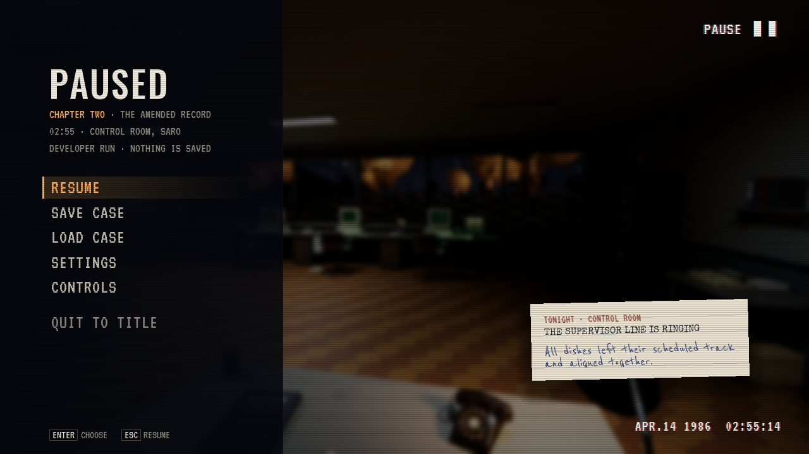
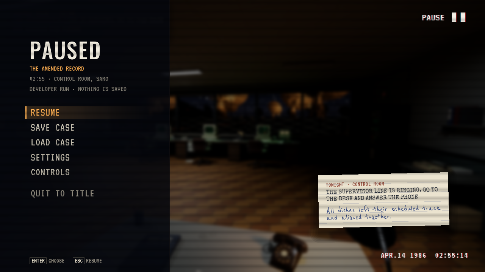

# Fortellingstitler og telefon som må oppsøkes

**Status:** Gjeldende leveringsbevis. **Gjelder:** Linux/Vulkan, runtime `0460a428`, PR305/306. **Sist kontrollert:** 1. november 2026 kl.08:53 CET.

Synlig kapittelnummer er fjernet fra pause, Fortsett, lagringskort, notatbok og overgangskort. Bare fortellingstittelen vises. Eldre lagringstekst normaliseres ved visning; interne ID-er og lagringsformat er beholdt. Fortellerens overgangskort følger den faktiske tittellinjen når nummerlinjen er tom.

The Amended Record beholder nå spillerens posisjon og blikk ved ny overgang. Telefonen ringer romlig ved kontrollromspulten og venter på vanlig svarhandling. Målet ber spilleren gå dit og svare. Ward/Dale-roller, historiefakta og eksisterende Continue-vakter er bevart.

Faktisk ordinær pause fra samme kamera, før og etter:

Editorbygg og en avgrenset kontroll av ny scenestart består: posisjon/retning er beholdt, telefonen venter og eldre sak beholder riktig livssyklus. Ferdig pakke består 1910 selvtester og faktisk pausebilde i Vulkan. Installert startfil og vanlig Fortsett på isolert original lagringskopi består. Alle 149 Saved-elementer, inkludert 118 personlige filer, er uendret. Gjeldende og to eldre testpakker beholdes etter normal payload-prune. [Installasjon](ChapterPhone-2026-11-01/installation.json).

Dette er målrettet API-kontroll og faktiske UI-bilder, ikke menneskelig lytting eller full gjennomspilling av overgangskort med forteller. SC04-rettingene fra PR304 og Jeep/Freeform inngår. Den gamle SARO-renderstansen er fortsatt uavklart. Ingen offentlig spillrelease.

Etter avsluttet motorarbeid er ferdig cook-/stagingcache ryddet i denne arbeidskopien. Netto 11.80 GiB frigjort; 22.87 GiB ledig. Øvrige Source-Saved-filer og installert personlig Saved er uendret. Andre aktive/uavklarte prosjekter er beskyttet. [Vedlikehold](ChapterPhone-2026-11-01/maintenance.json).
