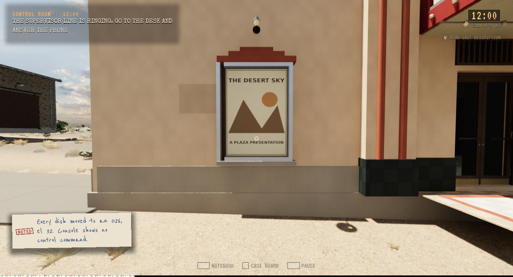
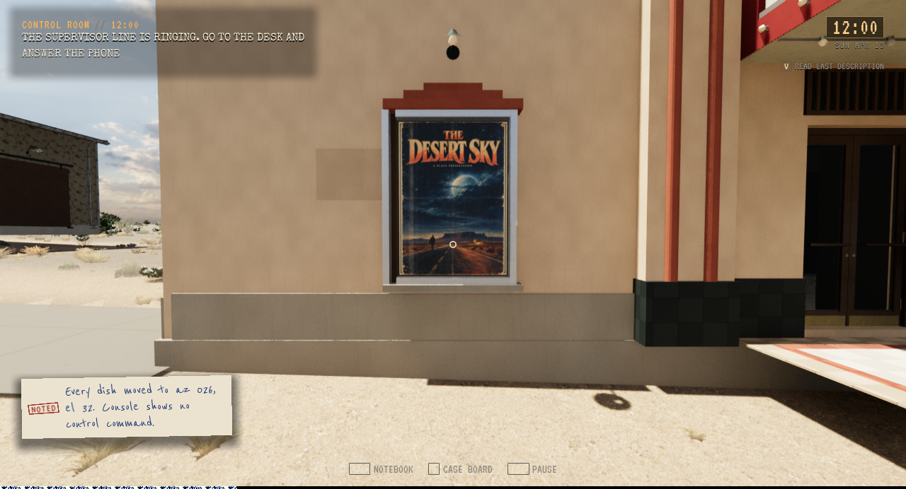
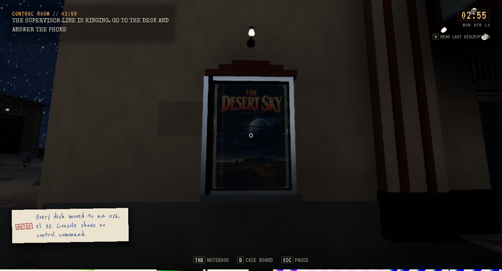
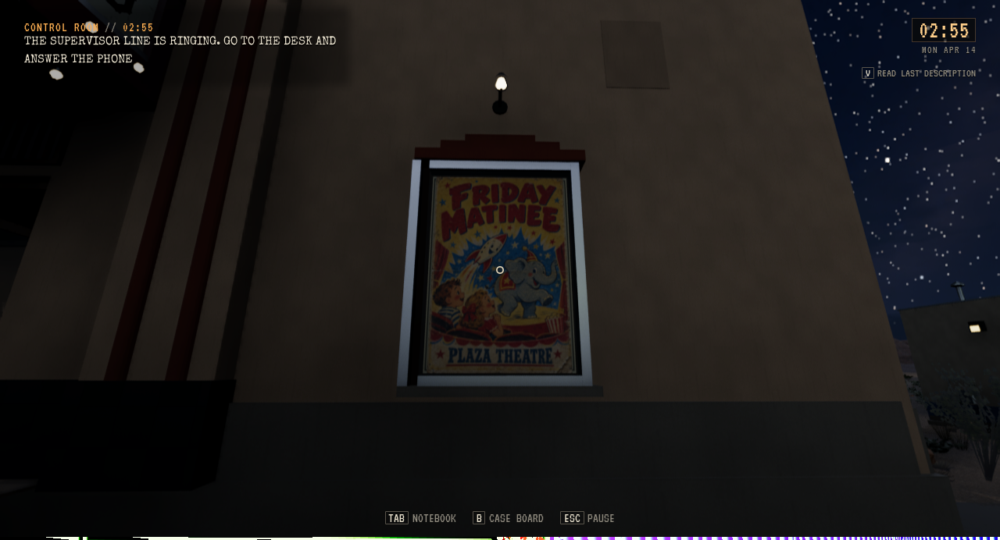

# Plaza-plakater, trygg dørlukking og Freeform-reisepause

**Status:** Referanse. **Gjelder:** installert Unreal-kilde `501cbe81`, Linux/Vulkan. **Sist kontrollert:** 3. november 2026 kl. 07:45 CET.

De to eksisterende Plaza-plakatene er koblet til den aktive CalicheAccess-kinoens faktiske skall og glass. Pensjonert TB2-geometri gjeninnføres ikke. Import og separat fersk native-leser består 170/171 kontroller; alle fem eksisterende plakatressurser er byteidentiske. Dette fullfører bindingen av eksisterende kunst uten nye motiver eller omimporterte teksturer.

## Før og etter

Før- og etterbildet nedenfor bruker samme forespurte utendørskamera ved klokken 12. Førbildet viser inaktiv binding; etterbildet kommer fra sluttpakken. De to påfølgende nærbildene er separate situasjoner fra den fysiske Walker-kontrakten, ikke samme kamera som A/B-paret.

## Kontroller

Før-reproen gikk 30,03 meter med vanlig Walker og faktisk kameraray/fokus/OnUse. Ved stage 62 lukket døren rundt spilleren. Dette dokumenterer feil lukking, ikke permanent fastlåsing. Lukkingsvakten avviser nå handlingen mens spillerens radius overlapper den faktiske dørblokkeringen og ber spilleren gå klar. Blad, spiller, kollidere og lagret åpen tilstand beholdes ved avvisningen.

Editor R2 består 109 kontroller og 42.39 meter. Den ferdige pakkekontrakten består 109 kontroller og 42.41 meter, med fire aksepterte OnUse-handlinger og én verifisert avvist lukking. Begge plakater, dørblad/kollidere, områdesynlighet og full isolert disk/title/Continue kontrolleres. Lukket, ikke-standard dørtilstand beholdes gjennom Continue; vanlig åpning og lagring virker etterpå. [Sammendrag](Cinema-Access-2026-11-03/summary.json).

## Freeform under faktisk reisestart

Før rettingen feilet prøven ved stage 9003: faktisk `busy=true` holdt verdensklokken stille, men internkontrollen gikk 0.01408584 sekunder frem og native enkodere beveget seg opptil 0.03098884°. Produksjonsendringen er ett `World.bBusy`-ledd i arbeidets pausevilkår.

Editor består 43 kontroller og 30 busy-rammer; sluttpakken består 45 kontroller og 32 busy-rammer. Begge holder klokke, kontroll og alle native enkodere uendret under faktisk StartTrip, beholder originalopptaket, gjenopptar samme jobb etter callback, avslutter turen ordinært i stillstand og fullfører den åtte sekunder lange internkontrollen. Begge har null disk-restores; dette er en separat prøve fra kinoens disk/Continue. Den bruker eksplisitt mottakerinnstilling, én kommando for antenneretning og ekte Roam/StartTrip, uten direkte skriving av busy eller påstand om naturlig pendling.

Installert oppstart består, og alle 126 personlige Saved-filer er uendret. [Installasjon](Cinema-Access-2026-11-03/installed.json).

## Gjenstående arbeid

ART-01 omfatter fortsatt flere motiver og rekvisitter. Den erklærte utvendige starten og områdeskiftet er testfiksturer; det hevdes ikke menneskelig input, naturlig ankomst, pendling eller full kino-interiørrute. Fire bilder og små sammendrag/kvitteringer er valgt; store native-rapporter og rute-/lagringsdata beholdes privat. Forrige Pale-pakke beholdes for tilbakeføring. Offentlig nedlasting er ikke oppdatert.
