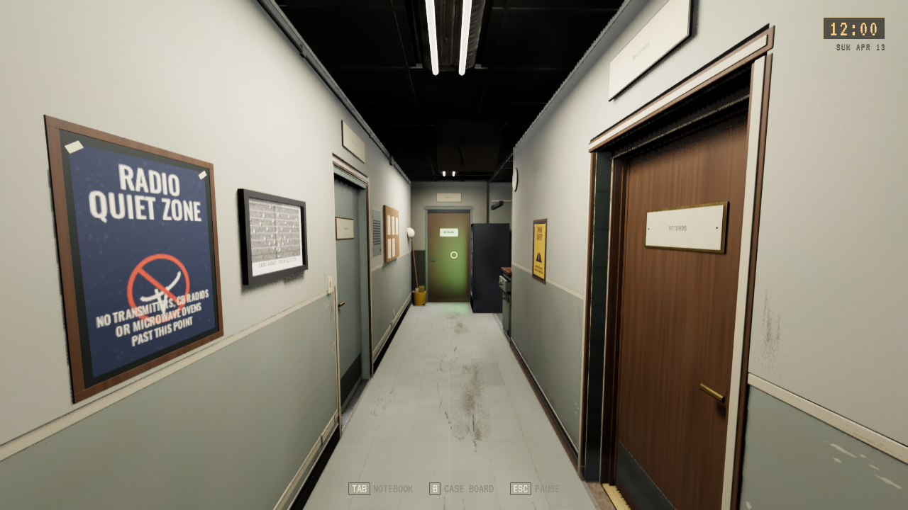

# Videreføring etter Claude, 30. oktober 2026

**Status:** Gjeldende, installert. **Gjelder:** kilde `12c1ac3d`, PR260/main `755fe7fc`, UE5.8.4 Linux. **Sist kontrollert:** 30. oktober 2026 kl.20:47.

Tom godkjente SARO-gangen og kontrollrommet for nå og ba om åpne PR-er samordnet og videreføring etter Claude. [PR260](https://github.com/Tombonator3000/SIGNAL-47/pull/260) leverer SC09 fra feltarbeid via retur og begge fremkalte kopier til Noras kontrollromstelefon og åpning av SC10. Ringing etter3s og fysisk håndsett brukes; eldre lagringer beholder den versjonerte feltsamtalen. SC03 har korrigert vogn/terreng, vanlige bilvalg og minst02:44 ved fullføring. SC04 avbryter Grab ved tapt nærhet/sikt, SC10 gjenopptar samtale/Fortsett, og E14/veien har kurérmerking10.4. Nyere SC04/08/11/Spine og Ward-kilder beholdes.

Claudes siste faktiske resultat var series42 i Signal47-sc04-20261029, fullført kl.14:55 fra main b6b4c1f2: bygg og12 navngitte målrettede kontrakter besto. Dette var ingen ordinær SC01-SC13-helreise. Ingen senere Claude-pakke ble funnet. Videreføringen bruker prosjektets eksisterende kilde og manus; bibliotekstreffene om AI-verdener/film var UNVERIFIED og ga ingen gjenbrukt ekstern implementering.

Nytt samordnet editorbygg består. Editor:1749 selvtester, alle14 Tripo-figurer, SC09 93 kontroller/12 disk/fullFlow-gjenopprettinger og SC04 17 kontroller består. Pakket Linux-SC09 består samme93/12 samt1749 selvtester og14 figurer. SC09-prøven bruker uttrykkelige reiseendepunkt-fixtures; vanlig kjøring av hele denne nye kilden er ikke bevist. Den gamle R12-prøven har egen ordinær World-kjøring. Det er ingen ny fullmatrise, menneskelig input- eller FPS-påstand. Hele SC01-SC13 og særskilt ny SC03/finale-RHI er fortsatt åpne.

[Installasjonen](CLAUDE_CONTINUATION_2026-10-30/installation.json) kl.20:47 matcher68 payload-noder; alle134 personlige Saved-noder er bevart. Installert isolert gangkamera og14-figurkontroll består. Alle godkjente SARO-rekvisitter og siste Tripo-armatur er med. Standardstarteren bruker den nye pakken. Ingen offentlig spillrelease. Kanonisk opprydding pensjonerte to eldre pakkepayloads; gjeldende kandidat og to eldre komplette bygg beholdes med originale kilder, assets, Saved, bilder og logger.

PR234 er faktisk flettet via260. PR224 er lukket som erstattet etter at forfatterkoden ble bevart som avskrudd prototype: begge prototype/TripoOff-flagg kreves, gammel Laundry-endring ble ikke tatt inn, fitted geometri brukes bare privat og følger ikke ny main-historie. PR235 og237 er lukket som erstattet etter funksjonsvis integrasjon av nyttige produksjonsrettinger; gamle kildegrener og råbevis beholdes. Den egne [FinaleSky-forfatterkilden](../../../unreal/ArtSource/FinaleSky/README.md) er bevart uaktivert, med nativepakker utenfor Content. Ingen ny finaleaktivering eller visuell aksept hevdes. Finalens foreslåtte nye ekko er fortsatt Toms valg.

