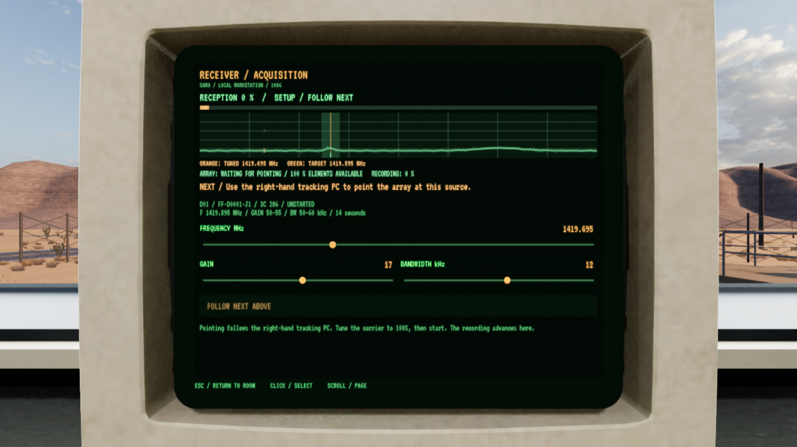
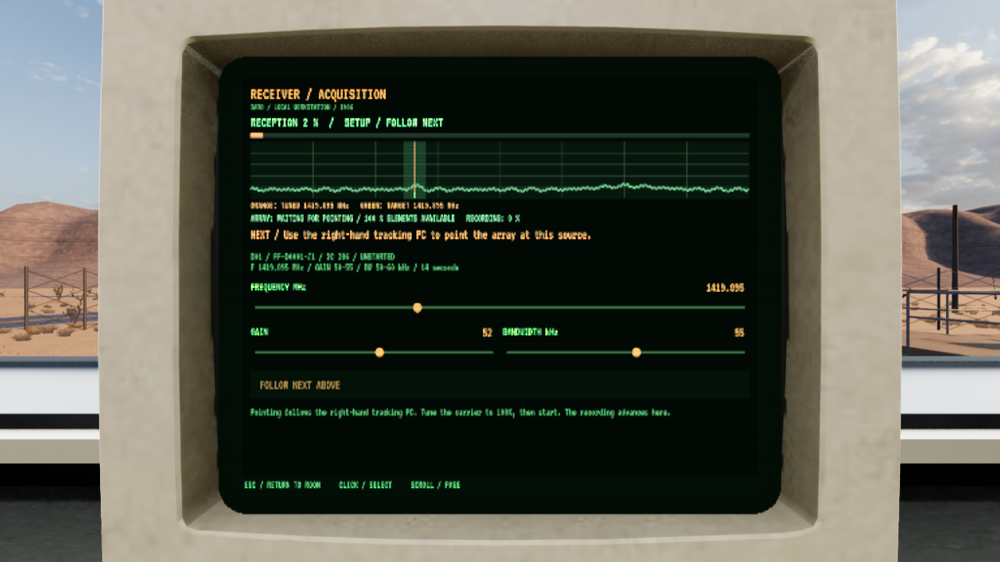
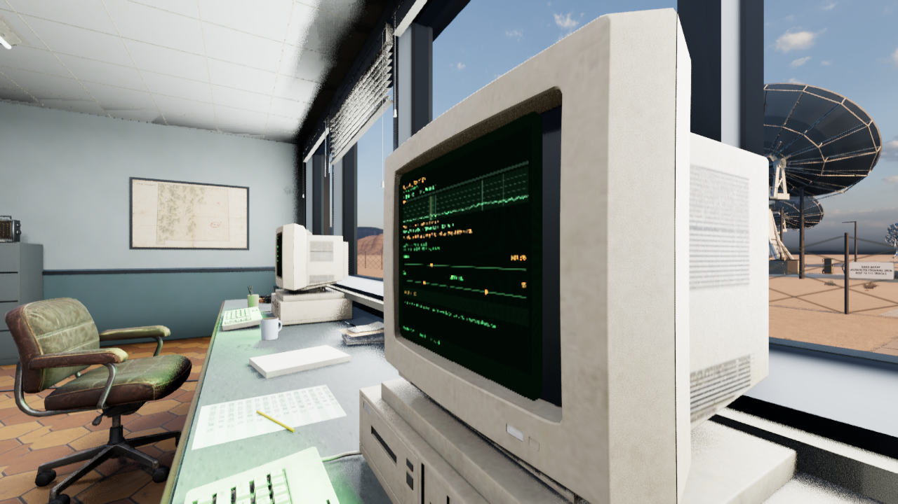

# Lokal CRT-respons, 3. november 2026

**Status:** Gjeldende leveringsbevis. **Gjelder:** kilde `3efa4bd2`, Linux/Vulkan UE 5.8.4. **Sist kontrollert:** 3. november 2026 kl. 01:21 CET.

De fire fysiske CRT-bildene tegnes etter den temporale bildeutjevningen. En lokal dybdekontroll skjuler fortsatt bildet bak skjermrammen og andre ugjennomsiktige flater. Felles kode i `clip_crt.py` brukes også av importgeneratoren. Global AA, skjermens UV-er, åpning, lysstyrkeparametre og faktisk Unlit-materiale er bevart.

## Før og etter

Ved samme tuningsendring inneholdt råteksturen de nye tallene, mens det gamle sluttbildet fortsatt viste 1419.695 / 17 / 12. Sliderne hadde allerede flyttet seg. Den nye flaten viser 1419.895 / 52 / 55 i det tidlige opptaket. Opptaket bestilles minst150 ms etter endringen; faktisk final-bestilling var omtrent194–197 ms. Dette er ikke en måling av fysisk input-til-skjerm-latens.

Begge sidevinkler er gjennomsett på High og Low. Skjermrammen skjuler flaten riktig. Små bokstaver har grovere pikselkanter enn med temporal utjevning; dette er responsretting, ikke et generelt skarphetsløft.

## Kontroller og avgrensning

Editorbygg, materialkompilering og pakking består. Den private native før/etter-prøven bruker faktisk receiver-CRT, uendret AA4, kontrollert tuning og sideforskjøvet kamera. Rå- og sluttbilder tas før endring, tidlig, etter ett sekund og fra begge sider. [Tider og opptaksparametre](CRT-Response-2026-11-03/response-timing.json). Midlertidig diagnosekode er tatt ut før kildelevering/pakking.

Pakket ordinær fire-skjerm-prøve og2130 selvtester består. Operations, status, tracking og receiver er åpnet gjennom produksjonskoden og bildene er gjennomsett. Installert kort oppstart består. Alle126 personlige Saved-filer er uendret. [Installasjonsresultat](CRT-Response-2026-11-03/installation.json). Forrige tavlepakke beholdes for tilbakeføring; nødvendig kandidat/cache og eldre ferdige pakker vurderes ved neste samlede rydding.

Nativebildene gjelder dagens Unlit-master. Generatorens eksisterende DefaultLit-variant beholder overflatekoblingene, men dens passive glassrefleksjoner er ikke visuelt godkjent i denne leveransen. Vanlig OS-input, menneskelig lesbarhet under fri kamerabevegelse og ytelsesmåling er ikke attestert. Ingen offentlig spillutgave er publisert.
