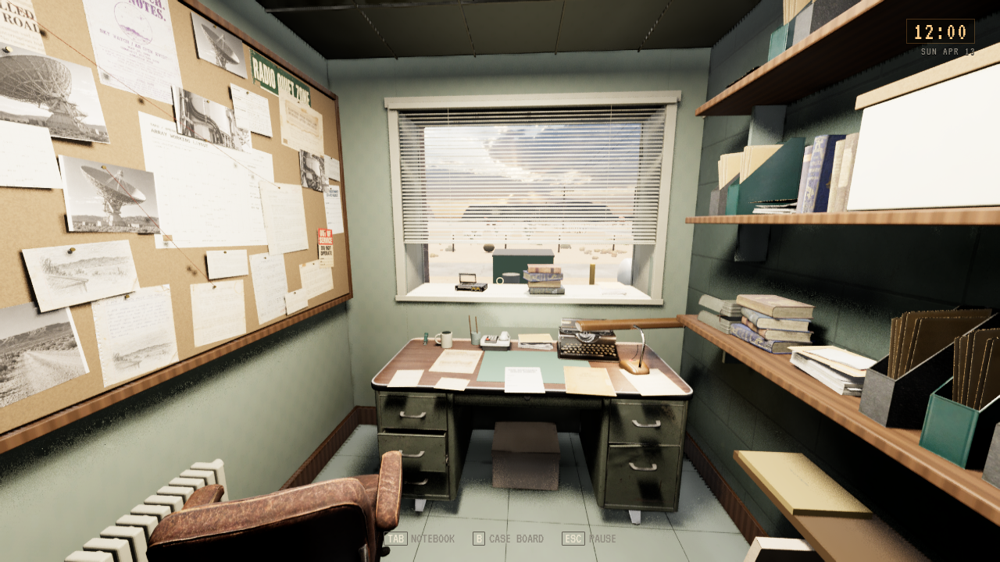
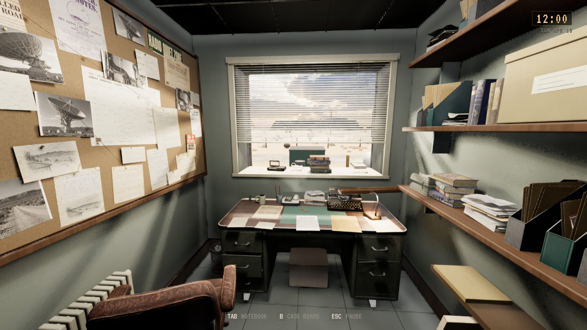
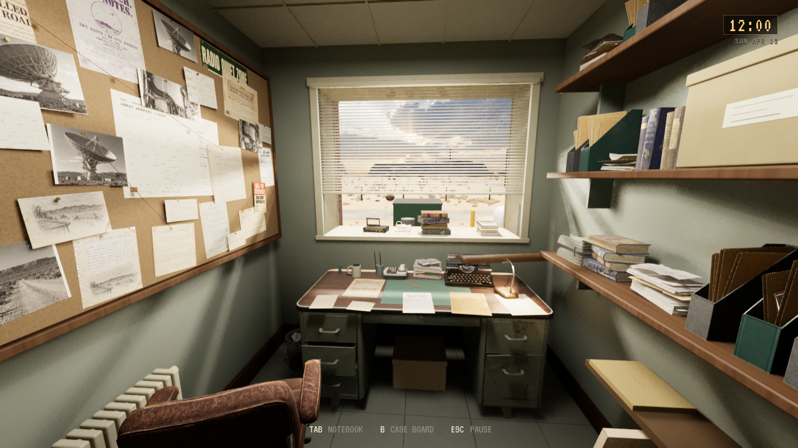
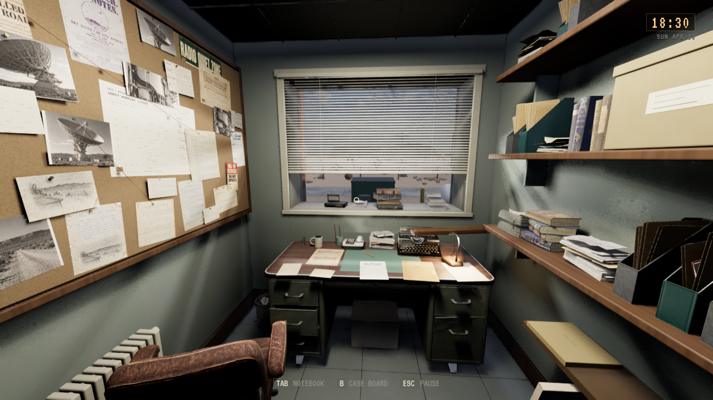

# Dales kontor, visuell pilot

**Status:** Visuelt godkjent og installert. **Gjelder:** Linux-kilde `67d308c2`, PR251/main `c44739a9`. **Sist kontrollert:** 30. oktober 2026 kl.16:01.

[PR251](https://github.com/Tombonator3000/SIGNAL-47/pull/251) retter malingsflaten som var skjult bak gammel blokkvegg, oppdaterer egne overflater og varierer 72 native rekvisitter. Vinduet gir dagslys etter eksisterende døgnkurve; elektriske lys følger fortsatt strømbruddet. Seks lesbare dokumenter beholder sine interaksjoner. Alle 14 Tripo-figurer og SC11 fra PR250 er med. SC09/SC10 i senere PR252 er kildearbeid for neste pakke.

Editorbygg, Linux-pakke, 1740 selvtester og kort pakket og installert kontorkamera med 14-modellkontroll består. [Installasjonen](DALE_OFFICE_PILOT_2026-10-30/installation.json) samsvarer med alle 68 payload-noder; alle 134 personlige Saved-noder er bevart. Ingen fullmatrise, nye kreditter, kjøp eller offentlig spillrelease. Tom godkjente den viste kontorpiloten 30. oktober 2026 med beskjed «Godkjent» i modelleringssamtalen. ENV-05 er dermed lukket for Dales kontor, som er visuell referanse for videre romarbeid.

Dagbildene bruker samme kamera kl.12:00. Førbildet er fra tidligere installasjon på Low; etterbildene er fra editor på Low og High. Siste bilde er faktisk ny installasjon kl.18:30 på Low. Motordiagnostikk er skjult på kamerabildene; ytelse er ikke målt.

Kanonisk opprydding er utført: to eldre pakkepayloads er pensjonert. Gjeldende kandidat og to eldre komplette bygg beholdes; kilder, assets, Saved, bilder og logger er bevart.
