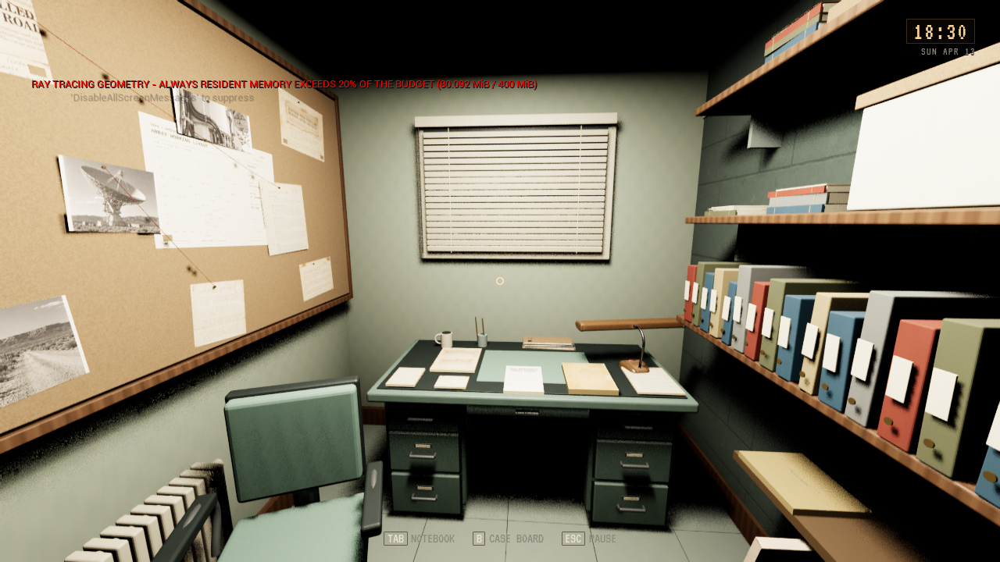
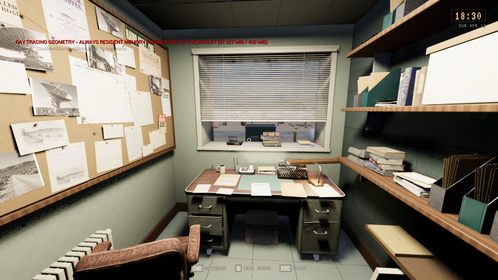
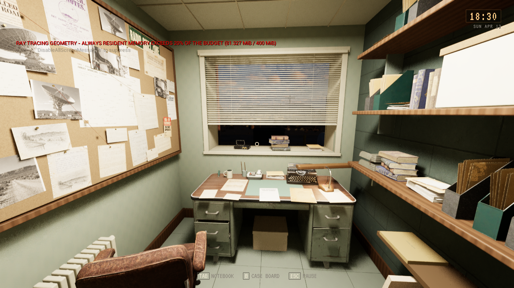

# Dales kontor, modell- og vindusrevisjon

**Status:** Gjeldende. **Gjelder:** Kilde5aa3ce12, PR242/main452e7d9f og lokal Linux-installasjon. **Sist kontrollert:**30. oktober2026 kl10:16.

Kontoret er installert lokalt etter [PR242](https://github.com/Tombonator3000/SIGNAL-47/pull/242). Pult og lampe bruker eksisterende native PBR-modeller; stolen er laget fra egen bildereferanse i Tripo, med18073 triangler og tre LOD-er. Bokgruppene er originale Old West-modeller. Mapper, skrivemaskin,28 saksveggark, kabelføring, lampelys og ekte vindusåpning erstatter det tidligere ryddige uttrykket. De seks lesearkene beholder sine egne dokument- og interaksjons-ID-er.

[Pakking og kort kontroll](DALE_REALISM_2026-10-30/package.json): editorbygg, Linux-pakke, selvtest og eksisterende OfficeEarly-rute med nøkkel/skuff/dør/feltark og lagringsforløp besto. Vinduet er kontrollert i den pakkede versjonen. Ingen fullmatrise er kjørt.

[Installasjon](DALE_REALISM_2026-10-30/installation.json):68 payload-noder kopiert og kontrollert;134 personlige Saved-noder bevart. Bildet nedenfor kommer fra den faktiske installasjonen, med isolert kamerafikstur. Originalmodeller og Tripo-eksport ligger privat utenfor Git.95 eksisterende Tripo-kreditter er brukt; ingen kjøp eller ny offentlig spillrelease.

Før og etter bruker samme `office-room-overview`, kl18:30 og Low. High-bildet kommer fra samme pakkede kandidat.

Dette dokumenterer en synlig modellrevisjon, ikke Toms visuelle aksept av referansens realismenivå. Det målet står fortsatt åpent. Det kjente RT-residentvarselet vises fortsatt; ytelse er ikke målt i denne kamerakontrollen. Opprydding er utført på to eldre pakkepayloads,14 filer; gjeldende kandidat og to eldre komplette bygg er beholdt, sammen med kilder, bilder og Saved.
