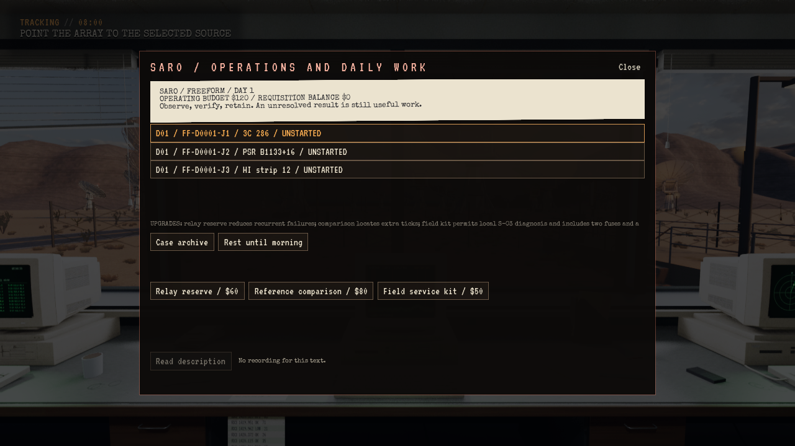
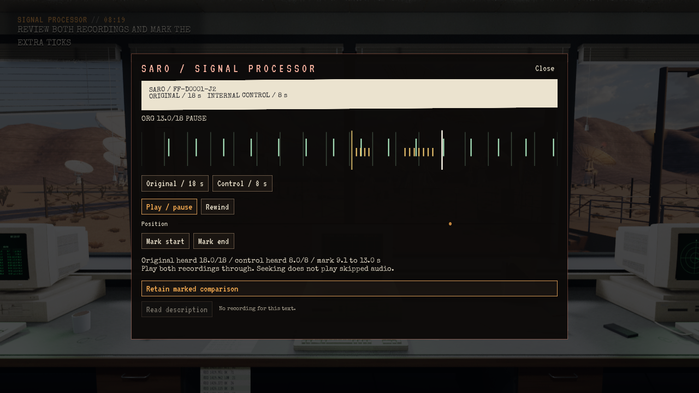
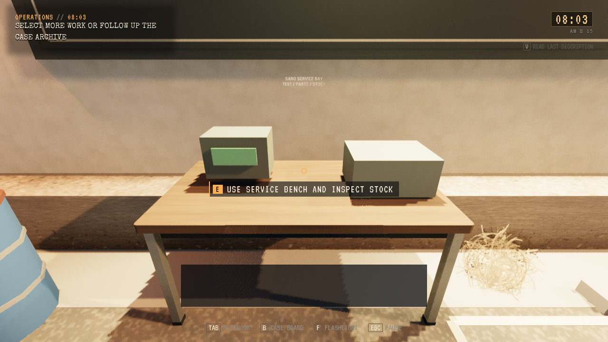
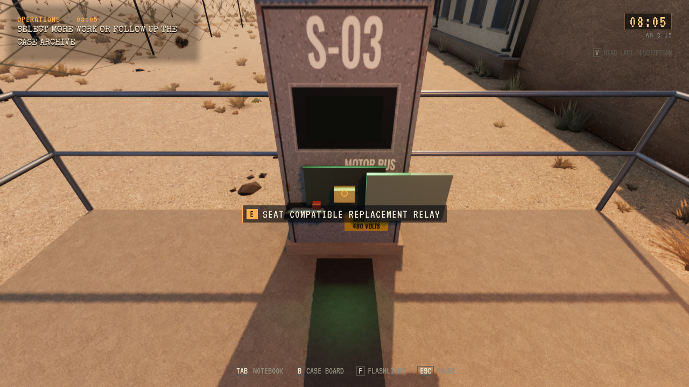
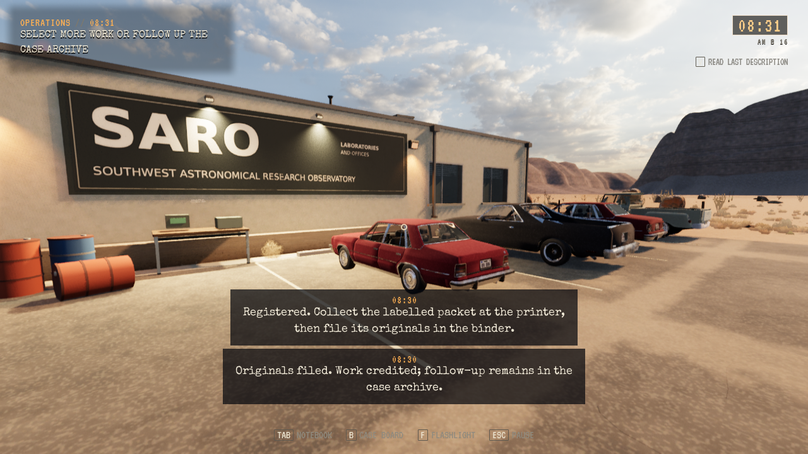
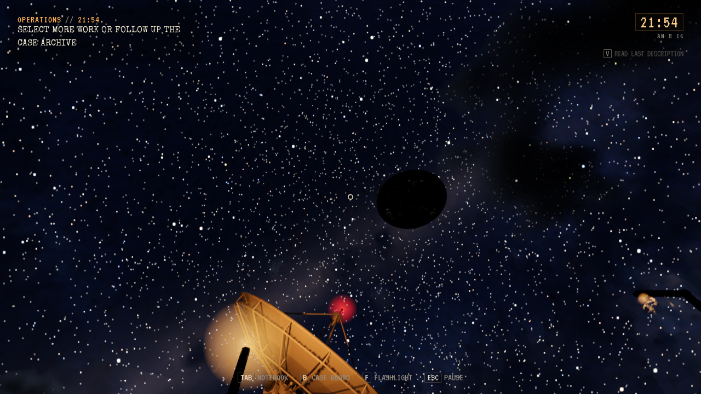

# Freeform: SARO-drift, forsyninger og hendelsesregissør

**Status:** Gjeldende, lokalt installert. **Gjelder:** UE 5.8.4/Linux/Vulkan, runtime `0f8f946e`, PR297. **Sist kontrollert:** 1. november 2026.

## Spillerforløp

Velg **NEW FREEFORM** og lokal recovery eller valgfri død/lasting. En ny sak starter kl. 08:00 med 120 dollar og tre daglige måleoppdrag. Et døgn varer 75 aktive minutter; menyer og pause holder døgnklokken. Dagens Story-saker beholder sin identitet og slutt. Gamle saker uten modusfelt behandles som Story.

Tracking-PC-en sender faktiske kommandoer til 27 antenner. Opptak krever at begge aksene er innenfor 0,1 grad i ett sekund. Normalreferansen bruker et fempunktskryss. Status-PC-en identifiserer en feil som krever lokal isolasjon, åpent servicepanel, kompatibelt relé og fem graders bevegelse ut og tilbake. Uaffiserte antenner kan fortsatt brukes med redusert målekvalitet.

Mottakeren sikrer originalen, lydutstyret spiller original og kontroll separat, og OPS registrerer en begrunnet konklusjon. En avvikspakke må hentes ved skriveren og legges i den faktiske arkivmappen. PC-arkivet kan leses på avstand; det gir ikke fysisk arkivering eller ny betaling. Naboretning, tidsreferanse og ekstra utskrift krever hver sin faktiske kontroll. Utskrift og registrering kan ikke gjøres med dødt utstyr. Originaler og senere kontrollkilder beholdes separat.

Bensinstasjonen selger sikring, relé, donorapparat, drivstoff og film mellom 08:00 og 20:00. Én pakke kjøpes, hentes, bæres eller lastes i bilen og losses ved SARO-benken. Donorapparatet testes før reléet høstes. Filmbeholdningen kan utvides uten å slette tidligere bilder. Den tilgjengelige testbenken/delelageret står ved nabobyggets servicefasade; nytt interiør er ikke bygget. Byens normale kjøretøy- og veisystem gjenbrukes. Bilens parkerte posisjon, last og drivstoff lagres; lagring under kjøring venter til parkering og utstigning. Nødretur bevarer lasten og gir nok reserve til en ny forsyningstur.

Tre oppdrag gir 20 dollar hver, én gang per jobb. Sikring koster 5, relé 25, donor 15 og drivstoff/film 10 dollar. Begrenset nødbestilling og startlager hindrer at en vanlig feil krever en umiddelbar tur til byen. Feeder-kontrollen og et drivstoffdrevet aggregat påvirker faktisk SARO-strøm og antennemotorer.

## Hendelser og fremgang

Seksten hendelsesfamilier inngår: ekstra puls, taklyder, S-03-feil, observatør, feederavvik, nærvær i serviceområdet, signal utenfor kilden, avsenderløst telex, tom bil, lysrespons, fysisk spor, uenige klokker, ekstra utskrift, overflyging, stille sone og sjelden nærpassasje. Roswell-individer bruker eksisterende fysisk sikt, dører, gulv og navigasjon; nærpassasjen gjenbruker Toms importerte tallerkenmodell.

Regissøren lagrer tilfeldighetssekvens, valgt hendelse, fase, apparateffekt og individtilstand. Lasting trekker ikke hendelsen på nytt og slår ikke ut en allerede reparert feeder igjen. Første døgn har ingen farlig jakt. Startbalansen er 2–4 små og 0–2 undersøkende muligheter per døgn, maksimalt ett farlig nattmøte med 35 prosent mulighet fra døgn 2, og 10 prosent stor hendelse fra døgn 4 med minst tre døgn mellom. Etter fare følger åtte aktive minutters hvile. Dette er konfigurasjon, ikke målt menneskelig skrekk-/tempoaksept.

Tre mysterielinjer kobler uavhengige funn over flere døgn. Første original omskrives ikke av senere gjentakelser. Feltfragmentet fotograferes før opptak, analyseres ved benken og sikres som forseglet original. Lokal recovery beholder sikret arbeid og budsjett; valgfri død krever lasting. Ingen våpen eller Story-finale inngår.

## Kontroll og leveringsgrenser

Editorbygg og 1902 selvtester består. Den pakkede fullprøven består 248 kontroller med 21 disk-/Flow-gjenopprettinger, hele arbeidsløkken, tre akselererte døgn og alle 16 hendelsesfamilier. Normal prosessavslutning består. Pakken er installert kl. 01:47 CET; den installerte standardstarteren består isolert Continue og 18 sekunders Vulkan-røykprøve. Alle 149 personlige Saved-elementer er uendret. [Rått resultat](Freeform-2026-11-01/result.json) og [installasjon](Freeform-2026-11-01/installed.json) fører konkret omfang.

SC04-koden, uendret siden editorprøven fra `343c9f7d`, består 17 kontroller med faktiske strålevalg og produksjonsinteraksjoner: dørrespons, fysisk lytting og tilbaketrekning, sikret kontrollrom og videre progresjon. En isolert kopi av den opprinnelige 03:00/AUTO HOLD-saken består vanlig Continue og 100 sekunders Vulkan-kjøring i faktisk vindu. Den tidligere renderstansens utløsende årsak er fortsatt uavklart; gjentatte terminalhandlinger og opprinnelig lang økt er ikke reprodusert.

Prøvene bruker midlertidige profiler og produksjonscallbacker med eksplisitt plassering av spiller/bil, valgte hendelser og akselererte døgn. De beviser ikke en naturlig kjøretur, ekte tastatur-/kontrollerbruk, menneskelig lytting, tilfeldig møtefrekvens eller hele Story. Nytt nabobygginteriør, utvidet verksted/bruktbutikk og balansering gjennom vanlig flerdøgnsspilling står fortsatt i TODO. Den installerte High-prøvens bilde viderefører et synlig HWRT-geometribudsjettvarsel; prøven er ikke en ytelses- eller GPU-minnemåling. Ingen offentlig spillrelease.

## Bilder fra den pakkede prøven

To eldre genererte payload er pensjonert etter levering. Gjeldende kandidat og to eldre beholdes; annet aktivt Jeep-arbeid er beskyttet. Egne tunge jobber er avsluttet og produksjonsreservasjonen frigitt.
