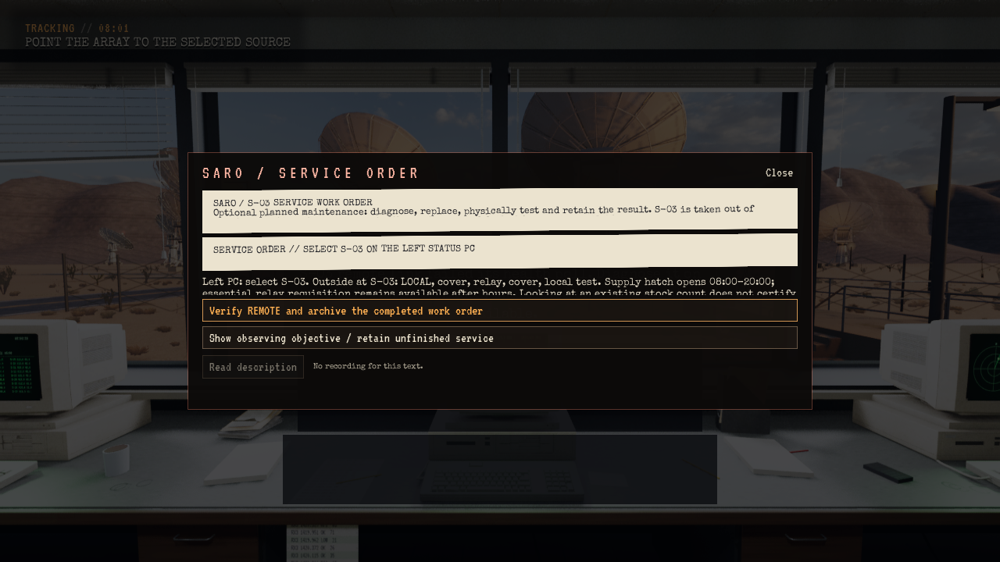
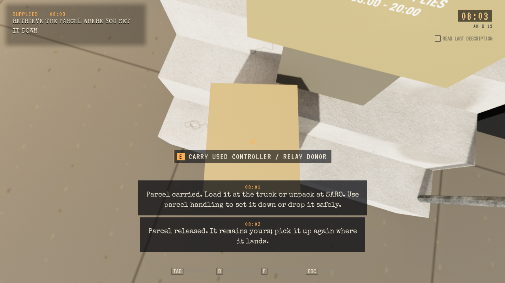
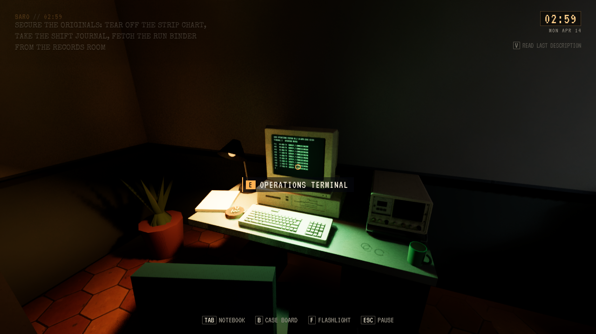

# Freeform: lengre natt og fysisk servicearbeid

**Status:** Gjeldende, lokalt installert. **Gjelder:** UE 5.8.4/Linux/Vulkan, runtime `35adb849`, PR310. **Sist kontrollert:** 1. november 2026.

Et døgn varer fortsatt 75 aktive minutter. Dag kl.06:00–19:00 tar 30 minutter; natt kl.19:00–06:00 tar 45. Fasegrenser og midnatt håndteres uten tidshopp, eksisterende klokkeslett beholdes, og pause/menyer stopper aktiv tid. Story har egen tidsstyring.

På OPS velges den valgfrie **Service work order**. Spilleren velger lokal reservedel eller ny forsyningstur. S-03 tas ut av REMOTE for planlagt reléarbeid. Venstre PC gir diagnose; HUD og notatbok beholder neste handling gjennom kjøp, lasting, levering, eventuell donortest, relébytte og faktisk fem-graders ut-/returtest. Bare et nytt virkelig fullført testresultat kan signeres ved OPS. Forsyningsruten krever i tillegg en ny relé-/donorpakke som faktisk har vært sikret i bilen og levert ved SARO. Ingen vedlikeholdsbetaling eller gjentatt registrering gis. Vanlige observasjonsjobber kan fortsette mens ordren står åpen.

Forsyningspakken bruker eksisterende geometri med bæring, treghet og redusert gangfart for tung last. Vanlig interaksjon mot ledig gulv åpner håndtering for nedsetting/slipp. Native box-sweeps beskytter mot vegger, og en Chaos-kropp gir fall, rotasjon og dempet trefflyd. Den eksporterte verdenen har query-only kollisjon; en avgrenset fysisk kontaktflate bygges derfor bare fra faktisk målt native underlag. Dette er selektiv pakkefysikk, ikke en generell motor for alle rekvisitter. Pose, rotasjon, bevegelse og objektidentitet beholdes gjennom pause, områdebytte og lagring. En gratis gjenbrukbar servicekasse kan hentes og returneres ved benken med samme ene bæreslot. Den lager ingen lagerdeler og gir ingen ny reparasjonsgate.

Kjøretøyet kan ikke starte med usikret båret pakke. Kartet og kjørehintet peker til Caliches bensinstasjon/forsyningsluke og SARO-benken, med åpningstid og nødutlevering forklart. Eldre v1-Freeform uten nye felt støttes. Story og eldre bevis beholdes.

Freeform-dører kontrollerer faktisk aktiv og synlig native alien-geometri ved terskelen før lukking. Storys særskilte SC04-kontroll beholdes. Tre eksisterende genererte materialinstanser fikk manglende Nanite-bruksflagget reparert; eksportøren setter flagget på kompatible opaque/masked-mastere ved fremtidig regenerering. Modeller, teksturer og materialgrafer er bevart.

## Kontrollgrenser

JourneyTest bruker produksjonscallbacker, faktisk kameravalg/hentehandling, Walker-bevegelse, Chaos-kontakt, vanlig disk-/Flow-gjenoppretting og faktisk antennebevegelse. Langtur og tilnærming til apparater bruker eksplisitt rapporterte plasseringsfixtures. Dette beviser ikke en naturlig kjøretur, menneskelig input, en hel 75-minutters runde, døgnbalanse eller subjektiv fysikk-/skrekkfølelse. Dørprøven kontrollerer faktisk kroppsgeometri mot en avgrenset boks, ikke naturlig dørpassering eller et ekte lukkeforsøk. Ingen nye hendelsesfamilier er lagt til.

SARO-diagnosen bruker en isolert kopi av original auto1, vanlig Continue og uendret High/HWRT i et synlig Vulkan-vindu. Spillerens kontrollromsplassering er en rapportert fixture; historieflagg er ikke nullstilt. Den gamle Vulkan-renderstansens rotårsak er fortsatt uavklart. En bestått kortprøve lukker ikke PLAY-31-16.

## Faktisk levering

Pakket og installert kl. 12:59 CET fra `35adb849`. Pakken består 1932 selvtester og 45 JourneyTest-kontroller med 3 disk-/Flow-gjenopprettinger og normal prosessavslutning. Installert standardstarter og isolert Continue består; alle 149 personlige Saved-elementer er uendret.

SARO-diagnosen fra editorbygg `35adb849` består 42 kontroller, 4 pauseåpninger/4 gjenopptak og 3 produksjonshandlinger på OPS. 120.7 sekunder og 3615 native rammer etter første terminalhandling er observert med faktisk sluttbilde og normal prosessavslutning. High/HWRT er bevart. Ingen Vulkan-rotårsak er fastslått.

[Rått journey-resultat](FreeformJourney-2026-11-01/journey-result.json), [SARO-diagnose](FreeformJourney-2026-11-01/saro-resume-result.json), [installasjon](FreeformJourney-2026-11-01/installed.json) og [materialbruk](FreeformJourney-2026-11-01/material-usage.json).

To eldre genererte payload er pensjonert etter vellykket installasjon. Gjeldende kandidat og to eldre beholdes; Saved, kilder, logger og bilder er bevart. Egne tunge jobber er avsluttet og produksjonsreservasjonen frigitt.
