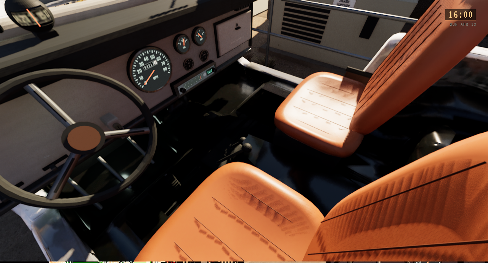
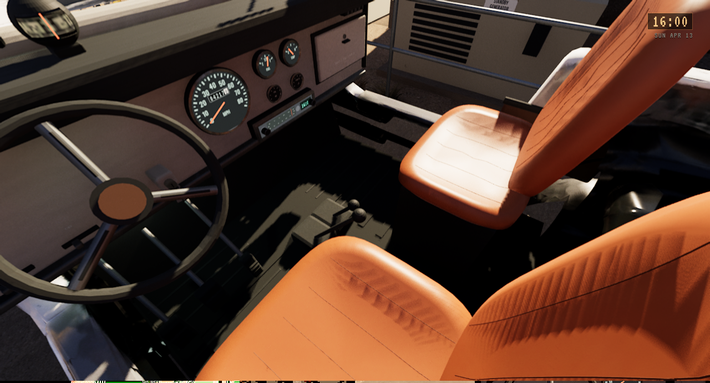
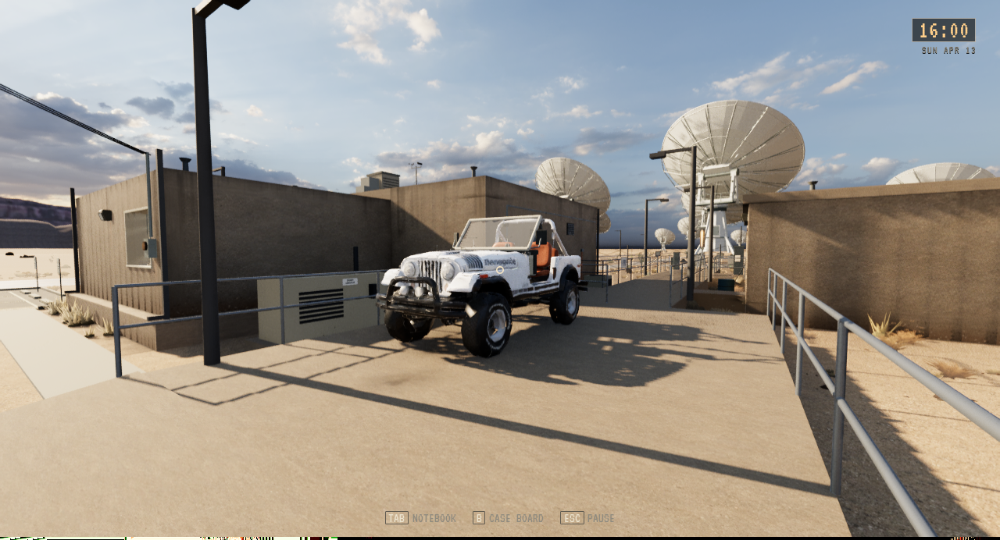
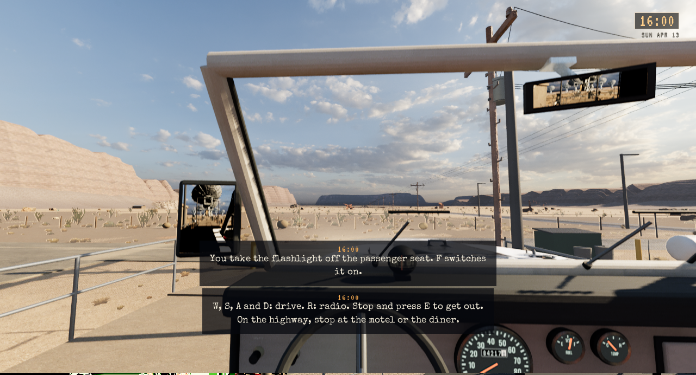

# Jeep-kabin, levende speil og separate originalhjul

**Status:** Gjeldende leveringsbevis, lokalt installert. **Gjelder:** Linux/Vulkan, runtime `444012cb`, [PR355](https://github.com/Tombonator3000/SIGNAL-47/pull/355). **Sist kontrollert:** 2. november 2026 kl. 23:43 CET.

Kabinens gamle gulvstrimler og seteryggrester er fjernet lokalt. Nye sømmer følger putene. De fire hjulene er delt fra originalens faktiske flater på alle tre LOD-er, med målte nav og radier. Karosseri og hjul dekker nøyaktig de samme flatene samlet; originalkilder, UV-er, materialnavn og lampemasker er bevart. Eksporten beholder også skarpe normalgrenser etter triangulering. Ufullstendig hjulsett gir komplett reservekarosseri med faste hjul.

Levende side- og ryggespeil følger førerplassen og det lagrede «Vehicle mirrors»-valget. Dører lukkes etter bruk. Den nye kjøredynamikken gjelder spillerens vanlige styring; testautopiloten beholder sin eksisterende driver. Ratt, instrumenter, lasting, verdensankre og lagringsformat er beholdt.

Samme native førerkamera i tidlig r16a-kandidat og ferdig r19a-modell:

Faktisk Linux-pakke:

| Kontroll | Resultat |
| --- | --- |
| Editorbygg og Linux-pakking | PASS; ingen materialkompileringsfeil |
| Selvtester | 2112 i editor og ferdig pakke |
| Native kabinimport | 691 kontroller, sju deler med tre LOD-er |
| Native hjulimport | 379 kontroller, fem deler med tre LOD-er |
| Kildebevaring ved hjuldeling | Alle flater fordelt én gang; UV-/fargeavvik 0, maksimal normalforskjell 0,000604 under grensen 0,001 |
| Ufullstendig hjulsett | Faktisk bare venstre forhjul importert; alle tre serviceetapper beholdt komplett reservekarosseri |
| Kjøreprøve | 8,554 m med eksisterende automatisk testinput; faktiske komponenter, hjultransformasjoner, ratt, instrumenter og lys består |
| Bilder og kort pakkekjøring | Kabin og karosseri gjennomsett; levende speil og Vulkan-røykprøve består |
| Installert startfil | 2112 selvtester og isolert tittel-/Vulkan-røykprøve består; binær/payload samsvarer med kandidaten |
| Personlig Saved | Alle 156 elementer, inkludert 126 filer, uendret |
| Vanlig tastaturprøve | Tittelmeny, LOAD CASE og gange med S/A bekreftet. Jeep ikke nådd: korridordøren kunne ikke siktes på uten mus |

Kjøreprøven over er en utviklerfixture og beviser ikke vanlig OS-input eller menneskelig kjørefølelse. De 2112 selvtestene inkluderer faktisk beregning med den nye kjøredynamikken, ulike tidssteg, veigrep, bakke og skrå veggkontakt. Den separate tastaturprøven brukte en kopi av en eksisterende isolert testprofil og ni native skjermbilder, uten teleport eller endring av lagringsdata utenom spillet. Museadapterens tidligere feil er ikke rettet av denne leveransen. Jeep-innstigning og kjøring med vanlig OS-input er fortsatt uverifisert. Ingen helnatts-/fullspillaksept eller offentlig spillutgave er påstått. Private modellfiler og native assets inngår ikke i Git.

[Avgrenset installasjonsresultat](Jeep-Finish-2026-11-02/installation.json). Den tidligere UFO-pakken er beholdt for tilbakeføring. 192,76 GB var ledig etter installasjonen. Ingen ny rydderunde er kjørt; midlertidige diagnosevarianter og erstattet eldste testpakke kan vurderes ved neste samlede rydding. Ferdige r19a-kilder, hjulderivat, gjeldende pakke og inkrementell cache beholdes.
