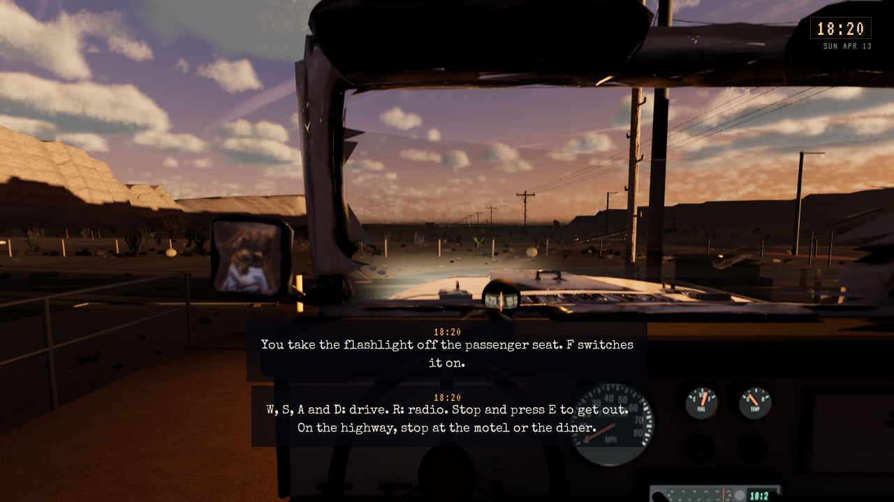
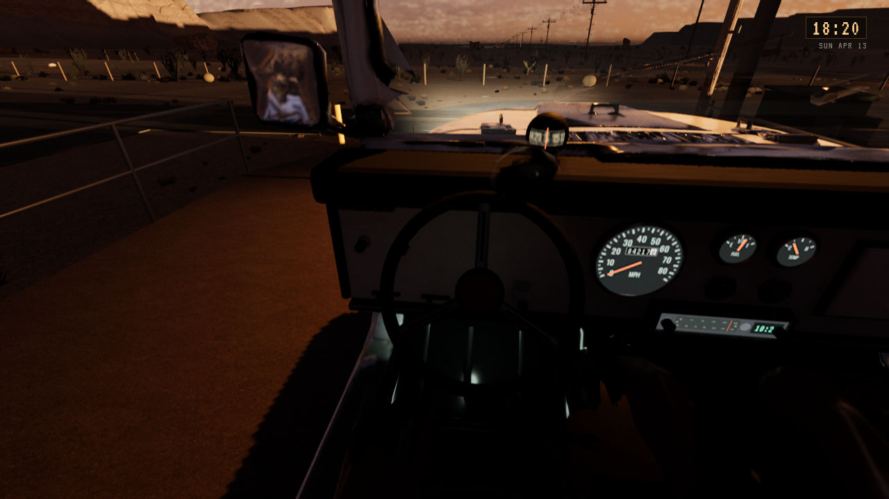
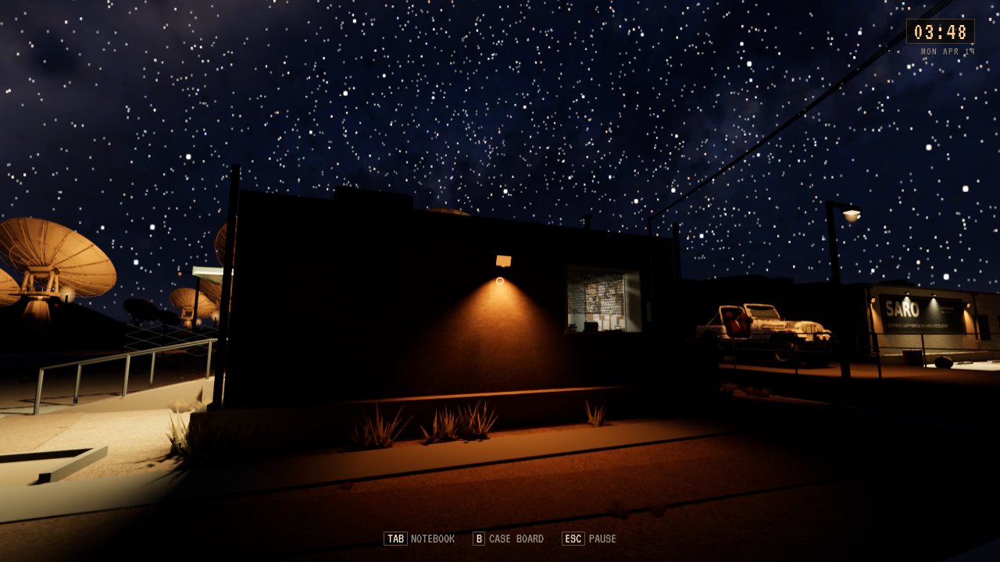

# Jeep-innside, SC04 og mindre lampeinsekter

**Status:** Gjeldende leveringsbevis. **Gjelder:** Linux/Vulkan, runtime `e944b8ed`, PR301 flettet som `9dfe1000`. **Sist kontrollert:** 1. november 2026 kl.02:18 CET.

Jeepen har en tilpasset Blender-innside med separat ratt/stamme, pedaler, gir-/4WD-spak, runde instrumenter, radio, hanskerom og støttet kompasshus. Alle tre serviceetapper bruker samme oppsett. Rattet følger faktisk styreinngang; hastighet, drivstoff, temperatur, kilometerteller og radio bruker eksisterende levende signaler. Original Tripo-modell og redigerbare Blender-kilder er bevart privat. Olje-/volt-skivene er kosmetiske; separat hjulrigg står fortsatt åpen.

Forrige installerte førerplass og samme førerkamera etter endringen:

Vinklet instrumentutsikt med faktisk ratt dreid av eksisterende styrefunksjon i kamerafiksturen:

SC04 avviser jakt mot en utilgjengelig rute. Dørbladets fysiske område og synlig kroppsutstrekning brukes ved lukking, med tydelig beskjed ved blokkering. Telefonlokking krever faktisk kontorankomst. Mains fysiske tilbaketrekning etter sikrede kontrollromsdører inngår, sammen med Freeform. Ingen ny service-yard-regi er lagt inn.

Lampeinsekter er redusert til 5–10 mm med dekning som avtar under én piksel. De tidligere lyse minimumsklumpene er fjernet. Flaggermusenes egen størrelse og filter er beholdt. Bare eksisterende `M_WebMoths` er regenerert gjennom `S47_ONLY=moths`; øvrige sceneassets beholdes. Samme SARO-kamera kl.03:48 før/etter viser effekten i Vulkan; små insekter er naturlig lite synlige i dette oversiktsbildet:

| Kontroll | Faktisk resultat |
| --- | --- |
| Editorbygg | PASS etter samordning med Freeform/main |
| Native interiør | Sju deler, tre LOD-er, faktisk import/koordinatramme og materialflater PASS |
| Selvtest | 1906 i editor og ferdig Linux-pakke |
| SC04short | 17 skriptstyrte kontroller: fangst, nytt forsøk, lukket arkivdør, telefonlokking, faktisk kontorankomst, sikret kontrollrom og gjenopprettede fakta |
| Pakking | Ordinær Linux Development, uten materialkompileringsfeil |
| Pakket og installert startfil | Vulkan, to faktiske cab-bilder og kort røykprøve PASS |
| Personlig Saved | Alle 149 elementer, inkludert 118 filer, uendret |
| Gamle testpakker | To eldre genererte payload pensjonert; gjeldende og to eldre pakker beholdt |

[Avgrenset installasjonsresultat](Jeep-2026-11-01/installation.json). Dette er målrettede native bilder og skriptstyrte handlinger, ikke menneskelig kjørefølelse, FPS-måling eller helnattsaksept. Konkrete situasjoner med dørlukking mens kroppen passerer og servicedør-sikt med sørdøren lukket trenger fortsatt særskilt oppfølging. Den eldre SARO-renderstansens utløsende årsak er uavklart; en bestått kort kjøring lukker ikke krasjfeilen. Ingen offentlig spillrelease.
