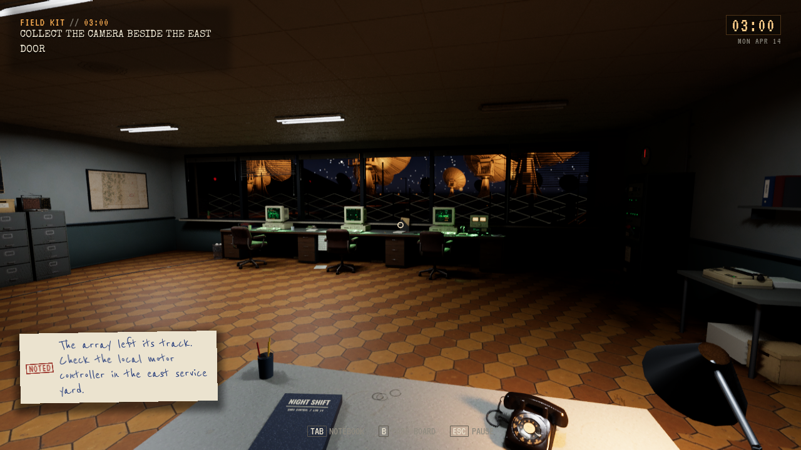
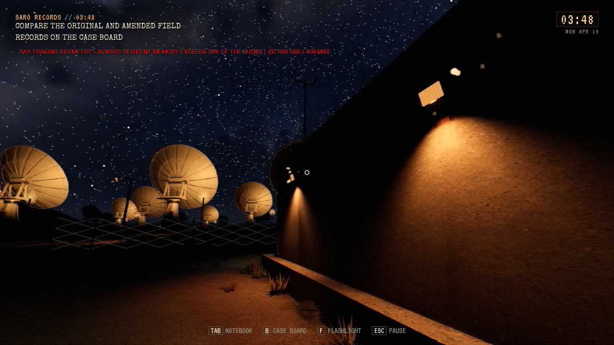

# Lokal installasjon av lookdev

**Status:** Gjeldende. **Gjelder:** UE 5.8.4/Linux, lokal pakke fra `09b128e7`, lookdev gjennom [PR284](https://github.com/Tombonator3000/SIGNAL-47/pull/284). **Sist kontrollert:** 31. oktober 2026 kl. 15:32 CET.

Nye SARO-/motellmaterialer, avgrenset glass, dag-/nattprofiler og korrigert fasadebelysning er pakket og installert på den vanlige spillplasseringen. Eksisterende snarvei/startfil brukes fortsatt. Ingen offentlig utgave er publisert.

Pakkeprøven avdekket to integrasjonspunkter som nå er rettet: lys-/materialkonfigurasjonene skilles fra rekvisittplassering, og materialbindingen følger den eksplisitte CPU-utgaven av kontormodellen gjennom helperens egne renderkopier. Kildeassetens opprinnelse registreres; et tilfeldig navn eller en generell regel for alle midlertidige modeller godtas ikke. Ingen verdensplassering, kollisjon eller spillregel er endret.

| Kontroll | Resultat og avgrensning |
| --- | --- |
| Editorbygg og Linux-pakking | PASS. Materialkompilering uten fallbackfeil. Sluttpakken inneholder bindings-/miljøkonfigurasjon og produksjonsassets. |
| Pakket selvtest | PASS, 1772 kontroller. |
| Pakket grafikk | PASS, kontrollrom og motell på High/Vulkan 1280×720. Native avlesning: 47 slotter, ingen manglende materialvarianter. |
| Installert startfil og Fortsett | PASS. Den ordinære startfilen laster en isolert kopi av den virkelige saken ved 03:48 gjennom tittel og Fortsett, uten utviklerhopp. Dette er en automatisk røyktest, ikke menneskelig input. |
| Payload og lagringer | PASS. 68 payload-noder / 40 filer samsvarer med kandidaten; 148 Saved-noder / 121 filer er uendret. Originalene er ikke brukt som testprofil. |
| Tilbakeføring og opprydding | Forrige installerte payload og separat Saved-kopi er bevart lokalt. Ett eldre generert testpayload er pensjonert; to eldre komplette testbygg beholdes i tillegg til eksplisitt beskyttet tilbakeføring. Kilder, Saved, bilder og logger er bevart. |

[Avgrenset kvittering med fil- og bildehash](LookdevInstall-2026-10-31/receipt.json). Tidligere editorprøver av før/etter, dag, Low, tåke High og strømbrudd er beskrevet i [arbeidsflyten](../../../unreal/Signal47/Tools/lookdev/README.md) og [STATUS](../../Active/STATUS.md).

Den opprinnelige renderstansen ved AUTO HOLD 03:00 er fortsatt uavklart; denne Fortsett-prøven ved 03:48 lukker den ikke. Kjente LOD-/plasseringsfeil, store insekter og øvrige åpne spillerfunn er heller ikke rettet av materialpasset. RT-residentvarslet kan fortsatt vises. Full historiereise, langvarig stabilitet og mottakerens Arch/niri-maskin er ikke akseptert gjennom denne lokale røyktesten.

