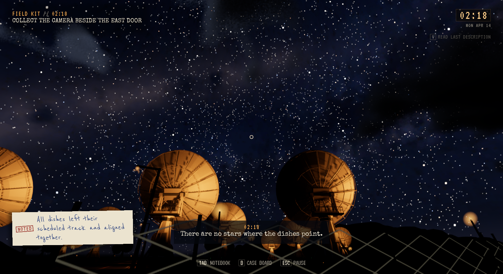
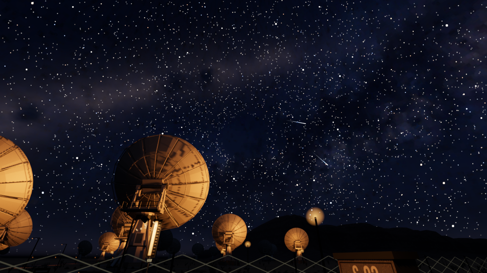
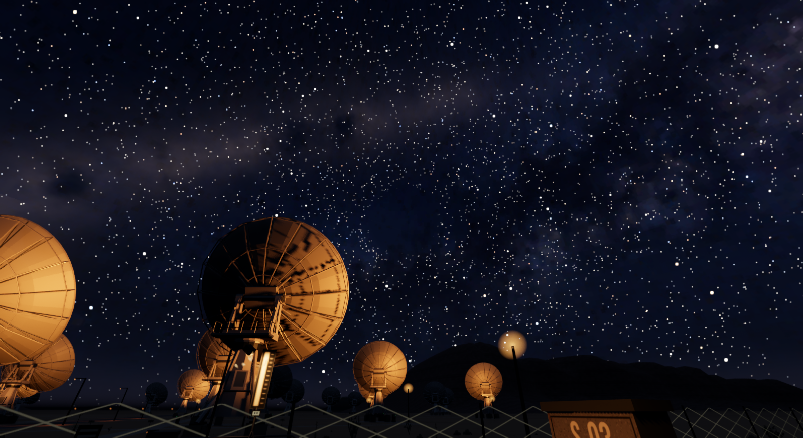

# Stjernehull og meteorpassasje, 3. november 2026

**Status:** Gjeldende leveringsbevis. **Gjelder:** kilde `765409cc`, UE 5.8.4 Linux/Vulkan. **Sist kontrollert:** 3. november 2026.

Signalet klargjør nå meteorpassasjen. Den starter først ved faktisk overgang fra SARO-rom til ute, når tomrommet har kommet fram. De 36 sekundene brukes bare under fri utendørs spilling; meny, innendørs opphold og andre områder holder tiden. Lasting fortsetter på lagret tidspunkt, og en ferdig passasje spilles ikke på nytt.

Tomrommet har radius 6 grader i kjernen og 8 grader ved ytterkanten, med samme azimut 026/elevasjon 32 og himmelfarge. Det kommer fram over åtte sekunder. Nye observasjoner beskriver omtrent fjorten graders bredde; gamle registreringer beholder gammel tekst. Foto/blikk bruker samme størrelse og hullstyrke. Ingen kamerabevegelse legges til i vanlig spilling.

Begge sammenligningsbilder er 1600×872, High, kl.02:18 fra samme stående posisjon. Størrelsen er økt uten lysring eller endring av resten av stjernefeltet.

## Meteorene

Den faste planen har 148 streker på High og 69 på Low, med elleve baner bak tomrommet på hver kvalitet. Faktisk kjøring måler opptil ti/fem samtidige hoder. Hode og hale bruker stjernenes eksisterende vinkelmaske. Banekontrollene følger innpassering, full skjuling og utpassering. De gjennomsette spillbildene viser tom kjerne og streker rundt feltet; den merkede siktefiksturen fryser en helt skjult meteor. Dette er ikke en video av hele kryssingen.

F10 Meteor shower har en egen pool med ti strimler. Den faktiske menyfunksjonen er kjørt og måler fem samtidige komponenter i et 1,5-sekundsvindu. Selvtesten følger 40 sekunders tetthet, poolgrense og frysing. Målingen attesterer komponenter, ikke fem synlige piksellinjer fra ett bestemt kamerablikk. En oppdaget dobbel tidsframrykning i skapelsesrammen er rettet.

## Kontroll og levering

Editorbygg, full pakking og 2141 installerte selvtester består. High i editor og Low i ferdig pakke består hver 100 kontroller og 17 Flow-gjenopprettelser: ekte signal innendørs, gang gjennom østdøren, menypause, inn/ut, annet område, lagret ventende/pågående/fullført og ingen replay. Eldre v1/manglende felt normaliseres konservativt; ugyldig og framtidig JSON beholdes uten avspilling.

Prøven bruker Walker-testinput, direkte dørhandling og eksplisitte posisjons-/klokkefixtures. Disklagring/lesing og Flow-lasting er kontrollert i samme prosess, ikke den vanlige autosave-slotten eller OS-input. De lagrede notatene beholdes; Seen/fotosamlingene er tomme i denne livsløpsprøven. Selvtesten kontrollerer gammel observasjonsbeskrivelse separat. Full naturlig natt og menneskelig vurdering er ikke utført.

Installert kl.03:01 CET. Kort installert oppstart og selvtester består, og alle 126 personlige Saved-filer er uendret. [High-resultat](Meteor-2026-11-03/high-result.json), [Low-resultat](Meteor-2026-11-03/low-result.json), [opptaksmetadata](Meteor-2026-11-03/captures.json) og [installasjon](Meteor-2026-11-03/installation.json).

Prosjektbiblioteksøket ga ingen kompatibel ferdigløsning; egne UE-materialer, historie-/lagringsflyt og meteorstrimler er gjenbrukt. Claude og to agenter leverte kildearbeid; Codex integrerte, gjennomgikk og kontrollerte det. Forrige himmel-/displaypakke beholdes for tilbakeføring. Kandidat/cache beholdes; eldre ferdige pakker går til neste samlede rydding. Ingen offentlig spillutgave.
