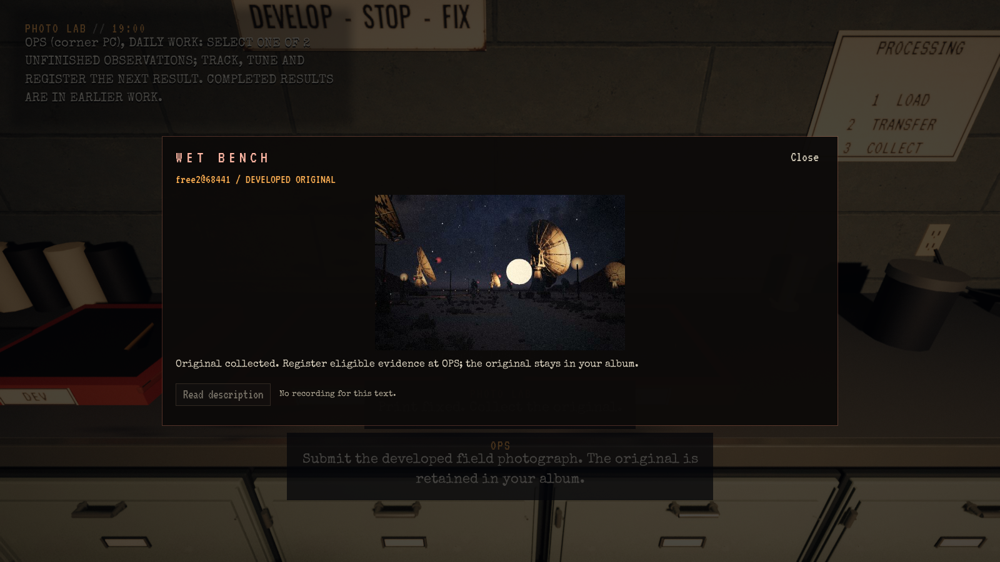
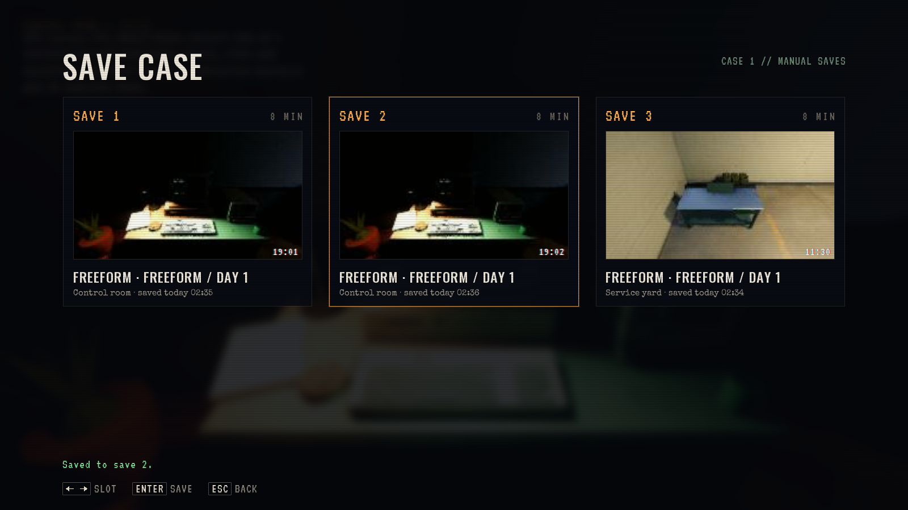

# Vanlig Freeform-reise og lasting ved Caliche

**Status:** Referanse. **Gjelder:** UE 5.8.4 Linux/Vulkan, editorbygg `normal-journey-build-r10`, normal testprofil `20261105-r8`. **Sist kontrollert:** 5. november 2026 kl.02:36 CET.

Lasten ved dineren kan nå nås med den faktiske bruksstrålen. Den store boarding-flaten på `dinerTruck` fanget tidligere strålen til den mindre cargo-flaten. Samme avgrensede prioritering som ved SARO gjelder nå også her; sikting på førerhuset gir fortsatt vanlig boarding.

En fersk Case 1 består hele reisen i fem separate prosesser, med 146 kontroller. Vanlig tittelinput starter spillet og velger Continue. Kontrollpunktets eksakte lagrings-ID og tidspunkt bekreftes før hver Continue. Ingen developer-Freeform, ferdige jobber, penger, bilder eller varer injiseres.

| Fase | Gjennomført | Kontroller |
| --- | --- | --- |
| 1 | Ekte tracking/tuning/opptak/printer, rutinebetaling, kamera/foto, første labtrinn og Save 1 | 32 |
| 2 | Continue, ferdig fremkalling, faktisk kjøretur til Caliche, to sikringer og ett relé for $35, Save 2 med betalt pakke | 20 |
| 3 | Continue, fysisk henting/lasting, førerhusets separate bruksstråle, full retur, lossing og én lagerlevering, Save 3 | 21 |
| 4 | Continue, vanlig bekreftet venting til skumring, naturlig lyskule, faktisk foto/lab, én $20-betaling og eksplisitt overskriving av Save 1 | 51 |
| 5 | Continue fra overskrevet Save 1, samme betalte hendelsesoriginal og ingen ny betalingsknapp, eksplisitt overskriving av Save 2 | 22 |

Begge fotografier beholder bildeinnhold og opptaksstilling; rutineutskriften beholder original og stempel. Sluttsaldo er $125 fra $120: +$20 rutine, -$35 varer, +$20 foto. Lageret får akkurat to sikringer og ett relé; leverings- og cargo-teller øker én gang. Filmforbruket følger de to faktiske eksponeringene. Andre manuelle lagringsfiler er byteidentiske ved hver ny lagring/overskriving; Save 3 beholdes etter begge overskrivingene. [Samlet audit](Normal-Journey-2026-11-05/audit.json).

Bildene er visuelt kontrollert. Hver prosess avslutter med kode 0 og egen PASS-rapport: [1](Normal-Journey-2026-11-05/phase-1.json), [2](Normal-Journey-2026-11-05/phase-2.json), [3](Normal-Journey-2026-11-05/phase-3.json), [4](Normal-Journey-2026-11-05/phase-4.json), [5](Normal-Journey-2026-11-05/phase-5.json).

Prøven bruker eksplisitte spiller-/kameraplasseringer, syntetisk Slate-/tastinput og produksjonens kjørefunksjoner med autopilot. Dusk følger produksjonens venting og Director uten Force eller direkte klokkesetting. Dette er ikke menneskelig oppdagelse, fri gange/kjøring eller lyttevurdering. Lokal installasjon følger nattens samlede kandidat; denne rapporten gjelder editorprøven.

Tidligere forsøk beholdes lokalt: r3 viste dinerens faktiske lastesvikt, r4/r5 avdekket feil sikting/handling i driveren, r6 feil knappetype i overskrivingsprøven og r7 en kontroll ett millisekund før siste Enter. Driveren bruker nå Enter og avgrenset venting på faktisk dialog. Disse forsøkenes delresultater erstatter ikke r8-PASS. Fullstendige logger ligger i `~/scratch-bm/Signal47-nightshift-20261104/journey-20261105-r8-phase*/`.
