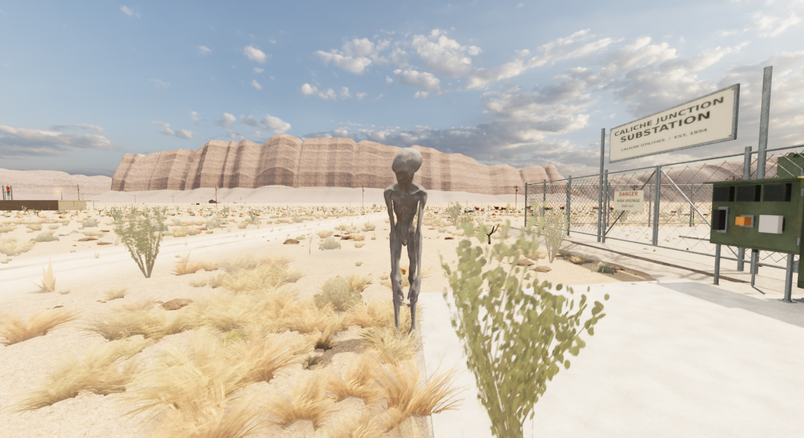
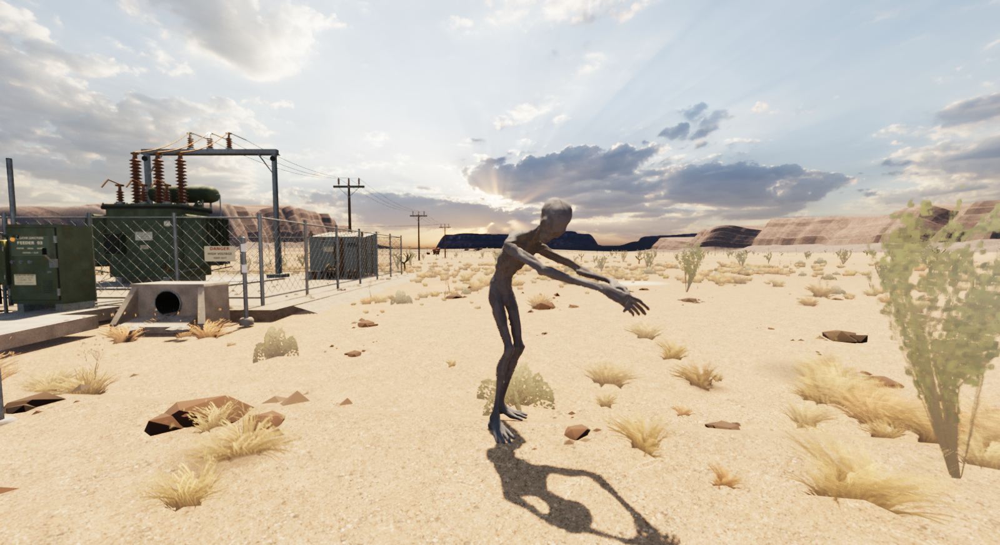
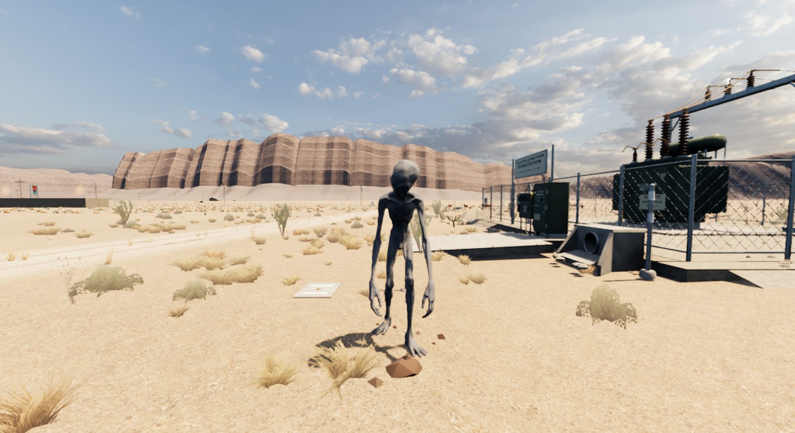

# Original Pale: bevegelse og grep

**Status:** Referanse, delvis levering av PLAY-31-22. **Gjelder:** installert Unreal-kilde `b0535f89`, Linux/Vulkan. **Sist kontrollert:** 3. november 2026 kl. 05:29 CET.

Stor Pale har egne idle-/lytteuttrykk, gange, løp, start/stopp, vending og grep. Stegene følger faktisk forflytning; fotplassering og retning holdes under støttefasen, og skrittlyd følger landinger. Armene sikter mot spillerens faktiske øvre bryst med riktig gulvhøyde og hoppløft. AI, rotbevegelse og kollisjon beholdes.

Original `SK_Tripo_Pale`, skinn, vekter, UV-er og materialer er bevart. Kilden har 61 bein; Unreal beholder også `TripoPaleRig`-roten, totalt 62. Ingen modellressurser eller Roswell-animasjoner er endret.

## Før og etter

[Førvideo, High, 8 sekunder](Pale-Motion-2026-11-03/baseline.mp4) og [sidevideo R3, High, 17 sekunder](Pale-Motion-2026-11-03/after-side-105.mp4) følger faktiske previewtider, uten lyd. Før går modellen på stedet; etter beveger den seg 10,90 meter gjennom sju faser. Kamera og rotbane er forskjellige, så dette er ikke pikselidentisk A/B.

Grepet får opptil 16 grader ekstra visuell framoverbøy mellom 0,90 og 1,05 meter, gradert etter faktisk mål og grepets innblanding. Originale leddlenger, rot og føtter beholdes. Midlertidig sidekamera, 1,05-metersfixture og hånddiagnose er fjernet fra produksjon; opt-in frontpreview bruker igjen 0,90 meter.

## Kontroller

Bygg, pakking, 2147 installerte selvtester og installert oppstart består. Alle 126 personlige Saved-filer / 156 noder er uendret. [Installasjon](Pale-Motion-2026-11-03/installed.json), [samlede resultater](Pale-Motion-2026-11-03/source-verification.json).

| Opptak | Bilder | Previewtid | Omfang |
|---|---:|---:|---|
| Før, High | 68 | 8,0305 s | Tre eksisterende faser |
| Side R3, High | 143 | 17,0342 s | Sju faser, 10,90 m, 1,05 m modellmål |
| Sluttpakke, Low | 143 | 17,0257 s | Sju faser, 10,90 m, 0,90 m frontpreview |

Sluttpakkens største ankel-/tå-hæl-probeavvik var 1,7392 cm; fotens vinkelavvik under støtte var omtrent 0,000002 grader. Diagnosepunktene bruker nå hele beintransformen med importskala, og er ikke faktiske sålevertices.

Også [Low-grep](Pale-Motion-2026-11-03/package-low-grab.png) og [R3-løp fra siden](Pale-Motion-2026-11-03/side-run-r3.png) er gjennomsett. Originalmodell, armer og føtter er intakte; gress skjuler deler av beina i enkelte bilder.

Faktisk SC04 består i sluttpakken med 17 kontroller, én fangst, nytt forsøk, lytting og lokking. En tidligere instrumentert SC04-kjøring målte håndavvik 0,1627/0,1522 cm ved omtrent 0,895 m, uten rekkeviddeklipping. Hendene lå utenfor førstepersonsbildet. [AI-målinger](Pale-Motion-2026-11-03/actual-sc04-grab.json).

R3-sideprøven ved 1,05 m målte 0,0377/0,0356 cm uten klipping, med begge hender i bildet. [Modellmålinger](Pale-Motion-2026-11-03/model-105-grab-r3.json). Dette er håndbein mot mål, ikke håndskinnets kollisjon med spillerkroppen eller et naturlig SC02-møte.

## Gjenstående arbeid

PLAY-31-22 står delvis åpent: krabbegang/kryping, passasjehøyde med AI/kollisjon, øvrige relevante figurer, full synlig fangstavslutning og Toms menneskelige vurdering gjenstår. Vellykket fangst beholder eksisterende skjul/fade. Naturlige møter, sidevinkler og høydeforskjeller er ikke uttømmende prøvd. SC04 kontrollerer serialisert Spine i samme prosess, ikke full disk/title/Continue.

Framebufferopptakene låser ikke opp skrivebordet. Bildeuttak påvirker veggtid og gir ingen FPS-, lyd- eller ytelsesaksept. Bare fem PNG-er, metadata og to eksisterende videoer følger rapporten; komplette PNG-serier beholdes privat. [Utvalg og kontrollsummer](Pale-Motion-2026-11-03/evidence-manifest.json). Avbrutt R2 er ikke godkjent bildebevis. Forrige SARO-pakke beholdes for tilbakeføring; ingen ny prosjektkopi eller samlet rydderunde. Offentlig nedlasting er ikke oppdatert.
