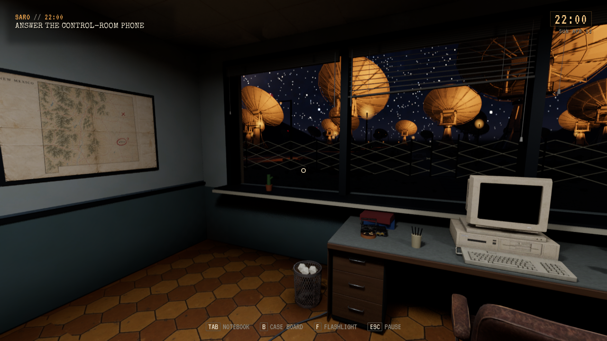
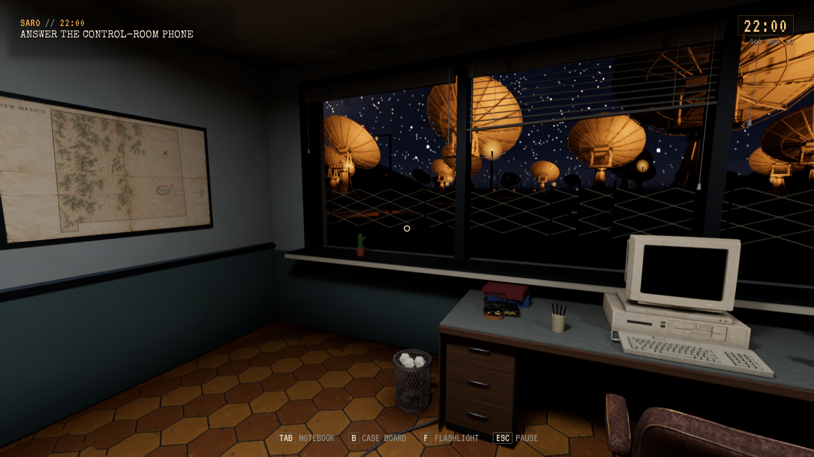

# Liten Roswell-alien, lokal levering

**Status:** Gjeldende. **Gjelder:** UE 5.8.4/Linux, kilde `48ba239e`, [PR287](https://github.com/Tombonator3000/SIGNAL-47/pull/287), main `04fdb1c8`. **Sist kontrollert:** 31. oktober 2026 kl. 17:02 CET.

Toms prioritet **0.1** er levert gjennom hele kjeden: to genererte referanser, faktisk Tripo H3.1-modell, Tripo-retopologi og humanoidrigg, redigerbar Blender-kilde, native Unreal-import og lokalt installert spill. Figuren er 1,20 m høy og separat fra den høye jakt-alienen, som er beholdt. Kilder, originalrigg, teksturer og genererte Licensed-assets ligger privat; ingenting av dette er lagt i offentlig Git.

Glimpse bruker den lille figuren ved nære SARO-vinduer/hjørner med hodevending, lesbar reaksjonstid og fysisk tilbaketrekning. Vindusfiguren bøyer knærne med plantede føtter og skjules først etter at den har nådd dekning. Egne kollisjonskomponenter hindrer ikke siktkontrollen. Tidligere scenevakter og grensen på åtte opptredener per natt er beholdt; ingen ny jakt er lagt til.

| Kontroll | Resultat og grense |
| --- | --- |
| Tripo og Blender | PASS. H3.1 fra frontreferansen, 10 196 retopologiserte firkanter og 65 kildebein. Blender-kilde med pakket originaltekstur/rigg og tre FBX-LOD-er: 19 259 / 9 627 / 3 851 trekanter. |
| Native import | PASS. 120 cm høyde, gulvpivot og samme koordinatramme i alle tre faktiske render-LOD-er, kontrollert med 27 asymmetriske geometripunkter. Enhets-/reimportinnstillinger er eksplisitte for alle LOD-er. |
| Editorbygg og Vulkan | PASS. Før/etter, faktisk skin, vinduspeek, hodevending, dukking/retrett og helfigur. Fotankrene står fast gjennom dukking. |
| Linux-pakke | PASS. 1778 selvtester, fem kontrollerte bilder og kort High/Vulkan-røyktest ved 1280×720. Ingen materialfallback. |
| Lokal installasjon | PASS, kl. 17:02 CET. Vanlig startfil, samme fem modell-/vindusbilder og full røyktest. 68 payload-noder samsvarer med kandidaten. |
| Personlige lagringer | PASS. 152 Saved-noder / 124 filer uendret. Prøven brukte egen `/tmp`-profil og case 0. Ingen personlig sak er brukt som testprofil. |
| Vedlikehold | Forrige installerte payload bevart. Ett eldre testpayload, sju genererte filer, er pensjonert; gjeldende og to eldre komplette testbygg samt eksplisitt beskyttet tilbakeføring beholdes. Kilder, Saved og råbevis er bevart. |

[Avgrenset kvittering og bilde-/pakkehash](Roswell-2026-10-31/receipt.json). Private originaler, referanseprompter, Blender-kilde og native sikkerhetskopi er samlet under modellmappen `roswell-glimpse-20261031`. Referansebildene er laget med innebygd imagegen; 3D-modell og rigg er laget i Tripo3D, ikke erstattet med håndlaget prøvegeometri. Eksisterende `triponpcs`-/`fieldintegration`-løype er gjenbrukt; bibliotekets Blender-/Tripo-profiler var UNVERIFIED bakgrunnsstoff, ikke bevis på motorstøtte.

Dette er en kontrollert prøve av spillets faktiske Glimpses-instans og modell. Naturlig tilfeldig opptreden, videre plassering ved Caliche-/motellvinduer, hele historien, langvarig stabilitet og Toms visuelle vurdering gjenstår under PLAY-31-37. Førbildet bruker `S47RoswellOff`, som viser det gamle oppsettet uten en nær vindusfigur. Fullfiguren er også prøvd med ordinær lommelykt; dette er ikke en godkjenning av hele spillets lysbalanse. Ingen offentlig utgave er publisert, og åpne krasj-/progresjonsfeil er ikke lukket av denne leveransen.

