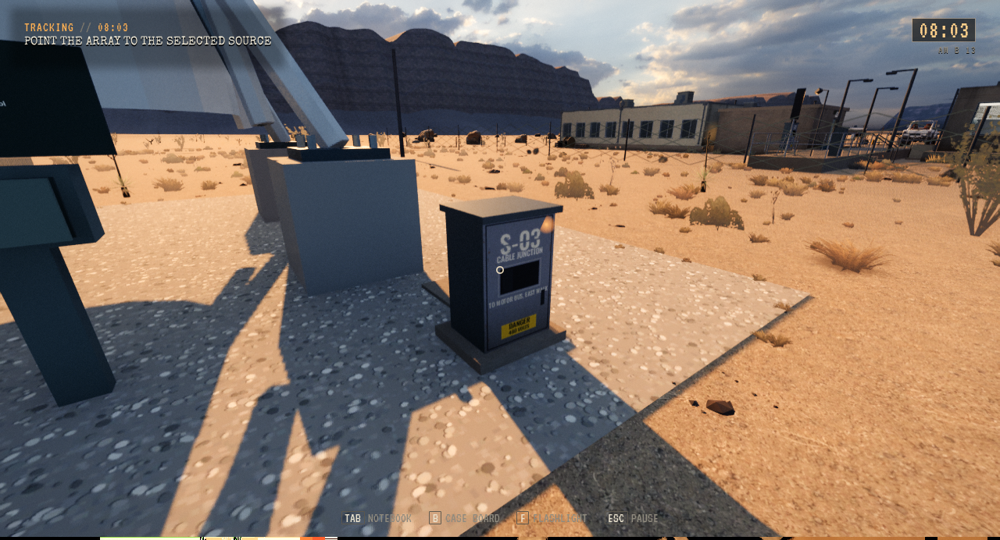
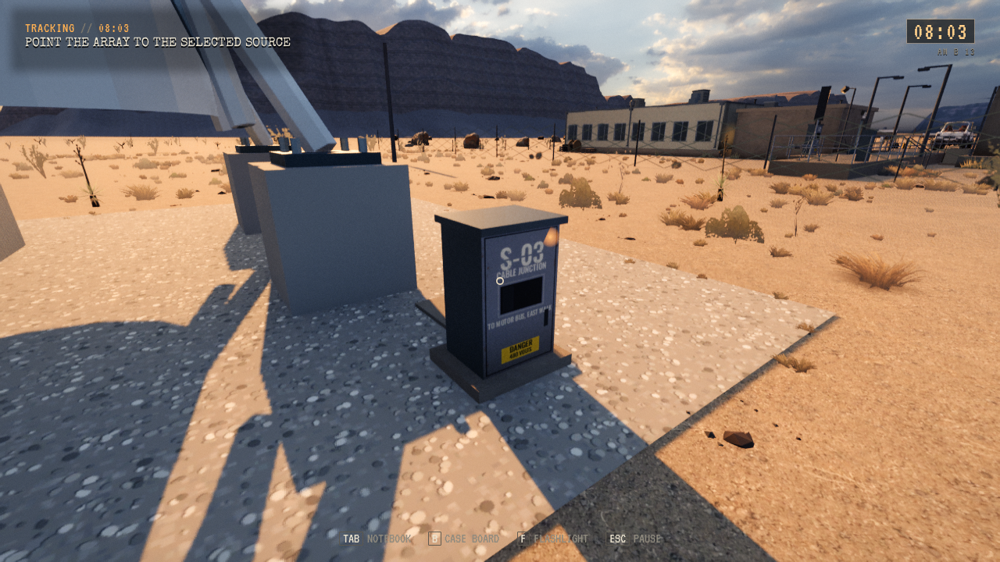

# Reparasjon i originalt S-03-skap

**Status:** Gjeldende. **Gjelder:** Lokal Unreal-installasjon, runtime `55990d45`, PR345. **Sist kontrollert:** 2. november 2026.

Originalt CABLE JUNCTION-skap brukes til Freeform-service. Originalfronten er hengslet; relé, lokalvelger og servicedeler sitter inne. Ekstra stativ/skilt er fjernet. Originalmodeller og atlas bevares, de øvrige 26 skapene er urørt, og Storys separate motorbus-inspeksjon er beholdt.

Editorbygg og Linux-pakking består. Pakket selvtest: 1997 kontroller. Pakket servicereise: 58 kontroller og fire disk/Flow-returer, inkludert faktisk kameraray/OnUse, åpen luke etter Continue, ett reléforbruk og antennens ut-og-tilbake-bevegelse før arkivering. Plassering mellom reisesteg er eksplisitte fixtures; dette er ikke menneskelig ruteaksept eller full regresjon.

Installert i standardstarteren med kort isolert Freeform-røykprøve. Alle 161 personlige Saved-elementer er uendret før/etter. Tidligere verifisert kandidat er beholdt for tilbakerulling. Ingen offentlig repakking; Linux-utgivelsen fra samme dato er fortsatt runtime bfa1c26d.

Før og etter, samme kamerafixture:

