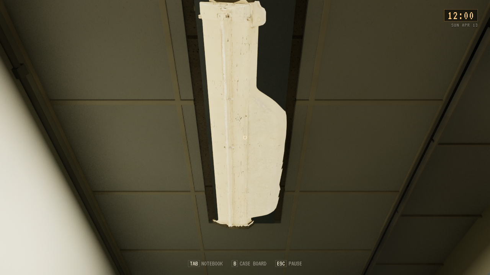
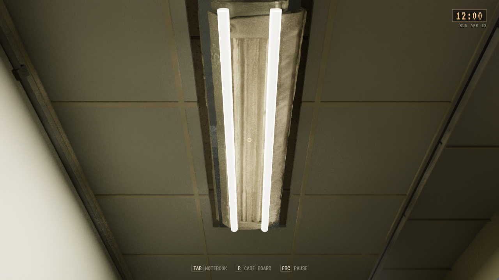
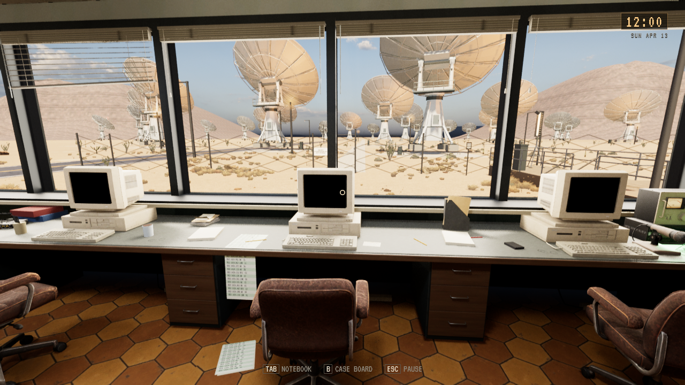
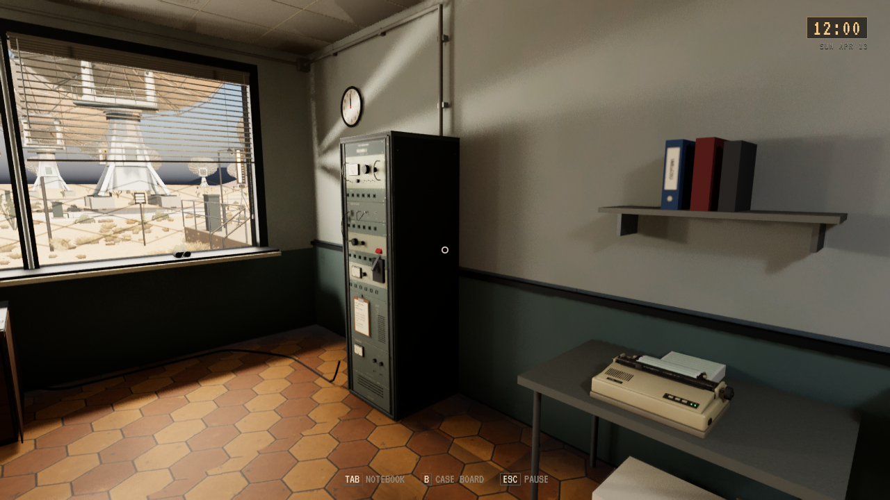
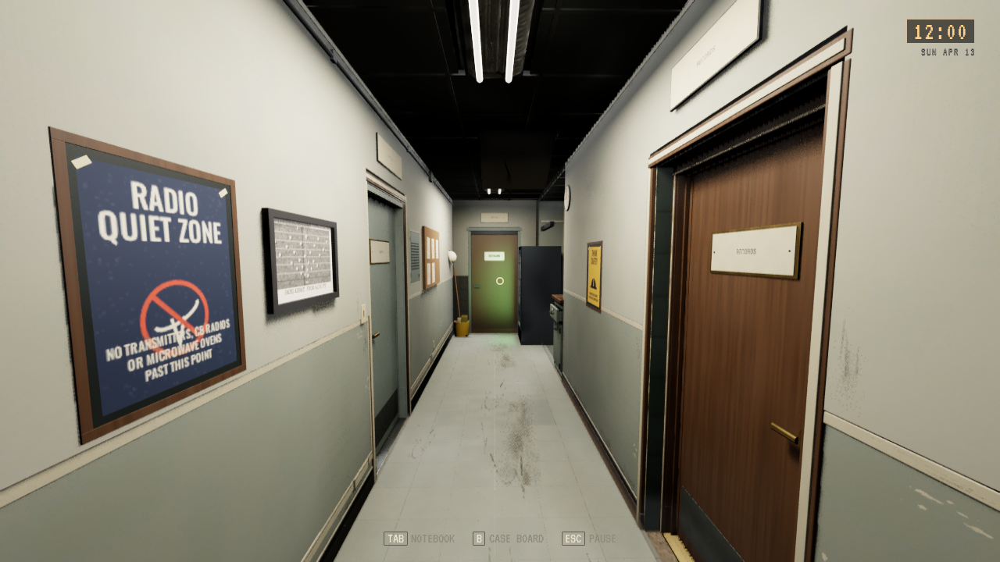
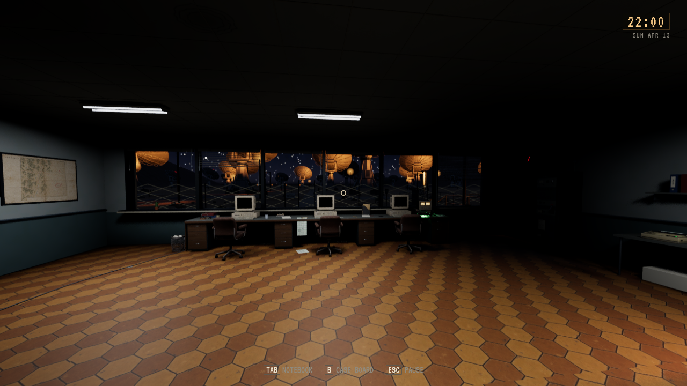

# SARO-rekvisitter og armaturer fra 1986

**Status:** Gjeldende, installert; visuell godkjenning avventes. **Gjelder:** Linux-kilde `0468d167`, PR258/main `ebaad3c0`. **Sist kontrollert:** 30. oktober 2026 kl.19:45.

[PR258](https://github.com/Tombonator3000/SIGNAL-47/pull/258) gir RX3 analoge målere, knotter, brytere, BNC-kabler, ventilasjon, skruer og etiketter. Konsollen får valnøttfronter/skuffer og tre brune kontorstoler. WE500-telefonen har separat håndsett og spiralledning. Papirkurvene er hule, inventarjakken er tynn og asymmetrisk, de to blokkformede dekorjakkene er fjernet, og plakatene ligger foran veggmalingen. [Visuell analyse](../../Design/SARO_1986.md), [kilder/import](../../../unreal/Signal47/Tools/saro1986/README.md).

Åtte armaturer bruker siste eksporterte Tripo H3.1/P1.0-modell: 18 748 trekanter i originalhuset og 184 i to rette T12-glassrør. Den tidligere importen brukte feil eldre kilde og er erstattet. Metallhuset har ingen glød; rørene følger eksisterende strøm og flimring. Tripo brukte 55 modellkreditter og 35 retopologikreditter. Originaleksporter, PBR-kart og redigerbar Blender-fil er bevart privat; lisensierte modeller/teksturer følger ikke Git.

Editorbygg, metrisk native import og High før/etter består. Linux-pakken består 1740 selvtester og figurkontroll: 14 lastet, 11 bundet, tre venter på SC03-scenen. Korte pakkede kameraer av gangen på dagtid og kontrollrommet kl.22:00 består med de nye modulene lastet. Eksisterende interaksjonsforeldre, kollisjoner og lysdrivere brukes videre. Dette er statiske kamerakontroller, uten fullmatrise, menneskelig input eller FPS-måling.

[Installasjonen](SARO_1986_PROPS_2026-10-30/installation.json) samsvarer med alle 68 payload-noder, og alle 134 personlige Saved-noder er bevart. Installert isolert gangkamera og 14-figurkontroll består. Standardstarteren bruker den nye pakken. Godkjente Dales kontor er bevart. Ingen offentlig spillrelease. Kanonisk opprydding pensjonerte to eldre pakkepayloads; gjeldende kandidat og to eldre komplette testbygg beholdes med kilder, assets, Saved, bilder og logger urørt.

ENV-06/ENV-07 avventer Toms vurdering. Low har vesentlig mørkere himling uten Lumen enn High; dette er et visuelt vurderingspunkt. Alle bilder under er faktiske Unreal-kameraer. Armaturparet er samme High-kamera, konsoll/RX3 er High på dagtid, gangbildet er faktisk installasjon på Low, og nattbildet er pakket Low.

