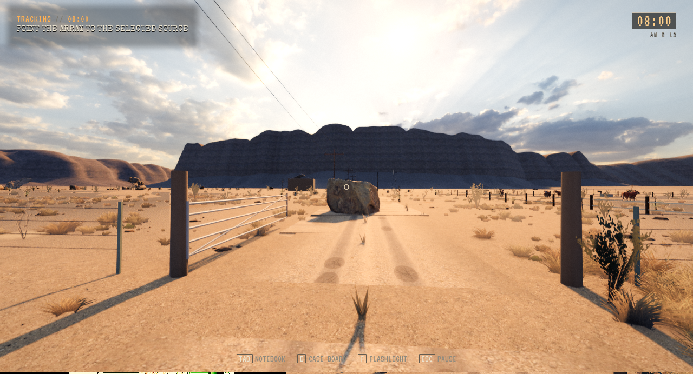
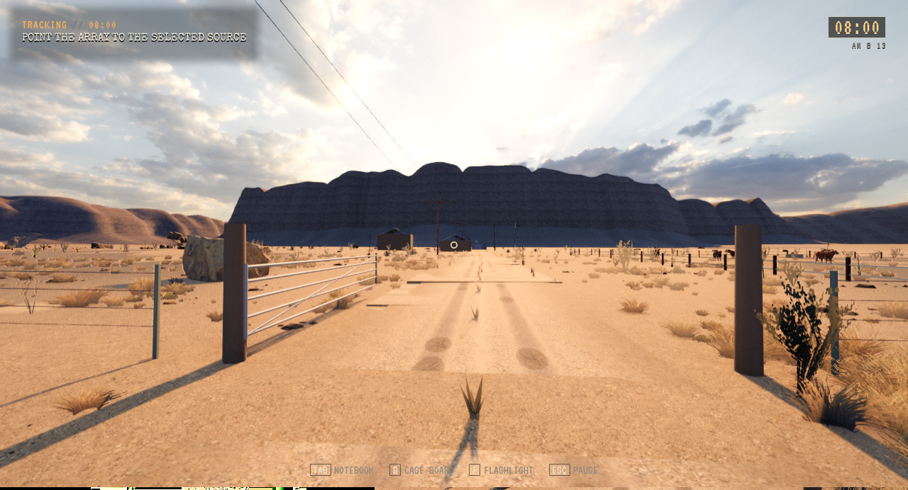
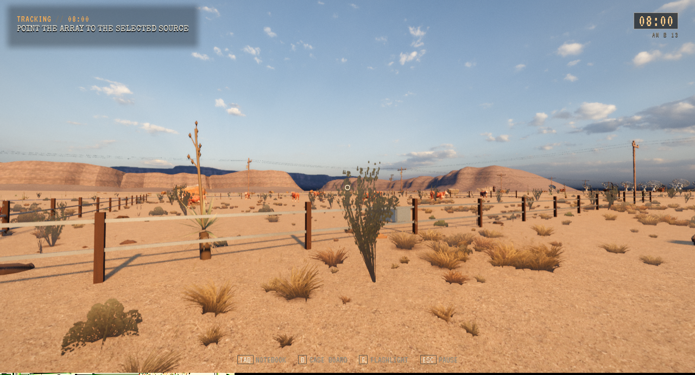
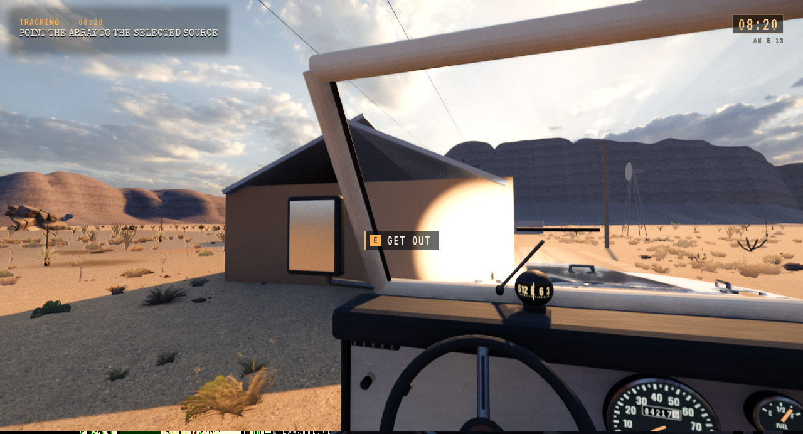
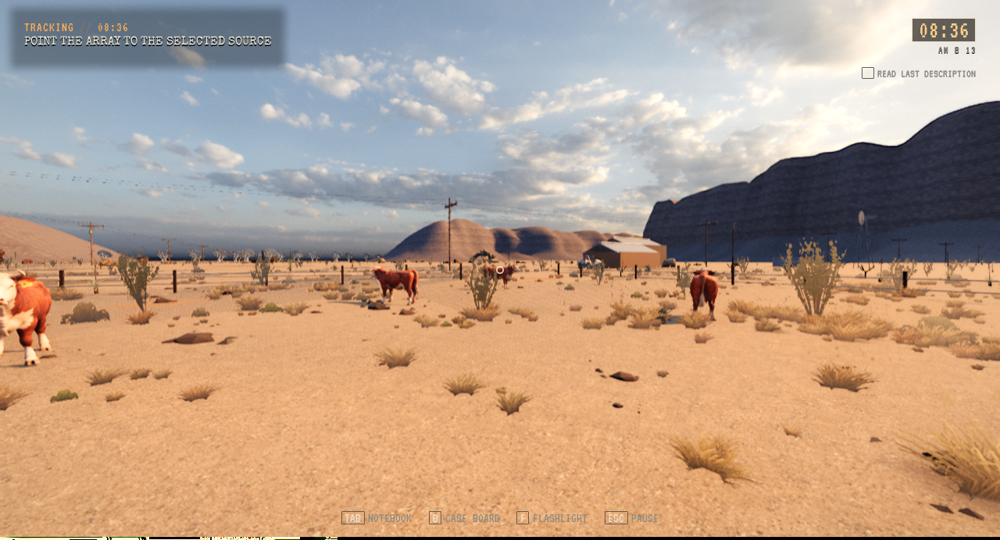
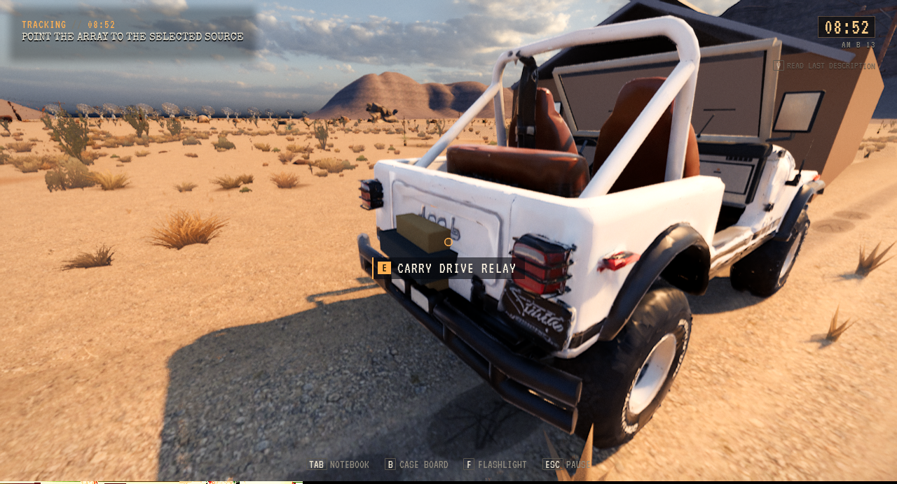

# Åpen Alderete-gård i Freeform

**Status:** Installert. **Gjelder:** runtime `19b0ab0b`, PR331/332, UE5.8.4/Linux/Vulkan. **Sist kontrollert:** 2. november 2026 kl.04:00 CET.

Freeform bruker den åpne Alderete-avkjøringen, gårdsbygg 310 m nærmere veien og ni kuer på det inngjerdede beitet. Alle synlige ku-/hode-/blikk-/øyelys-/fotoankre og 18 kjørehindere i de to områdeframmene følger samme modus. Bil, gange, grusdekke og terreng bruker samme grunnlag. Story beholder originalene og fysisk stengt port. Gården er fortsatt en enkel placeholder; husinteriører og finere utsmykking inngår ikke.

Bare 300 målte ranchtriangler og 192 porttriangler i hver områdekopi skilles fra blandede originalmesher. Egne kildeassets og materialer beholdes. Begge gårdsvarianter beholdes gjennom minneopprydding og modusbytte. CPU-retensjon for g678/g910/g911/g912 er klargjort i eksisterende arbeidskopi og hovedkildens cache med uendrede struktursignaturer.

Siktepunktet prioriterer den faktiske pakken eller cargo-racket gjennom bilens brede boardingproxy. Pakken kan tas ut og lastes inn igjen etter Fortsett. Vanlig sikting på bilen beholder kjøreaksjonen. Stedet vises som Alderete farm på lagringskort.

## Faktisk kontroll

Helreisen ble kjørt på `7a92120f` fra PR331. Siste avgrensede steinrydding i PR332 ble deretter bygget og prøvd med målrettet editor-/pakket kontroll, uten ny helreise. Den fullførte native reisen består 24 kontroller: 248,98 m egen Jeep, 124,09 m vanlig gange, null registrerte sammenstøt, av-/påstigning, faktiske ray/OnUse-handlinger på pakke/rack og 3 disk/Flow-gjenopprettinger. Etterpå starter en ekte Story-sak, måler originalenes plassering og prøver fire sekunder med ganginput mot stengt port. Den beholdte Freeform-saken gjenopprettes deretter med last og layout. Begge sett med alle ni kjørehindere måles i begge moduser.

Pakking og 1 995 selvtester består. To korte pakkede ressurs-/renderprøver kontrollerer innkjøring og beite, inkludert faktiske CPU-delinger, native kuinstanser og bakkestråle. Installert Fortsett består fra isolert kopi av personlig lagring. Alle 164 personlige Saved-elementer er uendret. [Avgrenset oppsummering](SaroAlderete-2026-11-02/summary.json).

Prøven har én uttrykkelig initial hovedvei-/parkert Jeep-/lastfixture. Den beviser ikke kjøpet eller den første lastingen av pakken. Resten av den målte ruten bruker ordinær kjøre- og gangfysikk, uten teleportredning. Modussammenligningen etter ruten har egne kamerafixtures. API-styring erstatter ikke menneskelig input eller spillfølelse. De to pakkede bildene er egne kamerafixtures og er ikke en gjentatt full kjøretur. Ingen naturlig flerdøgns-/helspillsprøve hevdes.

En dekorativ stein sto i veibanen selv om den ikke hadde bil-/gangkollisjon. Nøyaktig én av 180 instanser i 14 familier er flyttet til grøftekanten i Freeform: node 2036/props:rocksEast_1/instans4, namaqualand_boulder_03. Opprinnelig matrise, rotasjon, skala, LOD, materialer og antall beholdes. Ekte Story/Freeform-bytte kontrollerer originalmatrisen og fri veibane i hver modus. Dette rydder en visuell gjennomkjørbar sperre; det er ingen retting av WORLD01s ukjente svarte felt.

## Bilder

[Toms rapporterte førtilstand, port og gårdsvei](../Playtest-2026-11-01-FreeformWorld/09-alderete-farm-access.png) er fra hans tidligere spillprøve, ikke et kamera matchet til kandidaten. Bildene nedenfor viser den faktiske nye pakken og den fysisk gjennomførte kildeprøven.

WORLD01s svarte terrengstriper og WORLD04s manglende SARO-veggfelt er fortsatt åpne. Denne leveransen er ingen årsaksforklaring eller retting av dem. Motellvegger, finere motellneon, øvrig dagsmaskering og EVIDENCE01 står også igjen i TODO.
