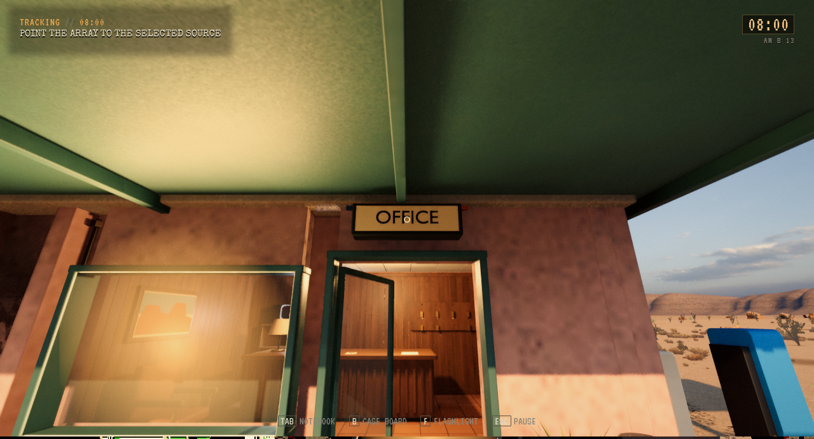
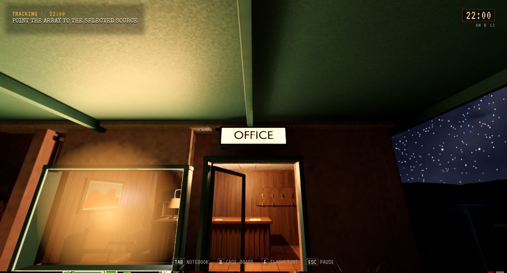
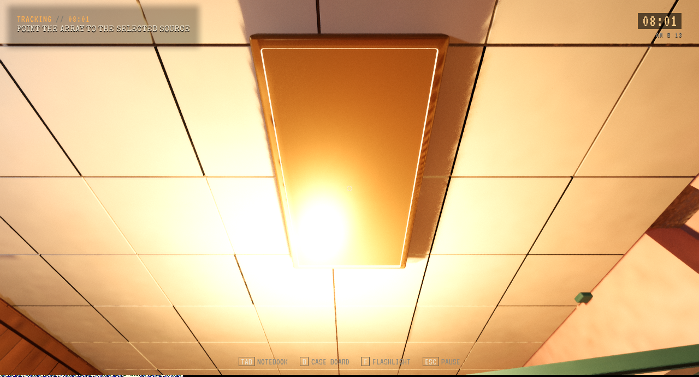
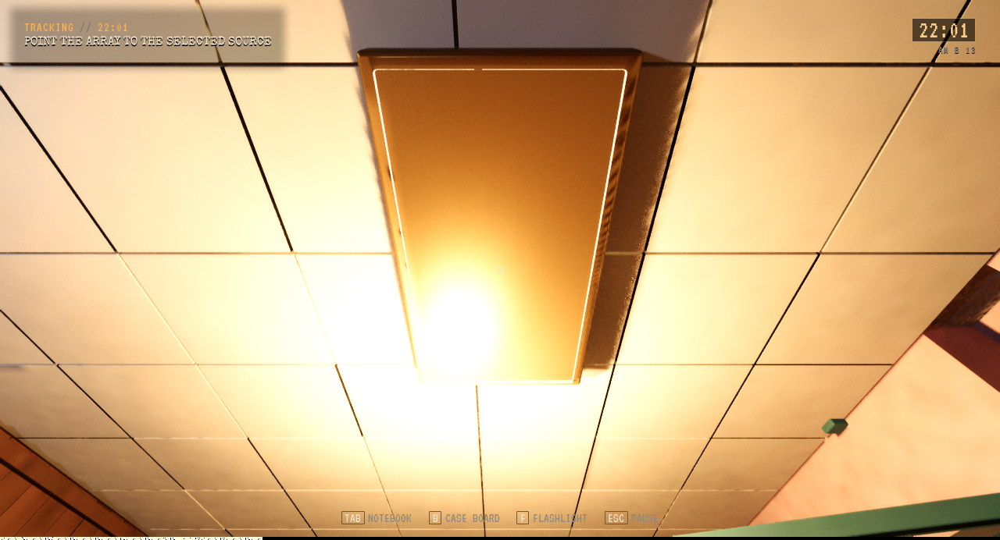
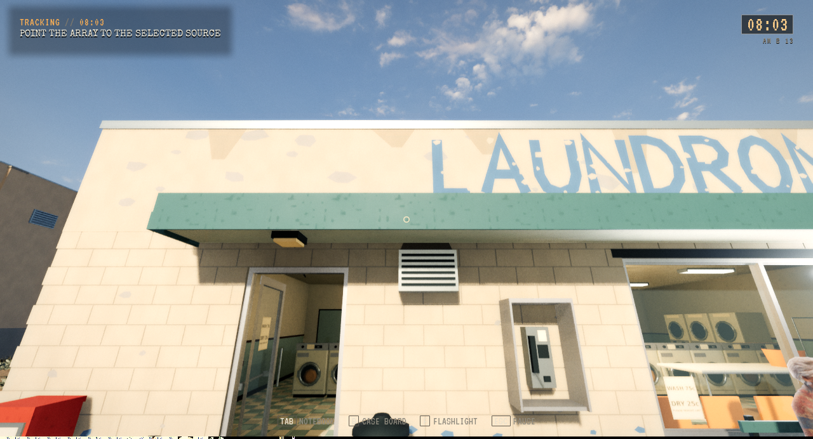
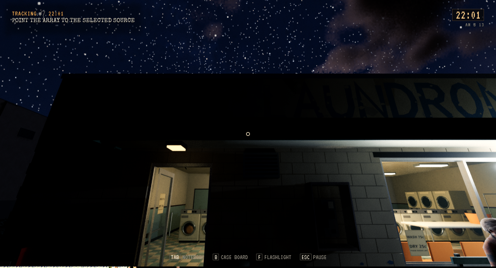
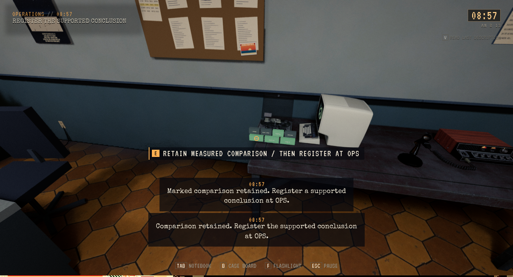
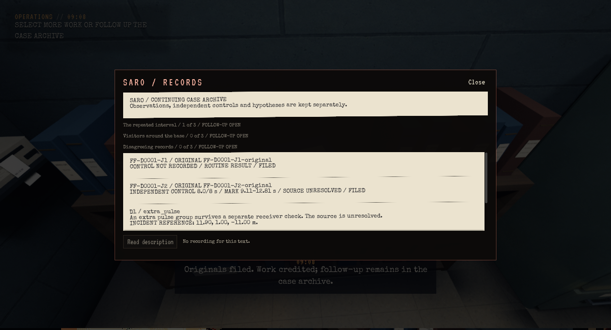
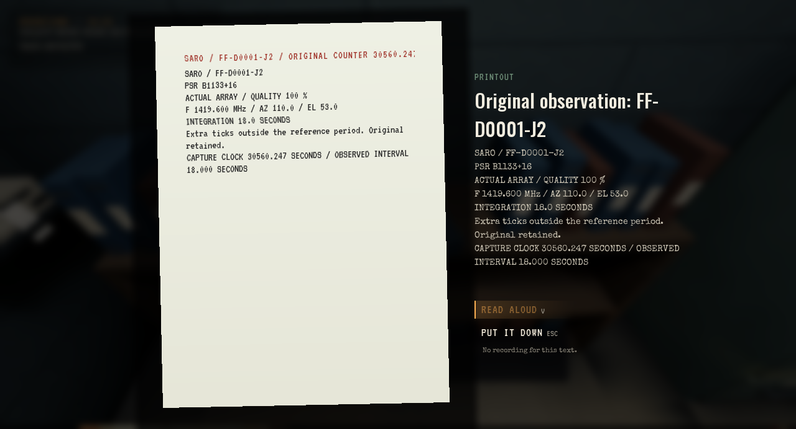

# SARO: komplett arkivreise og presist dagslys

**Status:** Gjeldende leveringsbevis. **Gjelder:** Unreal Linux/Vulkan, runtime `2e1cef62`. **Sist kontrollert:** 2. november 2026 kl. 05:45 CET.

Installert lokalt kl. 05:45. Kilden er flettet gjennom [PR335](https://github.com/Tombonator3000/SIGNAL-47/pull/335) og [PR336](https://github.com/Tombonator3000/SIGNAL-47/pull/336). Ingen offentlig spillrelease.

## Hva som er rettet

Freeform-permen var synlig, men den registrerte Story-handlingen returnerte tom brukstekst. Det hindret faktisk plukking selv med ferdig papirpakke. Aktiv Freeform-tekst har nå samme prioritet som den eksisterende brukshandlingen; Story beholder sin modusvakt.

Den sammenhengende reisen omfatter vanlig 3C 286-referanse med faktisk fempunktskryss, pulsaropptak på 18 sekunder, uavhengig internkontroll på 8 sekunder, fysisk full avspilling, markering og beholdt sammenligning. En sky-opprinnelse avvises; uavklart konklusjon registreres, papir hentes og legges fysisk i Records-permen. Original, kontroll, markering og engangsbetaling overlever ordinær lagring, tittelmeny og Fortsett. Originalarket kan åpnes igjen i notatboken.

Dagsmasken styrer seks eksakte utvendige CalicheAccess-materialspor på de synlige byggene. Den eldre TownBuildings-presentasjonen beholder sine familie-/strømdrivere som reserve. Motell-utelanterner dimmes i dagslys. Ett blandet Office-materiale har et eget klonet materiale: lokal X > 200 cm er bare utvendig lightbox; innvendig takpanel beholder tidligere styring. Ingen mesh, UV, normaler, kollisjon eller LOD er endret. Originalmaterialets kildebytes er uendret; kokt kontroll verifiserer ressursidentitet og viser til denne kildeprøven.

## Utført kontroll

| Kontroll | Resultat |
| --- | --- |
| Editorbygg og shaderkompilering | PASS |
| Utviklerens fulle arkivreise | 93 kontroller, 94,82 m gange, én ordinær Fortsett |
| Pakket helreise | 93 kontroller, 94,79 m gange, 1 ordinær Fortsett |
| Pakket dag/natt |336 kontroller, 6 faktisk gjennomsette kamerabilder |
| Pakkede selvtester |1995 |
| Installert Fortsett og personlig Saved |PASS, 164 elementer uendret |

Måling/lytting/markering/utstyr bruker faktisk produksjonslogikk. UI-knapper og skyvere styres gjennom native Slate, fysiske objekter gjennom øyestråle/OnUse, og turen gjennom Walker/Resolve uten mellomteleport. Hendelsen `extra_pulse` og utsatt konkurrerende første tilfeldigvalg er erklærte scenariofixturer. Ingen målefullføring, lyddekning eller belønning injiseres. Dette beviser én hel arbeidsreise, ikke naturlig hendelsesfrekvens eller menneskelig lytte-/spillaksept.

Lysbildene bruker eksplisitte faste CameraOverride-posisjoner og klokker 08/22, med kontroll av faktisk kamera og synlige etterfølgermodeller. De erstatter ikke naturlig reise eller full Story-regresjon. De pakkede bildene er sluttkontrollen; et tidlig editorbilde av vaskeriet viste fortsatt shaderforberedelse.

## Bilder

| Dag | Natt |
| --- | --- |
|  |  |
|  |  |
|  |  |

[Maskinlesbar oppsummering](SaroEvidenceLight-2026-11-02/summary.json). Private lagringer og hele diagnostiske GameState-filer ligger ikke i Git.

WORLD01s svarte terrengstriper, WORLD04s SARO-veggfeil og motellkontorets bredere visuelle rapport står fortsatt åpne. Denne leveransen inneholder ingen ny veggmodellretting. Ferdige kandidater og forrige payload er satt til neste samlede opprydding; ingen ny arbeidskopi eller full rydderunde er kjørt.
