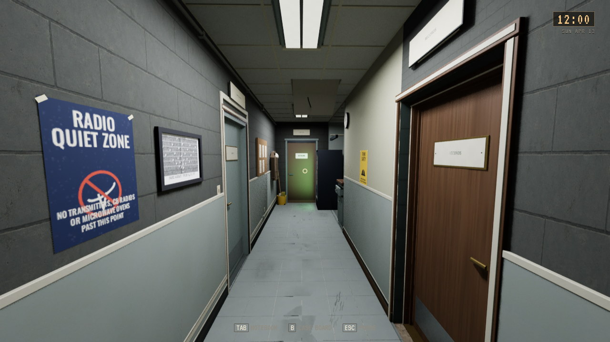
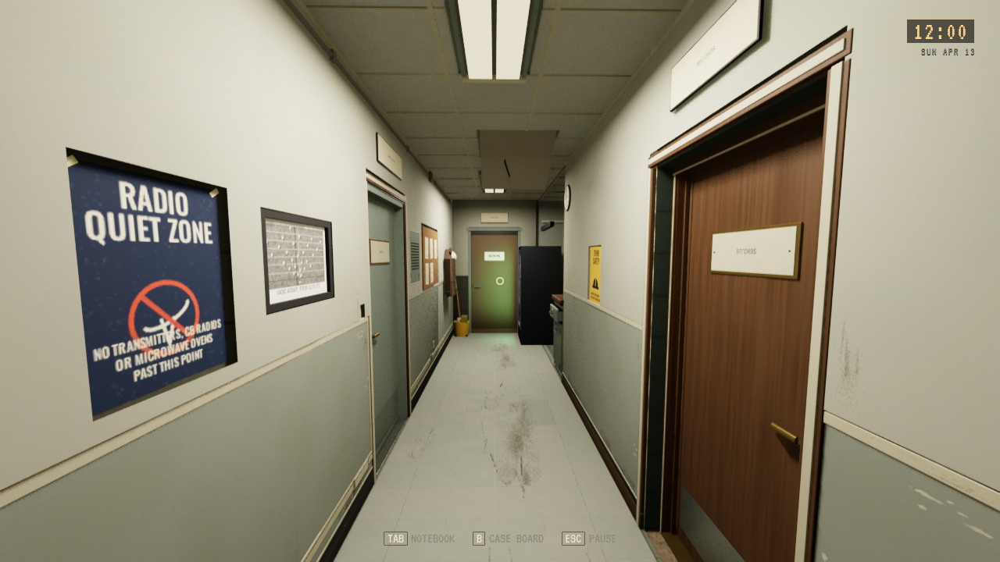
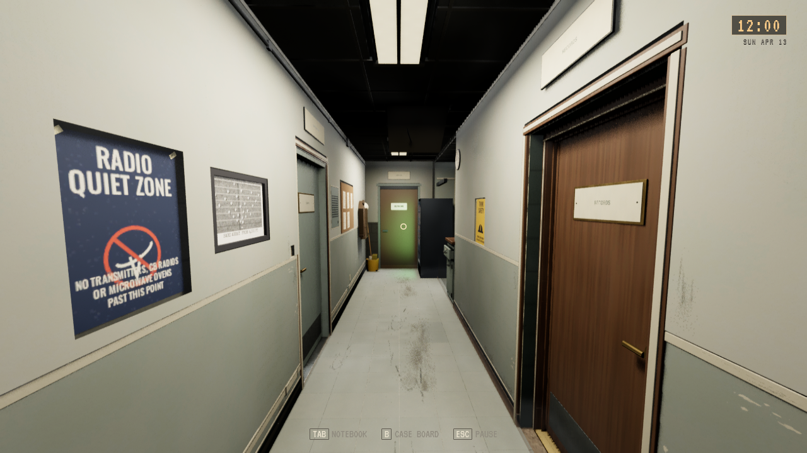
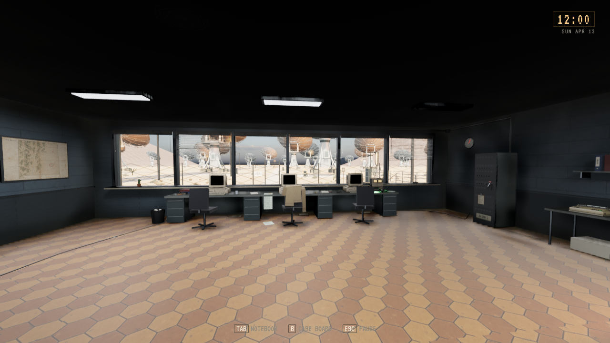
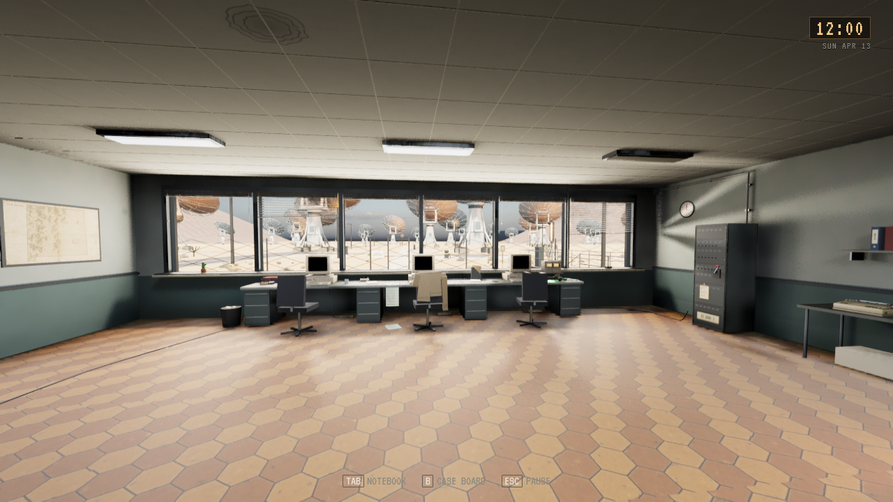
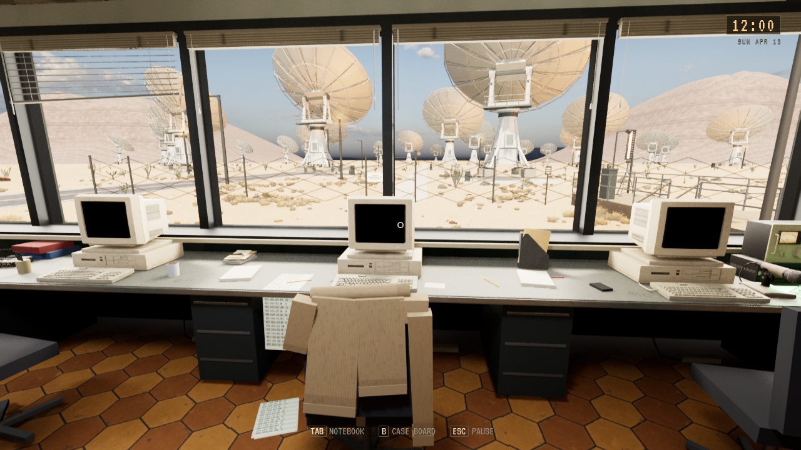
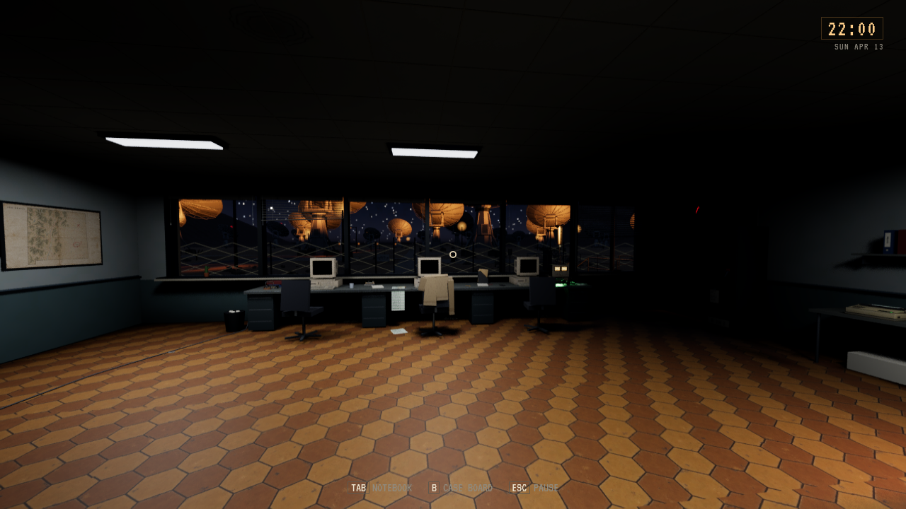

# SARO gang og kontrollrom

**Status:** Installert, visuell godkjenning avventes. **Gjelder:** Linux-kilde `2b9080ce`, PR256/main `153c1039`. **Sist kontrollert:** 30. oktober 2026 kl.17:08.

[PR256](https://github.com/Tombonator3000/SIGNAL-47/pull/256) forbedrer gangen først og kontrollrommet deretter, med godkjent Dales kontor som referanse. Gangen har malte overflater, et roligere gulv, slitasje ved trafikksoner/sokler/dører og veggstøttede servicedetaljer. Kontrollrommet får malte flater, akustikkhimling, seks døgnstyrte vinduslys og 15 dekorative arbeidsrekvisitter. [Kilder og importløype](../../../unreal/Signal47/Tools/sarointeriors/README.md).

De to nye egne meshes har 14268 triangler til sammen. Eksisterende elektriske lys beholder strøm- og flimringsdrivere; svake Low-reflekser slås av med Lumen. Nye flater og rekvisitter har NoCollision. Gangsoner, dører, instrumenter og interaksjonsankre brukes videre. Godkjente Office-kilder/native er byteurørt; alle 14 Tripo-figurer er med.

Editorbygg, faktiske før/etter på Low/High, Linux-pakke, 1740 selvtester, 14-modellkontroll og korte pakkede gang-/nattkontrollromkameraer består. Begge native finishmeshes er faktisk lastet i pakken. [Installasjonen](SARO_GANG_CONTROL_2026-10-30/installation.json) samsvarer med alle 68 payload-noder; alle 134 personlige Saved-noder er bevart. Ingen fullmatrise eller ytelsesmåling. Ingen kjøp, kredittbruk eller offentlig spillrelease.

Tom ba om mer detaljering og slitasje i første gangutkast. Revidert gang og kontrollrom er vist til vurdering; ENV-06/ENV-07 står åpne. Godkjenningen av Dales kontor gjelder fortsatt. Kanonisk opprydding har pensjonert to eldre pakkepayloads; gjeldende kandidat og to eldre komplette bygg beholdes, med kilder, assets, Saved, bilder og logger bevart.

Dagbildene bruker kl.12:00. Gangens før/etter er samme kamera på High. Kontrollrommets før/etter er samme kamera på Low; nærbildet er editor på High. Nattbildet kommer fra pakken kl.22:00 på Low. Gangens siste Low-bilde er faktisk installasjon. Motordiagnostikk er skjult på kamerabildene; statiske kameraer dokumenterer utseende.

