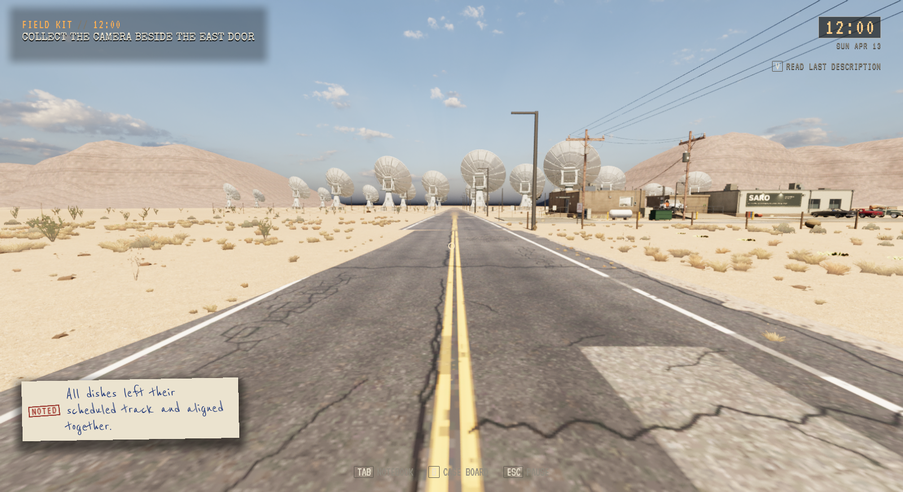
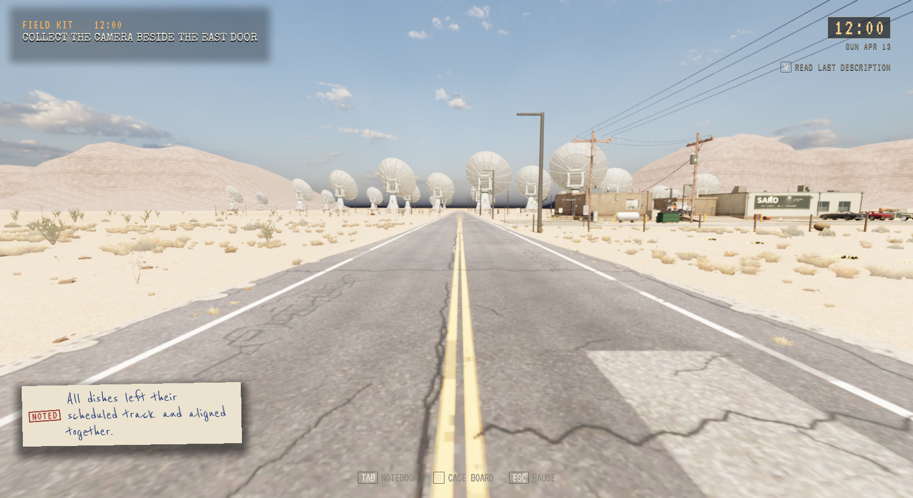
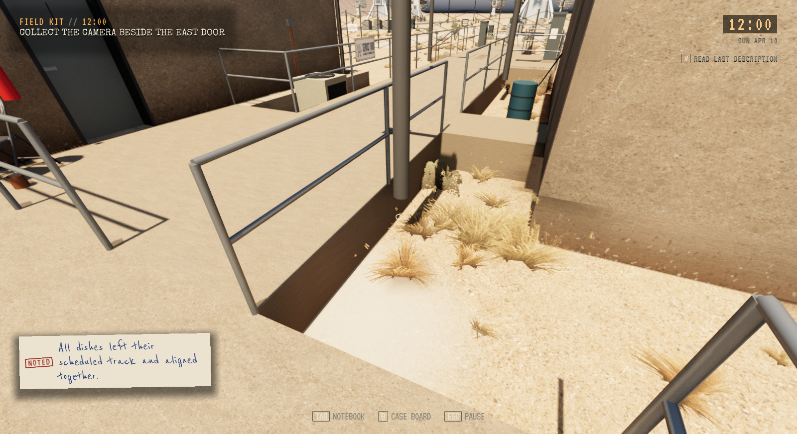
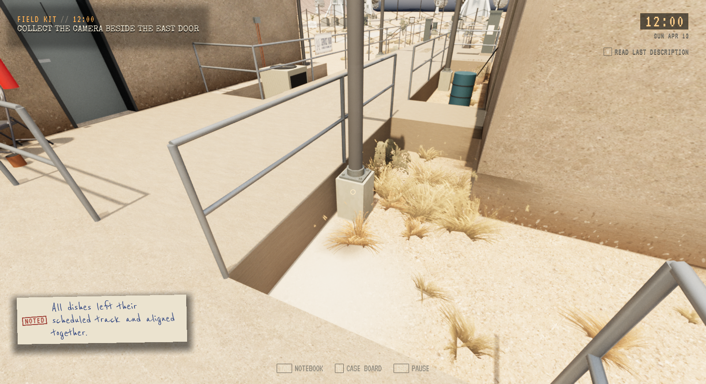
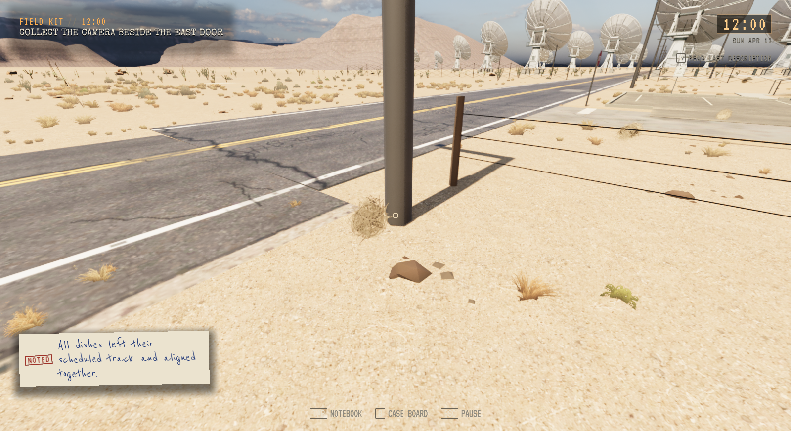
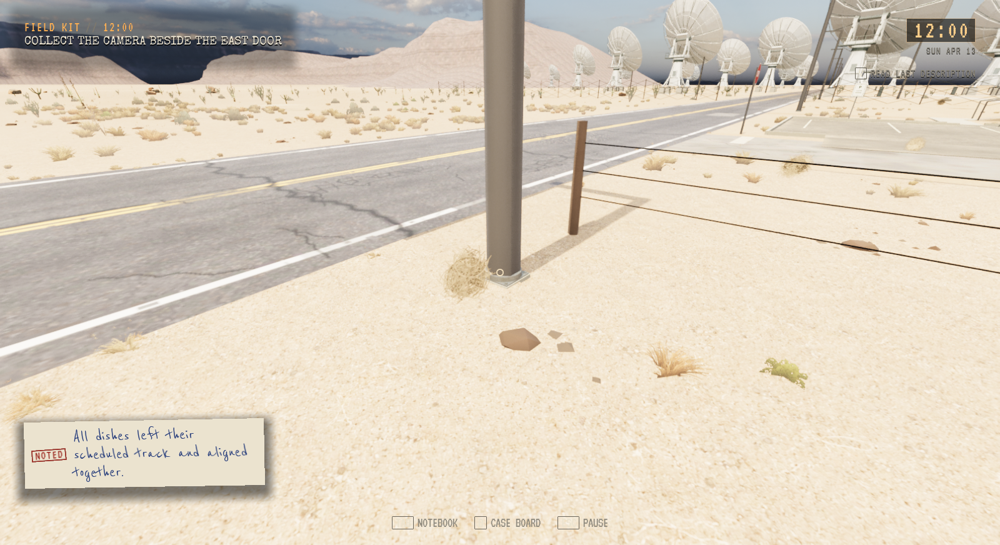
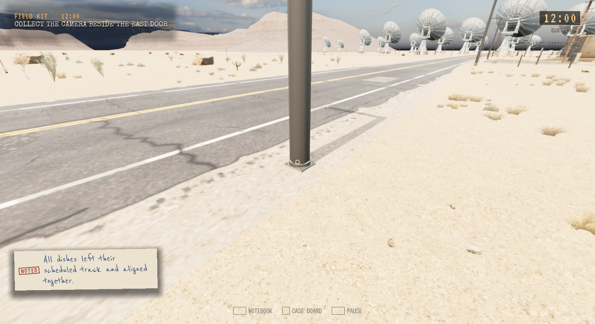
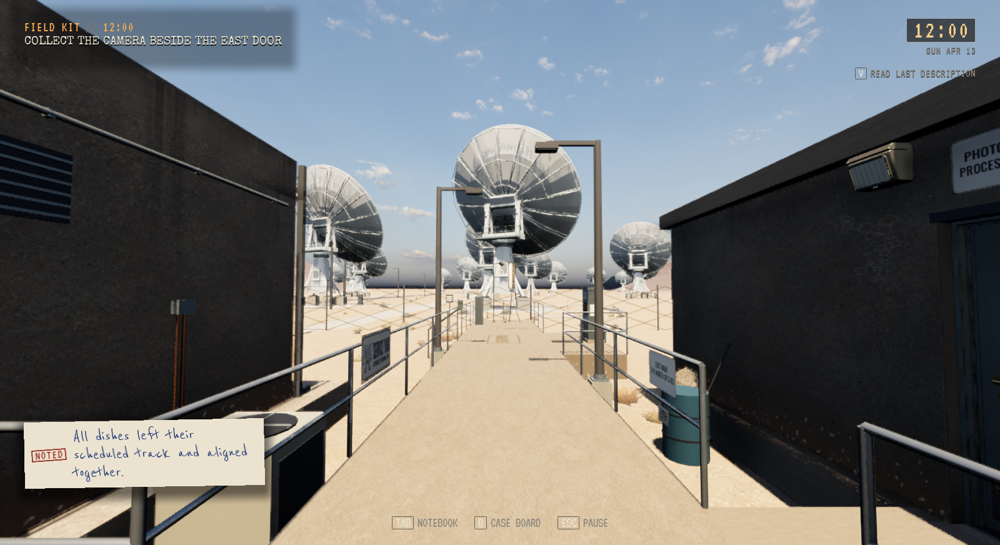

# SARO-veien og elleve lampefundamenter

**Status:** Referanse. **Gjelder:** installert Unreal-kilde `7b81ddd2`, Linux/Vulkan. **Sist kontrollert:** 3. november 2026 kl. 04:55 CET.

Innkjøringen går gradvis fra åtte til tolv meter over 32 meter. Asfalt, veiskulder, fysisk kollisjon og stedlig gulvhøyde bruker samme geometri. Midt- og kantlinjer beholder plasseringen sin. Originale kildemodeller, avkjørsler, transportankre og terrenget utenfor overgangen beholdes. De avledede veimeshene bruker samme ene LOD som originalene.

Tre lamper ved stasjonen og åtte langs SARO-veien har fått betongfundament, fotplate, krage og bolter. Faktiske stolpeender og synlig bakke måles før plassering; stolper, lampehoder og lys-/strømankre flyttes ikke. Totalt 121 instanser deler eksisterende grunnformer og materialer. To materialer har fått nødvendig støtte for instansering, med samme materialgraf.

## Før og etter

Samme kamera, High, ren bildeprofil, kl.12 og 1600×872. Lys-/ruhetsforskjeller i hele rammen er ikke en pikselidentisk sammenligning av været.

## Kontroller

Bygg, pakking, 2147 installerte selvtester og kort installert oppstart består. Alle 126 personlige Saved-filer er uendret. [Installasjon](Saro-Ground-2026-11-03/installed.json).

Native gange krysset hele området fra Z105 til Z26, 79 meter med synlig bakkenett under hvert steg. Største gulvavvik var 2 cm over hele denne ruten, inkludert de urørte områdene utenfor rettingen. Automatisk kjøring krysset skjøten utover på High og tilbake i ferdig Low-pakke. Dette er eksisterende Walker-/kjøreautopilot, ikke menneskelig input eller kjørefølelse. [Resultater](Saro-Ground-2026-11-03/source-verification.json).

Avledede modeller og ny kompleks kollisjon er kontrollert mot faktisk native geometri. Gulvbufferen inneholder 122 vei-/skuldertrekanter og 197 beholdte terrengtrekanter. Definerte normal-/tangentretninger bevares; Unreal fyller bare tidligere udefinert basis i uendrede vegetasjonsflater. Originalfiler er uendret. [Ressurskontroll](Saro-Ground-2026-11-03/asset-prepare.json), [materialflagg](Saro-Ground-2026-11-03/materials.json).

Nær-/mellomavstand og Low-materialer er gjennomsett i ferdig pakke:

## Gjenstående arbeid

PLAY-31-26 står delvis åpent: mer detaljerte armer, lampehus, reflektorer, videre LOD-arbeid og resten av ruten inngår ikke. Nordre motellstolpe stikker allerede 26 mm utenfor asfaltflaten; der trengs en egen fundamentløsning. Ingen motell- eller Caliche-fundamenter er endret. Ingen ytelsesaksept eller menneskelig vurdering av kjørefølelse er påstått.

Forrige lydpakke beholdes for tilbakeføring. Eldre ferdige kandidater kan ryddes ved neste samlede kjøring; ingen ny kopi eller rydderunde. Offentlig nedlasting er ikke oppdatert.
