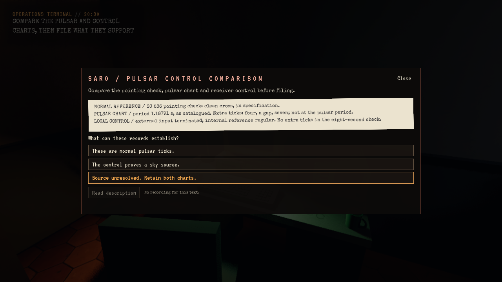

# Første SARO-løkke i Story

**Status:** Referanse. **Gjelder:** Linux/Vulkan-kandidaten fra runtimekilde `e16a9b1f`, lokalt installert 2026-10-31T17:20. **Sist kontrollert:** 31. oktober 2026.

## Levert spillerreise

En ny Story-natt beholder den eksisterende Observing-kvelden. Etter normalreferansen på 3C 286, aggregatprøven og pulsarobservasjonen må spilleren sikre pulsarutskriften, gå til mottakerracket og starte en åtte sekunders kontroll med terminert inngang og intern tidsreferanse. Skriveren gir et eget kontrollark. På operasjonsterminalen sammenlignes normalreferansen, pulsarutskriften og kontrollen før konklusjonen arkiveres.

Feil forklaring gir konkret tilbakemelding og lar begge arkene bli værende. En stille kontroll beviser ikke at avviket kom fra himmelen; den støttede konklusjonen er at kilden fortsatt er uavklart. Neste handling er den eksisterende mappen i arkivrommet og deretter hydrogenobservasjonen. Alt dette foregår på SARO før midnatt. Senere Story-rekkefølge og slutt er beholdt.

Kontrollens fremdrift og sammenligning lagres med saken. Dokumentlesing pauser en pågående kontroll. Eldre saker uten den nye løkketilstanden er unntatt, slik at allerede gjennomført arbeid ikke får et nytt tilbakevirkende krav. Start en **ny natt** for å prøve hele den nye løkken.

## Kontroll og installasjon

- Editorbygg og Linux BuildCookRun består; ingen rapportert materialkompileringsfallback i pakken.
- Editor og pakket Vulkan-kjøring består den målrettede SAROLoop-prøven med **75 kontroller**, **4 virkelige disk-/Flow-gjenopprettinger** og ca. **51,1 m** skriptstyrt gange. Vanlige instrumentinnstillinger, siktede interaksjoner, printer/rack/terminal, feil svar, avbrudd og korrekt svar er prøvd. Første feilvalg og riktig konklusjon aktiveres med fokusert Slate Enter/Tab; egen avvisning av himmelbevis bruker produksjonscallbacken.
- Pakkens **1786 selvtester** består, inkludert lagring og eldre Observing-saker.
- Den prøvde pakken erstattet standardinstallasjonen i `~/Games/Signal47/Linux`. Installert startfil og **Fortsett** består en kort Vulkan-røyktest med isolert kopi av den personlige saken. Original Saved er kontrollert uendret før/etter; forrige payload og en separat Saved-kopi er bevart lokalt.
- Etter levering er fire eldre pakkepayload pensjonert med prosjektets prune-verktøy. Gjeldende SARO-kandidat, forrige installasjon og Roswell-kandidaten beholdes, i tillegg til vanlig installert spill. Saved, bilder, logger og kilder er bevart. Egne tunge jobber og reservasjonen er avsluttet.

Lokale kjørelogger, kandidat, testprofiler og installasjonskontroll ligger under `~/scratch-bm/Signal47-saro-loop-20261031/`. Dette er skriptstyrte, avgrensede prøver. Menneskelig lytting/input, full natt, samlet historieaksept, Xbox og de åpne render-/SC04-spillerfeilene er ikke lukket av disse resultatene. Fortsett-bildet ved 04:29 viser også et varsel om residentminne for raytracing-geometri; det er ikke diagnostisert eller rettet her. Ingen offentlig spillrelease er publisert.

## Videre arbeid

[Modusplanen](../../Design/Story/SARO_STORY_FREEFORM.md) og [TODO](../../Active/TODO.md#story-og-freeform) fører senere separat Freeform med døgn, vedvarende arbeid og tilfeldige hendelser. Freeform er ikke implementert i denne leveransen. VotV er brukt som gameplayreferanse; ingen dekompilerte filer eller assets fra det spillet er lagt i SIGNAL / 47.
