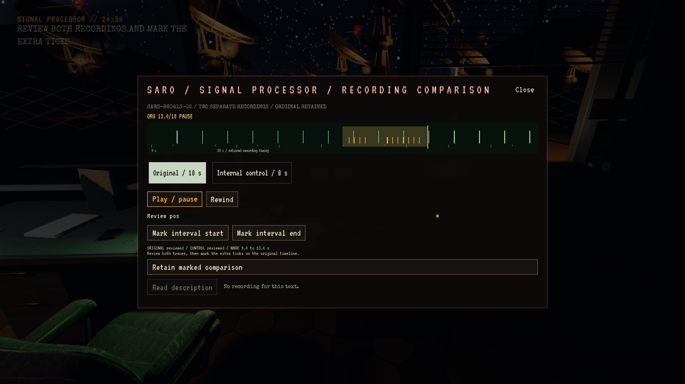

# Aktive SARO-arbeidsstasjoner og antenneservice

**Status:** Referanse. **Gjelder:** Linux/Vulkan-kandidaten fra runtimekilde `3e723bba`, lokalt installert kl.18:56 CET. **Sist kontrollert:** 31. oktober 2026.

## Levert spillerreise

En ny Story-natt bruker høyre PC til kilderetning og venstre PC til antennestatus og kommandologg. Alle 27 synlige antenner beveger seg mot de valgte vinklene; mottakeren venter til faktisk retning har vært stabil i ett sekund. Normalreferansen inkluderer en fempunktsmåling. Mottakerinnstillingene overstyrer ikke tracking-PC-ens høydevinkel.

Etter aggregatprøven må S-03 diagnostiseres på venstre PC. Ved det eksisterende serviceskapet ute isoleres fjernstyringen, luka åpnes, den løse kommandokontakten festes og luka lukkes. En lokal femgraders bevegelse og retur bekrefter reparasjonen før fjernstyring gjenopprettes. Luka beholder ferdig tilstand når senere Story tar over.

Lydutstyret ved telefonen sammenligner det 18 sekunders originalopptaket med en separat åtte sekunders internkontroll. Begge må avspilles; flytting av markøren gir ikke avspillingskreditt. Spilleren markerer avviket, registrerer den støttede vurderingen på operasjonsterminalen og henter den merkede papirpakken fra skriveren før fysisk arkivering i arkivrommet. Telexordre, original, kontroll, registrering og papirpakke deler referansen `SARO-860413-02`.

Lagring bevarer antenneretning, reparasjonstrinn, avspilling, markører og papirpakke. Dokumenter og pausemeny stopper antennearbeidet; status- og trackingpaneler viser levende tilbakemelding. Eldre saker får ikke nye tilbakevirkende plikter. Start en **ny natt** for hele reisen. Ny Freeform-modus og bygget ved SARO-skiltet står fortsatt som senere arbeid i [TODO](../../Active/TODO.md#story-og-freeform).

## Kontroll og installasjon

Editorbygget, Linux-pakken og begge målrettede Vulkan-prøver består med **163 kontroller**, **9 disk-/Flow-gjenopprettinger**, omtrent **160,8 m** skriptstyrt gange og **1819 selvtester**. Prøven kontrollerer faktiske native antennetransformasjoner, alle fem målepunkter, fysisk serviceskap, opptak, avbrudd, feil vurdering, merket pakke og fysisk arkiv. Den ender ved neste hydrogenobservasjon.

Den prøvde pakken er installert i `~/Games/Signal47/Linux` kl.18:56 CET og inkluderer Roswell-arbeidet fra main/PR291. Installert startfil og Fortsett består på Vulkan med isolert kopi av saken ved 04:29. Alle **152 personlige Saved-elementer** er kontrollert uendret. Forrige payload og separat Saved-kopi er bevart lokalt. Bildet viser fortsatt det kjente varselet om residentminne for raytracing-geometri; dette er ikke diagnostisert eller rettet her.

Tre eldre pakkepayload er pensjonert med prosjektets prune-verktøy. Gjeldende kandidat, forrige installasjon og Roswell-kandidaten beholdes, i tillegg til standardinstallasjonen. Kilder, Saved, logger og bilder er bevart. Egne tunge jobber er avsluttet og reservasjonen frigitt.

[Antennestatus](SAROWorkstations-2026-10-31/status.png), [åpen serviceluke](SAROWorkstations-2026-10-31/service.png) og [registrert papirpakke](SAROWorkstations-2026-10-31/packet.png) er originale bilder fra den pakkede prøven. De lokale klippene `array-window-run1.mp4` og `array-field-service.mp4` er kodet fra pakkens bildeserier ved åtte bilder per sekund; de er korte visuelle utsnitt, ikke ytelsesmålinger.

Prøven bruker vanlige instrumentinnstillinger, siktede interaksjoner og Walker-ruter. Trackingkommando og sammenligningssvar aktiveres gjennom fokusert Slate Enter/Tab; antennevalg og lydtransport bruker navngitte produksjonscallbacker etter fysisk åpning av enheten. Bildeseriene viser faktisk editor- og pakkeruntime. Dette er ikke menneskelig input/lytting, full natt, senere historieaksept, Xbox eller Freeform. Åpne render-/SC04-spillerfunn er ikke lukket av denne prøven. Ingen offentlig spillrelease er publisert.

Lokale logger, testprofiler, sekvenser og kandidat ligger under `~/scratch-bm/Signal47-saro-workstations-20261031/`. [Design og avgrensning](../../Design/Story/SARO_STORY_FREEFORM.md#aktive-arbeidsstasjoner-og-antenneservice).
