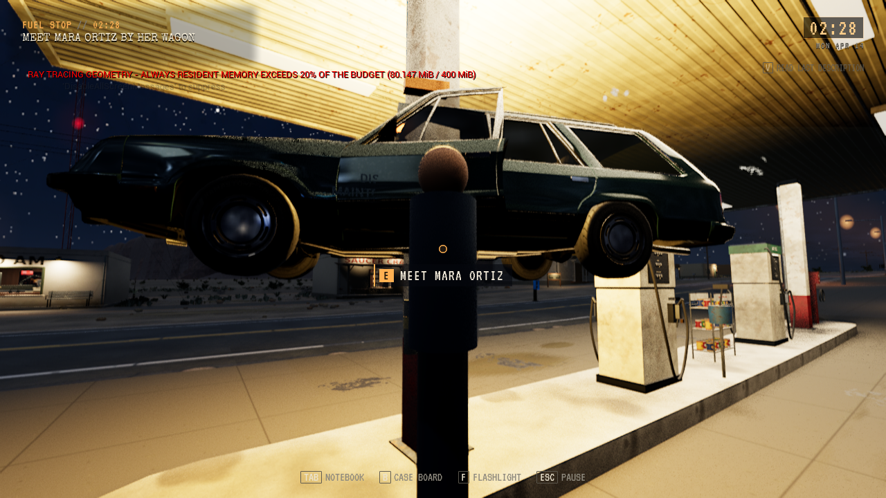
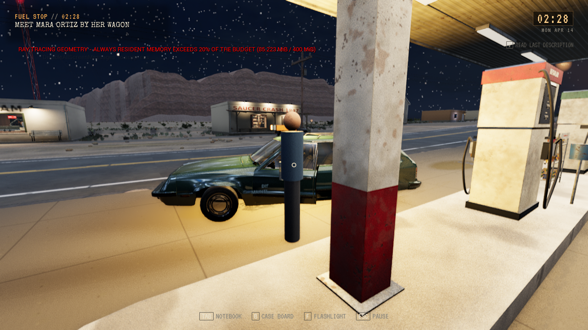

# SC03: vogn 23 på fri bakke

**Status:** Under arbeid. Målrettet geometri og bilde består; vanlig nattreise prøves videre. **Gjelder:** R16 fra `cbe52f54`, focused R3, modul `e2125156`. **Sist kontrollert:** 30. oktober 2026.

Vognens gamle parkeringspunkt lå inne i sørstolpen under bensinstasjonstaket. Bakkestrålen traff den røde stolpebasen på5,397m, og biltransformen la på ytterligere0,50m. Betongen under lå på4,518m. Dette forklarer svevingen i R7s faktiske runtime-bilde før Ortiz ble løftet.

Den komplette parkeringsrammen flyttes2,95m til siden. Innkjøring, Ortiz, spor, termos og øvrige Park-følgere bruker samme nye ramme. Karosseri og dør bruker modellens basepivot; lysbar, skilt og amberlys beholder høyden relativt karosseriet. Original Fairheaven-modell, teksturer, native uasset og kreditering er uendret.

Ground venter på et faktisk vist, registrert og mappet underlag. Ukjente og synlige sperrer kan ikke hoppes over. Unreal-kilden viser at synlighet er lokal for komponenten; en skjult hjelpeboks som feste skjuler ikke automatisk den synlige bilmeshen. Både faktisk renderkomponent og scenens metadata kontrolleres.

Focused R3 bruker den uendrede, faktiske mid-arrival-filen fra NightR9, SHA1 `51308480037DF7A8AF9348531C2A6E2798636DFE`, i en isolert utviklerprofil med eksisterende residual-start og fersk diskleser/full Flow-restore. Den endrer ingen kilderevisjon, feltfakta eller klokke for å få riktig scene. Alle SC02-/SC03-/T01-fakta og de komplette dokumentene kontrolleres etter innlasting. Dette er en avgrenset måleprøve og ingen ny SC03-forelder.

| Kontroll | Faktisk resultat |
| --- | --- |
| Editor R16 | PASS12,198s. Modul og638fryste inputfiler bevart. |
| Focused R3 | PASS49,062s,8kontroller, ett disk/Flow-forløp og16,361m native gange. |
| Native pivot | Park[7992,547;4,284453;2050,170], uten ekstra halvmeter. |
| Fire dekkpunkter | Kildeavledede dekkminima med faktisk native komponenttransform. World- og direkte komponentstråler treffer vist g1004. Avvik−1,208 til+1,035cm, grense±1,5cm. Dette er ikke dynamisk hjulfysikk eller renderbufferavlesning. |
| Bilklaring | Hele horisontale bilboksen med10cm margin,681 prøver med5cm mellomrom og251289 sammenligninger mot faktiske runtime-kollidere. Ingen overlapp. Ingen kontinuerlig3D-meshsweep eller renderet innkjøringsaksept hevdes. |
| Bilde | Fullført native PNG før identifikasjon og Ortiz-løft, åpnet av Codex. Bakkekontakt og fri stolpe godkjent. Menneskelig aksept, subjektiv figurkunst og FPS er ikke målt. |

[Portabel kvittering](../../../unreal/Evidence/SC03-2026-10-30/grounding-r3.json) binder kilde, modul, faktisk kildefil, native mål og bilder. Alle råfiler og tidligere avslag er bevart. R12/R13 hadde en lokal shadowing-feil; R14 bygde. Focused R1 avviste hjelpeboksens synlighetsantakelse. R15/focused R2 består geometri, men en gammel gangrute treffer pumpesokkelen. R16 gjenbruker den eksisterende ruteplanleggeren med alle faktiske kollidere og native Walkable, uten rettlinjet reserve eller Place.

Før og etter har forskjellige kameraer og ståsteder:

Etterbildet har fortsatt ray-tracing-varselet om85,223MiB alltid resident geometri mot400MiB og20%-grensen. Ingen løsning på dette varselet eller ytelsesgevinst hevdes.

Vanlig E-retur til SARO er rettet separat i kilde og inngår i NightR10 fra ny sak. Den fulle SC04 til SC13-kjeden, finale-RHI, pakking og eventuell installasjon er fortsatt ikke akseptert. Se [nattkjederapporten](NIGHT_CHAIN_2026-10-30.md).
