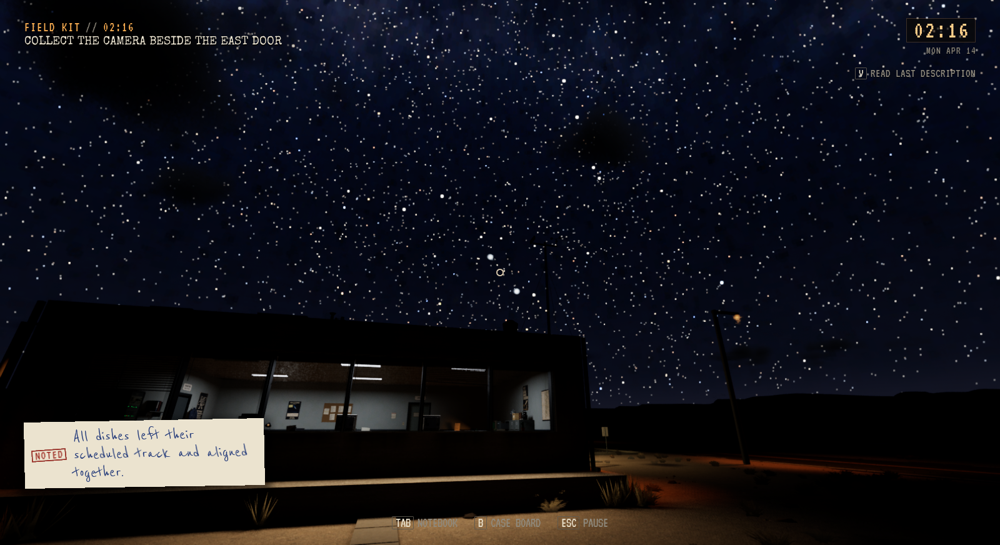
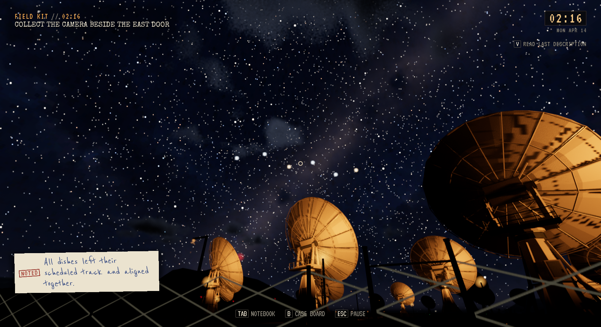
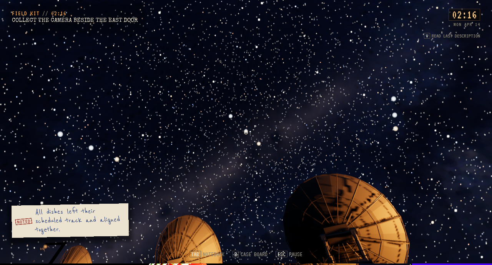
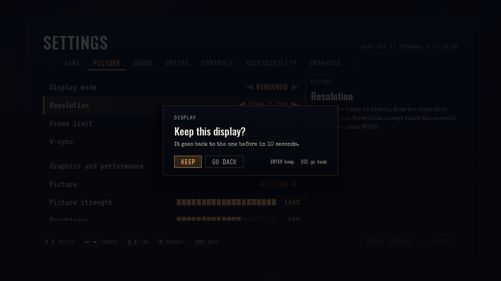
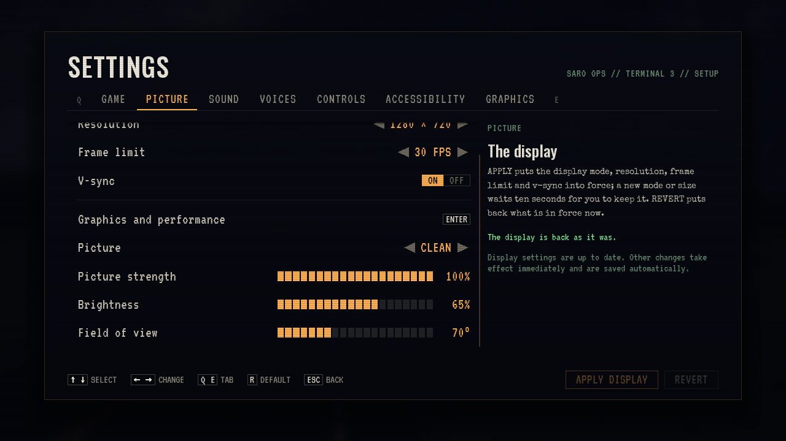
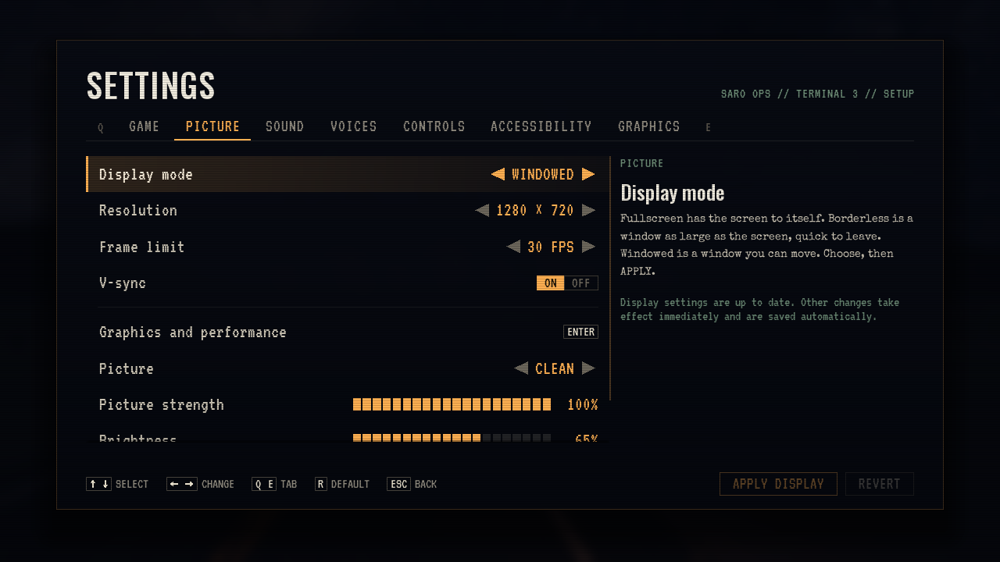

# Himmellys og lagrede skjermvalg, 3. november 2026

**Status:** Gjeldende leveringsbevis. **Gjelder:** kilde `8e56365b`, Linux/Vulkan UE 5.8.4. **Sist kontrollert:** 3. november 2026.

Senere himmellys har større synlig vinkelstørrelse: trinn 2–5 bruker 10/11/12/14 piksler ved 900p, skalert med faktisk bildehøyde. Trinn 1 beholder 6,4 piksler. Glød, naturlige baner, varighet, siktkrav og lagret progresjon beholdes. F10-forhåndsvisning har egen midlertidig tilstand; samme eller tidligere trinn kan startes igjen uten å gi naturlig observasjonskreditt.

Begge trinn 2-bilder er 1600×872 fra samme stående SARO-posisjon. Trinn 3/4 er kontrollert på High og trinn 5 på Low. Opptakene bruker eksplisitte trinn-/kamerafixtures, ikke en full naturlig natt. Naturlig tilstandslogikk og selvtester er beholdt; preview-prøven bekrefter gjentakelse, bytte bakover, menypause, stopp og uendrede lagrede observasjoner/notater.

## Skjermvalg

Den nye prøven fant at Linux/Wayland-vinduet ved omstart gikk fra ønsket 1280×720 til 1280×692, som motoren deretter bekreftet tilbake til GameUserSettings. Oppstarten bevarer nå lagret klientstørrelse før motorinitialisering og bruker den én gang i den forberedte oppstartsfasen, etter at viewporten og den første vinduskonfigurasjonen er tilgjengelige. Eksplisitte startvalg og størrelser utenfor skjermens arbeidsområde respekteres. Ingen hardkodet 28-pikselkompensasjon eller endring av grafikkvalgene.

Pakket kontroll bruker faktisk Slate-museklikk på APPLY DISPLAY, tastaturvalg og gamepad-A som Slate-tastehendelse. Den sammenligner synlig valg med viewport, vinduets klientområde, GameUserSettings, t.MaxFPS/r.VSync og fysisk INI. Før Apply er valgene bare ventende; Keep beholder dem, og ekte ti sekunders tidsavbrudd ruller oppløsningen tilbake. Ny spillprosess har ingen oppløsningsflagg. Tilpasset grafikk, Picture og lysstyrke beholdes.

Det andre Apply-forsøket endrer oppløsning; prøven viser at FPS/VSync beholdes gjennom rollback, ikke retur fra et annet midlertidig FPS/VSync-valg. Eksklusiv fullskjerm, fysisk kontrollertilkopling, monitorens faktiske VSync-timing og menneskelig inputvurdering er ikke attestert.

## Levering

Installert kl. 02:17 CET fra `8e56365b`. Editorbygg og pakking består; etter den rene C++-oppstartsrettelsen er game-målet bygget på nytt og binær/debug/sym lagt i samme uendrede kokte pakke. Pakket display-write/read består 89/19 kontroller. Installert oppstart og 2130 selvtester består. Alle 126 personlige Saved-filer er uendret.

[Skjermresultat](Sky-Display-2026-11-03/display-summary.json), [pakkens kodeoppdatering](Sky-Display-2026-11-03/package-code-update.json), [installasjon](Sky-Display-2026-11-03/installation.json). CRT-pakken beholdes for tilbakeføring. Kandidat/cache beholdes; erstattede ferdige pakker vurderes ved neste samlede rydding.

Bilder av himmelen er fra `45e4b6d2` før den etterfølgende oppstartsrettelsen; [opptaksmetadata](Sky-Display-2026-11-03/captures.json). Prosjektbiblioteksøk ga ingen kompatibel ferdigløsning; eksisterende UE-vindusflyt og eget glow-materiale er brukt. Ingen offentlig spillutgave.
