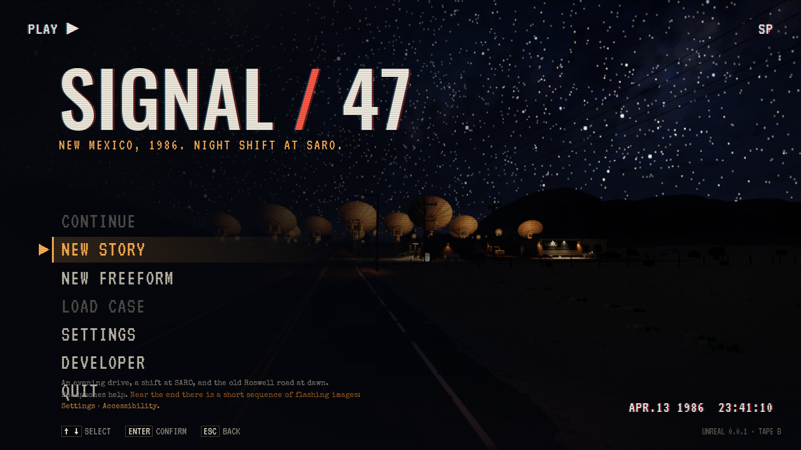
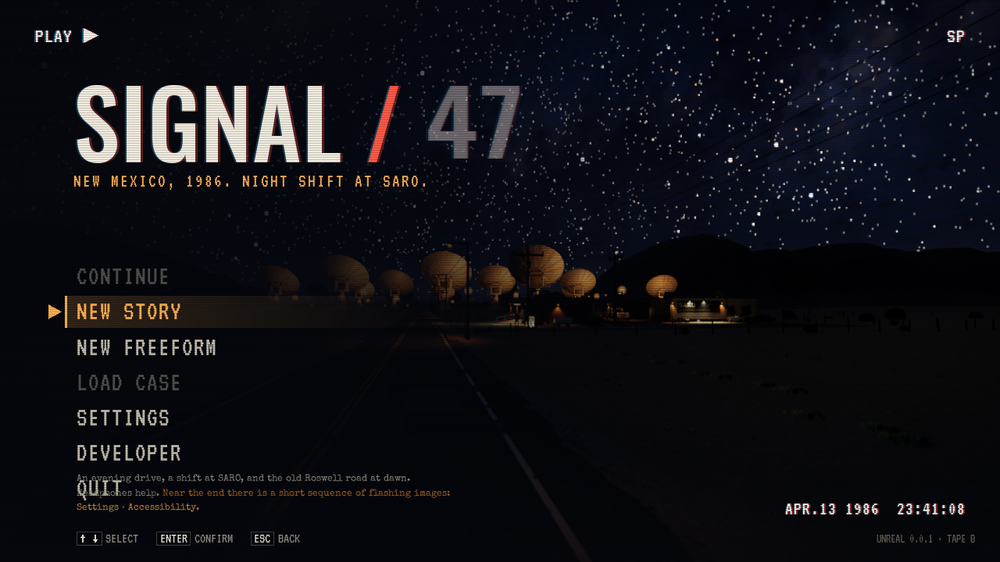
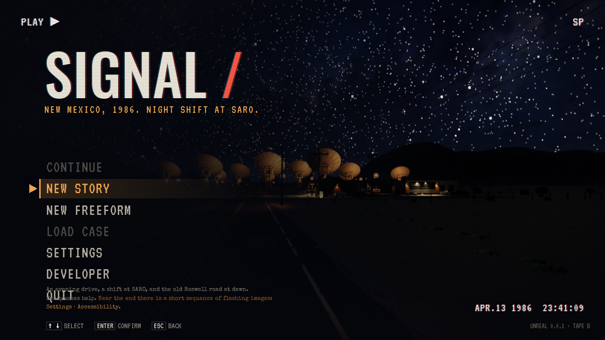

# Tittelens «47» etter fullført Story

**Status:** Gjeldende. **Gjelder:** PR312, samordnet pakke med PR311. **Sist kontrollert:** 1. november 2026.

## Levert kilde og spilleratferd

[PR312](https://github.com/Tombonator3000/SIGNAL-47/pull/312), head `94aaff74`, er flettet i main `b98c6fe1`. Etter siste fotografi i Story-finalen registreres fullføring. Neste tittelskjerm lar bare «47» miste signalet gjennom lokal forskyvning/flimring og en egen lav elektrisk SFX før tallet blir borte. SIGNAL, skråstreken og menyplasseringene beholdes. Rolig modus gir en myk uttoning og mildere lyd.

Profilfilen `Saved/SaveGames/story-completion.json` bevarer fullføring og avspilt effekt separat fra de roterende sakene. Ny sak eller sletting av en sak opphever ikke belønningen. Freeform, utviklerfinale og bare å nå siste kapittel låser den ikke opp. Ingen personlige profiler forhåndslåses opp ved installasjon. Ukjent framtidig profilversjon beholdes urørt.

Effekten venter på en synlig, aktiv meny. Tiden beholdes ved et menyavbrudd, egen lyd stoppes når spilleren går videre, og den starter ikke på nytt ved gjentatte menykall. Eksisterende SFX-/mastervolum styrer lyden.

## Kontrollgrunnlag

Editorbygg og 1 950 selvtester består på grunnlaget før PR311. Én målrettet native Vulkan-prøve består 11 kontroller: fersk tittel, registrert finale, Freeform-/utvikler-/ufullført-avslag, fullføringsregistrering, én synkronisert lyd, varig fravær, ny lagringsleser og menybesøk uten replay samt rendret lydprøve. [Kjøringsresultat](TitleErasure-2026-11-01/editor-result.json).

Prøven bruker en uttrykkelig sluttfixture og syntetisk Slate-aktivering fordi Wayland ikke automatisk fokuserer den ubetjente forhåndsvisningen. Produksjonens slutthook og aktive-vindu-vakt er bevart. Dette er ingen menneskelig full gjennomspilling eller lytting. Selvtesten kontrollerer også originallydens nivå, ender i stillhet, stopp, duplikatvern og faktisk SFX-demping.

[Original lydprøve, normal fulgt av rolig variant](TitleErasure-2026-11-01/title-sound.wav).

Den samlede Linux-pakken fra `b98c6fe1` består 1 957 selvtester og alle 11 tittelsjekker i synlig High/Vulkan-vindu. [Pakket resultat](TitleErasure-2026-11-01/packaged-result.json), [før](TitleErasure-2026-11-01/packaged-before.png), [under](TitleErasure-2026-11-01/packaged-glitch.png), [etter](TitleErasure-2026-11-01/packaged-after.png) og [lyd](TitleErasure-2026-11-01/packaged-title-sound.wav) gjelder den faktisk pakkede runtime. Samme slutt-/aktiveringsfixture er brukt. Samlet runtime `b98c6fe1` er installert kl. 16:35 CET. Den korte installerte Fortsett-prøven består på isolert kopi; alle 149 personlige Saved-elementer er uendret. [Installasjonsresultat](TitleErasure-2026-11-01/installed.json). Tittelbelønningen er ikke forhåndsaktivert i den personlige profilen. Ingen offentlig spillrelease.

## Arbeidskopier og disk

32 ferdige arbeidskopier er avviklet med normal Git-rutine etter sikring av upubliserte commits, indeks-/mergegrunnlag, faktiske endrede filer, private kilder og Saved i lokale gjenopprettbare arkiver. Hovedkopien og de to aktive oppdragene ble beholdt, totalt 3. Målt fysisk reserve etterpå var 190,6 GB; summert logisk filstørrelse i Btrfs-arkivene er ikke det samme som frigjort diskplass. Ingen arkivreferanser eller private råassets er publisert.
