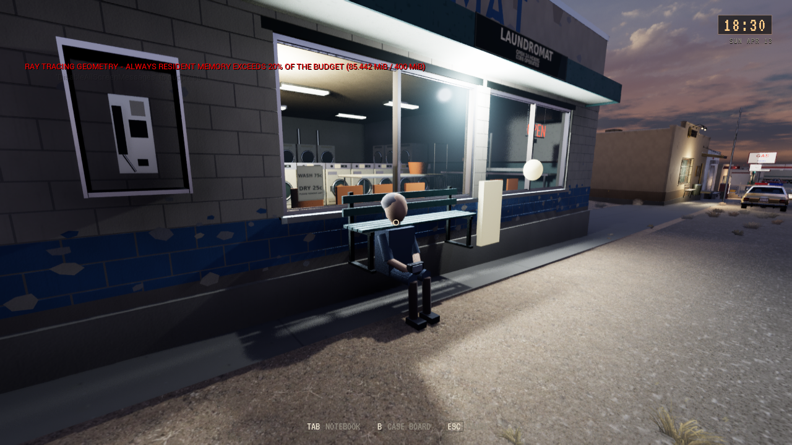
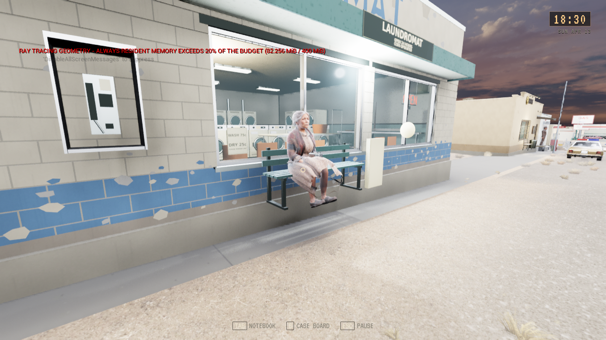
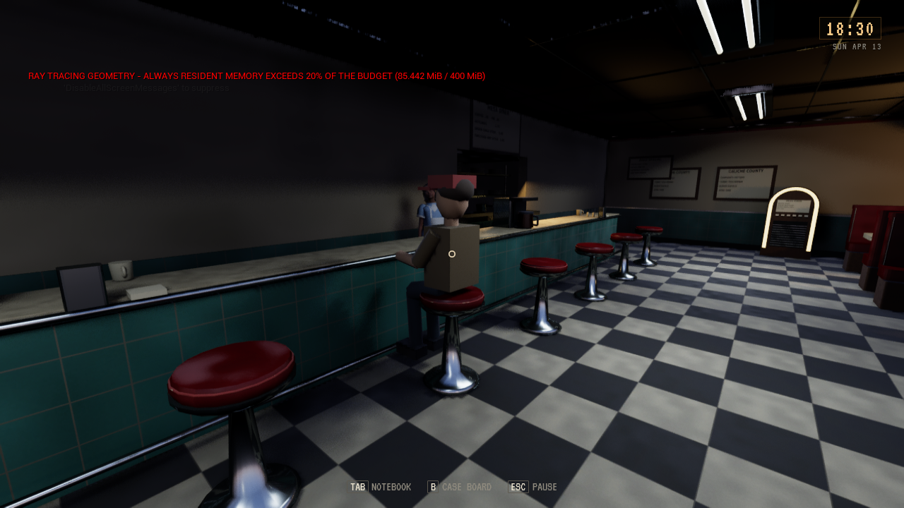
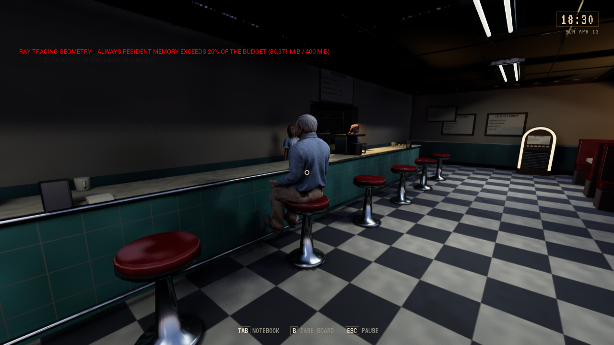

# Tripo-figurene som statiske mannekenger

**Status:** Levert og installert lokalt. **Gjelder:** kilde `8a512269`, PR247/main `81736f2a`, UE5.8.4/Linux. **Sist kontrollert:** 30. oktober 2026 kl.13:28.

Alle 14 aktive Tripo-figurer er importert med teksturer og tre LOD-er og inngår i det installerte spillet. Nora, radio-kvinnen og diner-patronen har bakte sittepositurer. Øvrige mennesker står med senkede armer. Originalriggene og FBX-eksportene er bevart privat for senere animasjon. Ingen penger eller Tripo-kreditter er brukt på denne importen.

Elleve plasseringer følger eksisterende rolleankre direkte. Mara, Tall One og Crawler bindes når SC03 oppretter de ordinære sceneankrene. Dagens tilstedeværelse, dialogproxyer og hendelser beholdes. MetaHuman-servitrisen fortsetter ved disken; Tripo-servitrisen er en reserve i staffgangen. Dale er en dekorativ mannekeng ved kontordøren uten ny dialog. [Full rolleoversikt og importløype](../../../unreal/Signal47/Tools/triponpcs/README.md).

Editorbygg, kontroll av alle 14 faktiske native modeller/materialer/størrelser, Linux-pakking, 1735 selvtester og kort pakket diner-smoke består. Installert modellkontroll og kveldskamera består også. Alle 68 payload-noder samsvarer med kandidaten og alle 134 personlige Saved-noder er bevart. Kontrollen gjelder import og statisk visning; senere animasjon gjenstår. Ingen fullmatrise eller ny offentlig spillrelease.

En parallell act1-2-installasjon erstattet først pakken. Etter at dens kontroll var ferdig, ble Tripo-kandidaten installert igjen kl.13:28 og kontrollert mot kandidaten. Den bygger på samme PR246-grunnlag med Tripo-endringene i tillegg. Nativefilene er også speilet privat til hovedprosjektets `Content/Licensed/TripoNPC`. Kanonisk opprydding er utført. Gjeldende kandidat og to eldre komplette bygg er beholdt, sammen med kilder, assets, Saved og bilder.

Faste kameraer, Low, kl.18:30. Førbildene bruker `S47TripoNpcsOff`. Radio-kvinnens etterbilde kommer fra det installerte spillet; patronens etterbilde kommer fra editorkandidaten og er også kontrollert i den pakkede diner-visningen.

