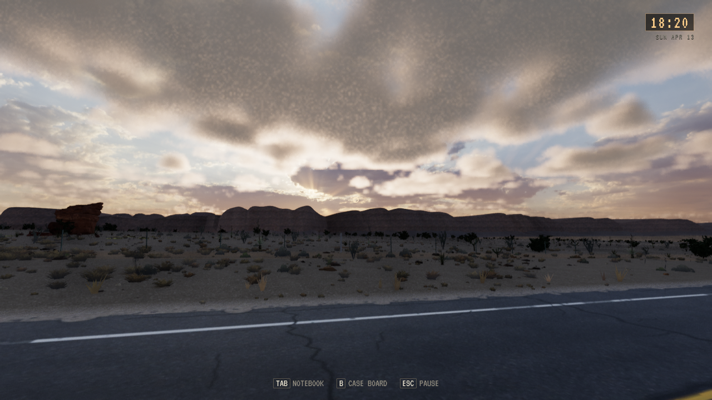
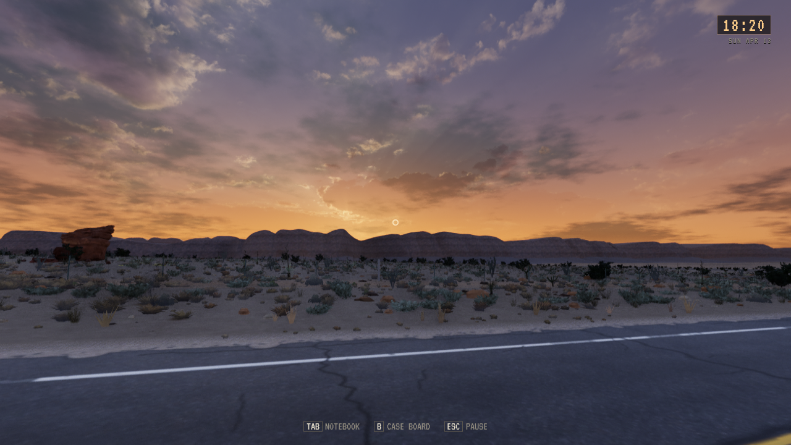
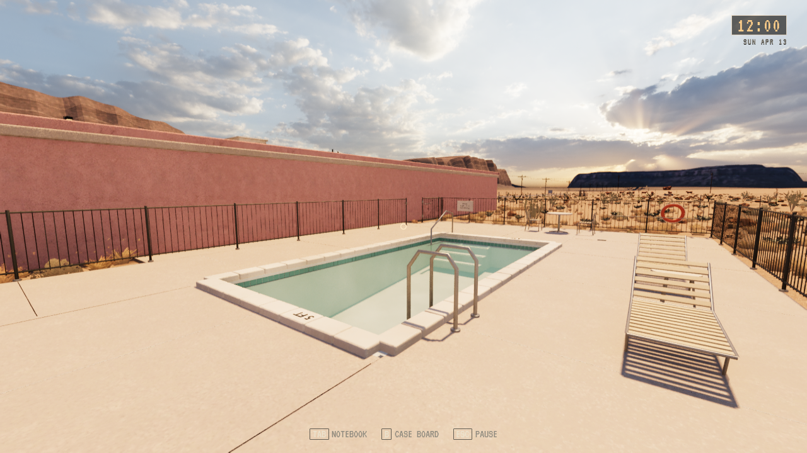
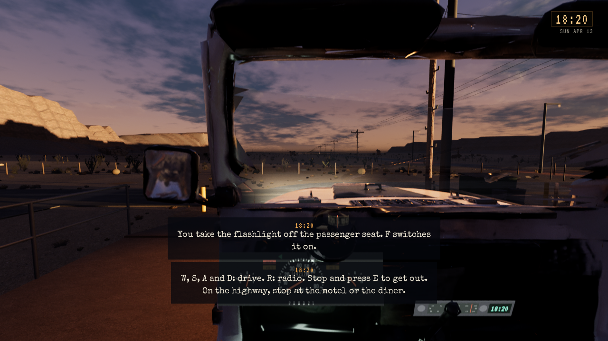
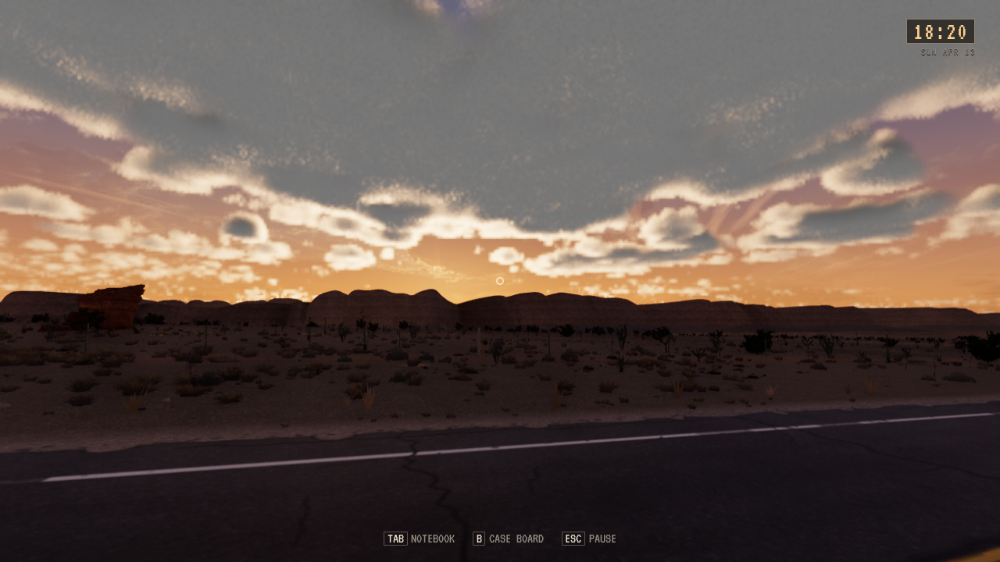
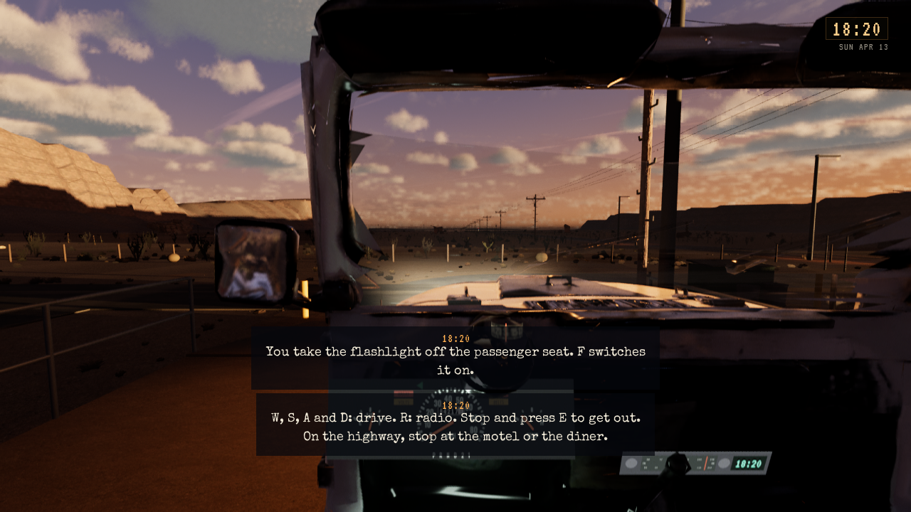

# Tripo-flåte, motell og ravgul solnedgang

**Status:** Gjeldende. **Gjelder:** lokal Linux-installasjon, UE 5.8.4/Vulkan. **Sist kontrollert:** 31. oktober 2026.

Kilde `c8c8fa89`, [PR298](https://github.com/Tombonator3000/SIGNAL-47/pull/298) og [PR299](https://github.com/Tombonator3000/SIGNAL-47/pull/299) mot main. Fem private Tripo-originaler er bevart og tilpasset i Blender: kjørbar service-jeep, gammel SARO-truck i sideparkeringen, diner-trekkvogn, politibil med egen dør og to UFO-modeller med F10-forhåndsvisning. 3 769 015 originale trekanter er redusert til 364 631 i nærmodellene, med ytterligere to LOD-er. Jeepens kildehjul er ennå ikke separat animert.

Caliche- og motellnivåene har samme faktiske FBX-ramme; bygningsretninger og motellets svevende/overlappende LOD-deler er rettet. Storskiltet beholdes også nærme. Basseng, terrasse, gjerde og møbler ligger bak romrekken med tilpasset terrengkutt og vegetasjon. TV-film/lyd oppdateres i åpningsfasen. Terminalens viste 100 % og godkjenning deler avrunding, med opprinnelige service-/retningskrav beholdt.

Solnedgangen har ravgul vesthimmel og gyllent skylys med kjøligere skygger; original nattprofil og nattassets er bevart.

Bygg og 1838 selvtester består. Kildekontroll av native modeller dekker tre render-LOD-er; faktiske Vulkan-bilder viser bygningsfronter, normalt motell, bakre basseng, cockpit og begge UFO-er. TV-prøven leser to faktiske GPU-skjermrammer og fremadgående film-/lydklokker. Motellruten bruker normal Walker og isolert disk/title/Continue. Dette er avgrensede skript-/bildeprøver; naturlig helnatt, menneskelig kjøring, lytting og Toms visuelle aksept er ikke ferdig verifisert. Ingen offentlig spillrelease er utført.

Private native Tripo-assets er lokale under `Content/Licensed/TripoFleet`, også kopiert til det kanoniske lokale prosjektet. Andre arbeidskopier må kopiere disse før pakking; råfiler og avledede modeller ligger utenfor offentlig Git.

Installert kl.23:55 CET. Pakken består 1838 selvtester og faktisk TV-film/lyd. Installert startfil består med native jeep og varm solnedgang. Alle 149 Saved-elementer/118 filer er uendret. Motellrute består 60 punkter, 14 interaksjoner, 7 dørnisjer og 228,68 m med normal Walker og isolert disk/title/Continue. To eldre genererte payload er pensjonert, nåværende kandidat og to eldre beholdes.

