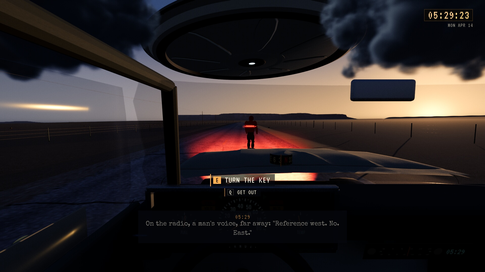
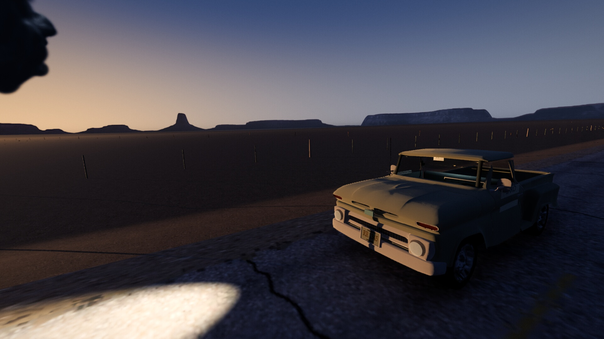
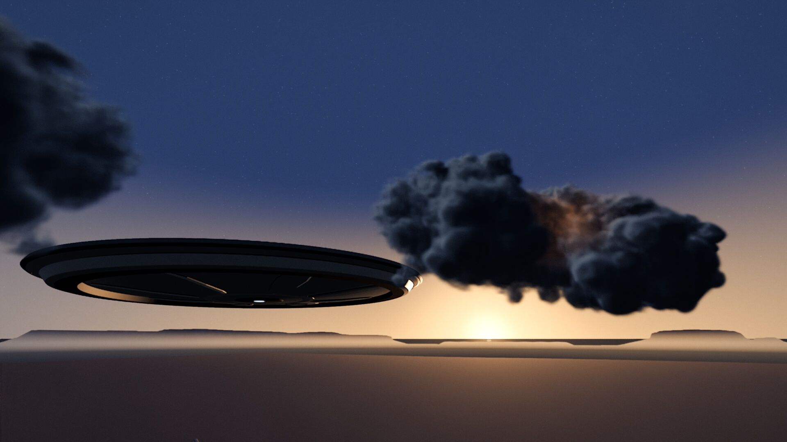

# UFO-finalen med cloud tank-skyer

**Status:** Gjeldende, installert til visuell vurdering. **Gjelder:** kilde `a202d88a`, main `31e153b9`, UE 5.8.4 Linux/Vulkan. **Sist kontrollert:** 31. oktober 2026 kl. 08:00.

[PR262](https://github.com/Tombonator3000/SIGNAL-47/pull/262) leverer den fysiske fartøyavsløringen i SC13, og [PR263](https://github.com/Tombonator3000/SIGNAL-47/pull/263) gjør første kameraheving jevn. Toms bestilling er episk cloud tank-uttrykk, faktiske bilder underveis og aktiv iterering til minst 31. oktober kl. 08. Nattarbeidet og siste bildegjennomgang er ført fram til kl. 08:00. Visuell sluttaksept fra Tom gjenstår.

Et eget, opakt v5-fartøy har åtte brede bærefelt, separat konstruksjonskrage og tre LOD-er. To lokale volumskyer bruker ni stadier fra samme bevarte Mantaflow-bake, med wavelet-detalj. Alle ni er bekreftet på GPU som 256³ PF_R16F. Volum og naboblanding følger eksisterende Chapter6-fase. Skyene dekker skroget ved motorstopp og åpner seg fysisk, med kald ytterkant og varm glød i foldene. Fartøyet kommer frem uten opacity-fade. High bruker 128 marsjsteg; Low bruker 28.

Vanlige skyer, cirrus og tilhørende lyskompensasjon viker lokalt under innkjøringen og gjenopprettes ved cleanup. To private bakkematerialer fjerner fargesøm og grove normalbrudd uten å endre terreng eller kollisjon. Tom kabin, rattkopier, lokal kabinfylling og roligere stjerner støtter uttrekket. De originale materialene og komponentflaggene gjenopprettes.

Et fullført pakkeopptak avdekket et kamerarykk rundt sju sekunder: bevegelig kamera og siktepunkt kom nær hverandre. Kun orienteringen ved 6,5 til 13 sekunder bruker nå de opprinnelige enderetningene med Slerp. Målt topp i den installerte sekvensen er 21,453 grader/s, tidligere 116,03; mellompartiet holder 29,063. Posisjoner, fallback og siste blikk er bevart.

THE EVENT er fortsatt 47 sekunder. Uttrekket varer 34 sekunder med den eksisterende uttoningen etterpå. C 8.15, budet ved 10.4 som ikke nås, 1420.405 MHz, 27 antenner, az 026, siste 031°/48° og originalfotoet fra 1947 er beholdt. Ingen ny slutt eller ny taletekst er lagt inn.

## Pakke, måling og installasjon

Ny Game-binær er bygget og arkivert etter kamerarettingen. Alle fem kokte containere fra den kontrollerte PR262-pakken er byteidentiske; C++-rettingen krever ingen ny asset-cook. Den aktuelle pakken består 1 750 selvtester og 98 sekunders High- og Low-kjøring. Pakket native-bildekontroll bekrefter ni R16F-volum, High 128, begge normalvarianter og skjult vanlig vær. Installert isolert Low-bildekontroll bekrefter ni volum og 28 steg.

[Ytelsesdata](UFO_FINALE_2026-10-31/performance.json) gjelder RTX 3080 10 GB, i7-12700KF og 1080p utgang uten bildefangst, med vanlig preset og Carpenter-bilde. Low bruker presetens oppskalering. Det blandede finalevinduet rundt 15 til 57 sekunder gir High 92,7 FPS / GPU 9,99 ms og Low 113,9 FPS / GPU 8,04 ms. Dette er gjennomsnitt for det valgte vinduet, ikke minste FPS, ren EVENT-måling eller løfte for andre maskiner.

[Installasjonen](UFO_FINALE_2026-10-31/installation.json) kl. 06:56:25 matcher 68 payload-noder. Alle 134 personlige Saved-noder er bevart. Den vanlige starteren bruker denne pakken. Forrige installasjon er bevart som kontrollert CoW-kopi. Godkjente SARO-rom, siste Tripo-armatur, Tripo14 og videreføringen etter Claude er med. Ingen offentlig spillrelease er oppdatert. Loggen fra det hele opptaket viser at vanlig vær og sanntidscapture kommer tilbake ved tittelovergangen.

[Hele opptaket fra installasjonen](UFO_FINALE_2026-10-31/capture-summary.json) fullførte gjennom originalfotoet, med 7 872 HD-bilder og faktisk 6-kanals 48 kHz spillmiks. Bildefangsten startet ved faktisk mile 5,90016 etter utviklerinngang til C6 fra diner. Kamera og sekvenstid er vanlige; dette er ingen menneskelig SC01-SC13-helreise. Alle registrerte kameraposisjoner og orienteringer er endelige tall. HD- og mobilfilm er eksportert fra disse råbildene. [Mobilfilm med hele sluttforløpet, 5:32 / 39 MB](UFO_FINALE_2026-10-31/ufo-finale-mobil.mp4) og [kort utdrag, 1:31 / 9 MB](UFO_FINALE_2026-10-31/ufo-utdrag.mp4) er bevart med Git LFS. Utdraget slutter før tittel/kreditter/foto; hele filmen inneholder originalfotoet. Begge er H.264/720p med stereolyd og eksplisitt BT.709-farge. Lokal HD-kopi er 1080p, omtrent 355 MB. Rene 3840×2160-bilder er også tatt fra installert High med native vær klart; dette er frosne utviklerbilder, ikke avspilt bevegelse eller en 4K-ytelsesmåling. Eksportkopien korrigerer omtrent 1,05 prosent drift mellom lydopptakets klokke og bildeklokken med et estimat fra endepunktene; rå WAV, bilder og tidsmanifest er urørt. Dette er ingen påstand om samplenøyaktig lydsynk.

Etter installasjonen pensjonerte det kanoniske oppryddingsverktøyet bare sju genererte payload-filer i den overflødige Claude-kandidaten. Dagens installasjon, testkandidaten og forrige installasjon er beholdt; kilder, Saved, logger og råbilder er bevart.

Faktiske bilder fra den normale installerte sekvensen:

[Rent 4K-bilde av det samme utsnittet](UFO_FINALE_2026-10-31/hero-4k.png), tatt med frosset utviklertid i installert High. Filmrammen over er frame-005981.jpg ved 26.978 sekunder i det normale opptaket.

## Kilder og grenser

[Produksjonsverktøy og innstillinger](../../../unreal/Signal47/Tools/finalesky/README.md) beskriver den egne Blender-/FBX-kilden, bevarte VDB-data, native import, sekvensmateriale og utvikleropptak. Prosjektbiblioteket ble søkt; ingen kompatibel, ferdig testet fluidløype ble funnet. Ingen ekstern modell eller filmplate er kopiert.

Ett tidlig Low-forsøk fikk Vulkan device-lost/Xid109. Identisk gjentakelse, LowOff og senere Low-pakker fullførte. Årsaken er fortsatt ubevist; dette er ingen påstand om driverretting. Windows, andre maskiner, menneskelig input/lytting og Toms endelige visuelle aksept er ikke bekreftet. Ny sak, alle FOV-/pause-/restore-varianter og full spillmatrise er ikke kjørt på nytt for denne visuelle leveransen.
