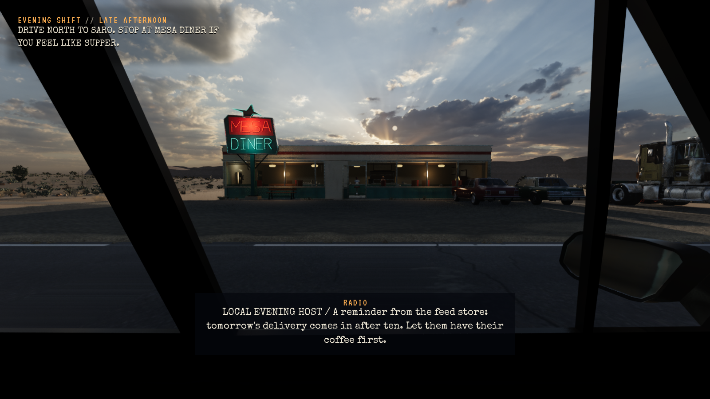

# Vegetasjon ved kameravending og raytracing-overlegg

**Status:** Installert. **Gjelder:** runtime `867dd44a`, UE 5.8.4 / Linux / Vulkan. **Sist kontrollert:** 1. november 2026, kl. 18:04 CET. [PR314](https://github.com/Tombonator3000/SIGNAL-47/pull/314).

Vegetasjonen beholder et avstandsbegrenset plantedekke rundt hele kameraet med samme artscaps og fade. Linux omgår occlusion queries som feilaktig forkastet synlige plantegrupper ved kameravending. Vanlig frustum-, instans- og avstandsculling brukes fortsatt. Dette kan tegne mer geometri bak andre objekter; FPS for en hel rute er ikke målt.

Raytracing-utvikleroverlegget er slått av med `r.RayTracing.ShowOnScreenWarnings=0`. Raytracing og geometribudsjettet beholder sine eksisterende innstillinger.

Editorbygg, normal Linux-pakking og 1957 selvtester består. Den pakkede flora-turn-prøven bruker et uttrykkelig fast biløye ved Mesa Diner og fem kameraretninger: foran, venstre, bak, høyre og retur. Alle beholder sju arter, 4099 instanser og identiske transformdata. De fem faktiske Vulkan-bildene er gjennomsett; side-/bakoverbildene viser det gjenopprettede plantedekket. Dette er en avgrenset utviklerfixture, ikke fysisk museinput eller en hel gjennomspilling.

| Før synlighetsrettingen (`14216962`) | Installert retting (`867dd44a`) |
| --- | --- |
|  |  |

Installert kl. 18:04 CET i `~/Games/Signal47/Linux`. Kort Fortsett-prøve fra isolert kopi av saken består. Den leser faktisk `r.AllowOcclusionQueries=0` og avslått skjermvarsel fra SystemSettingsIni. Alle 151 personlige Saved-elementer er uendret; store payloadfiler er installert med kontrollerte Btrfs-reflinks. Original forrige payload er bevart for rollback.

Lokale rålogger/bilder: `/home/tom/scratch-bm/Signal47-foliage-camera-20261101`, særlig `packaged-r3.log`, `packaged-r3-result.json`, `packaged-r3-shots/`, `installed.json` og `payload-reflinks.json`.

Bibliotekskilde: [festet UE 5.8 foliage/HISM-referanse](https://github.com/kevinpbuckley/unreal-engine-skills/blob/b22b11d0a46bac2d55eae8d3273d2ef22c08a95d/skills/core/ue-landscape-and-foliage/references/foliage-and-hism.md), kontrollert mot den lokale motorkoden. Løsningen bruker eksisterende prosjektkode og rendererinnstillinger.
