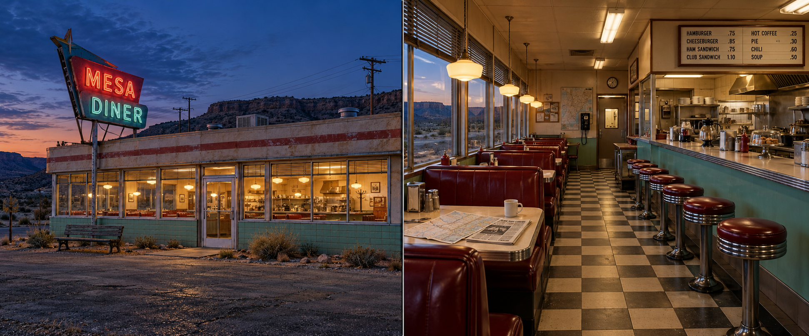
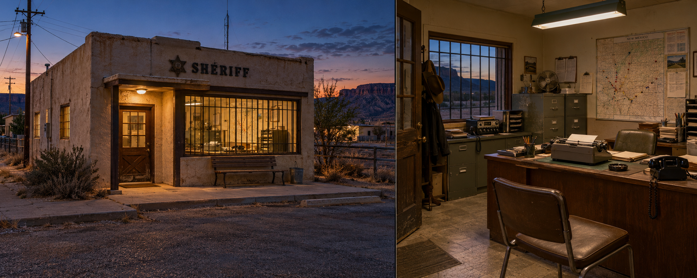
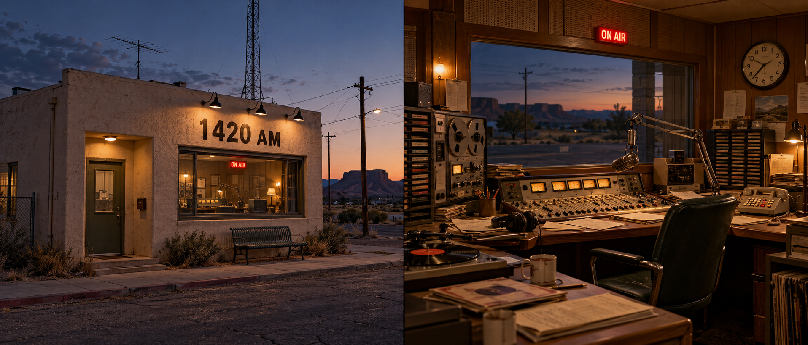
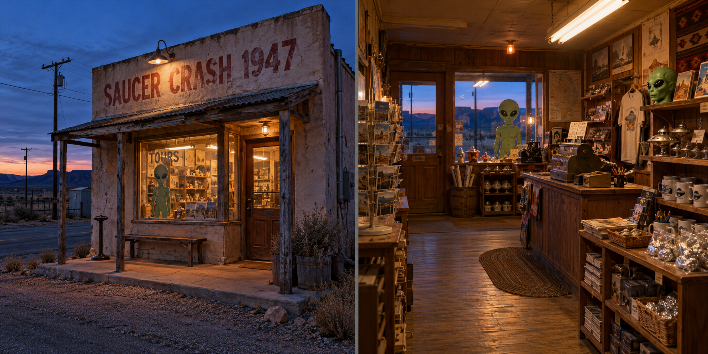
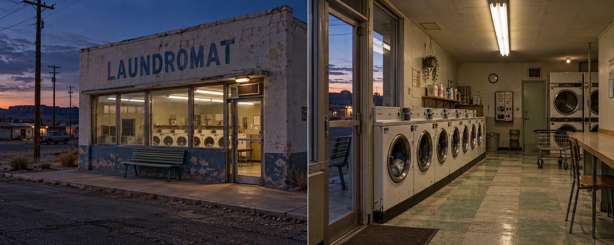
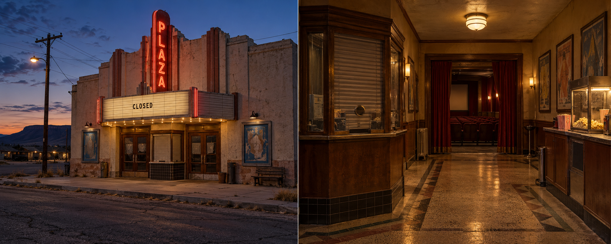
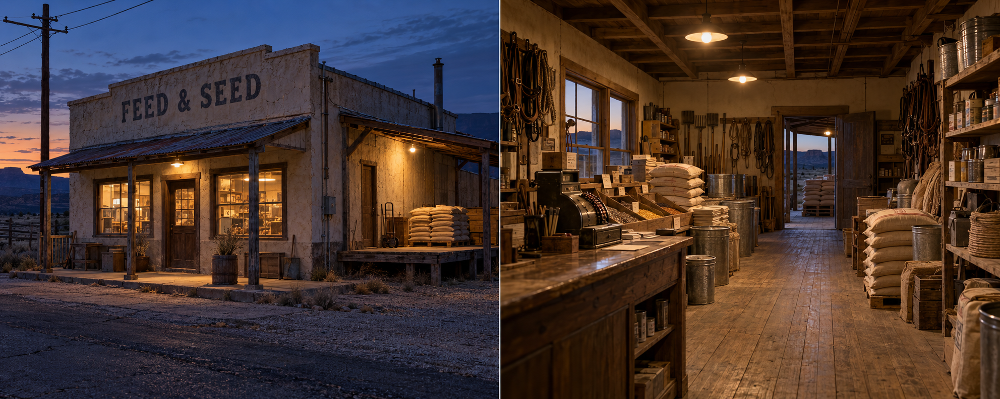
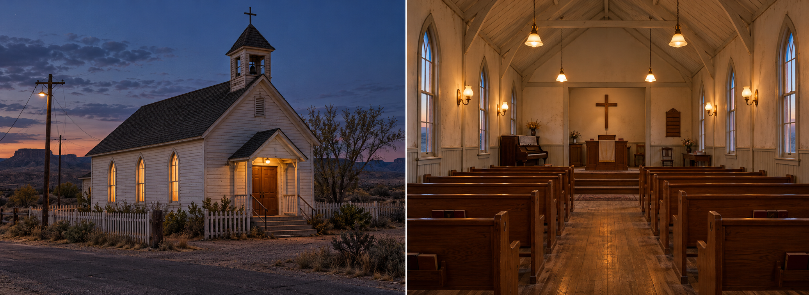

# Caliche: eksteriør og interiør

Åtte konseptark for SIGNAL / 47, New Mexico i 1986. Hvert bilde har eksteriør til venstre og foreslått interiør til høyre. Bensinstasjonen er uttrykkelig utelatt.

Laget med innebygd image_gen, med mer naturtro materialer og kveldens varme praktiske lys. Visuell retning fra de eksisterende Caliche- og Mesa Diner-konseptene og bygningslisten i ANOMALY_PLAN.md. Bildene er gjennomgått visuelt. Dette er konseptkunst for modellering, ikke Unreal-skjermbilder eller ferdige spillmodeller. Kinoens, fôrbutikkens og kirkens interiører er designforslag og lover ikke nye åpne spillområder.

Komplette prompter, kildefiler og SHA-256 ligger i prompts-and-manifest.json. Ingen spillkode eller eksisterende bygningsassets er endret.

Bruk arkene som inspirasjon til egne Blender-modeller: bygningsvolum, materialer, vindusdybde, skilt, innredning og lokale lyskilder. Mål, plantegning, tekst på småskilt og nøyaktig antall rekvisitter må fastsettes i modelleringen. Bevar spillets eksisterende innganger, interaksjoner, siktlinjer og anomalireferanser. Fullverdige interiører i stengte bygg må avtales som egen spillfunksjon.

## Mesa Diner

## Sheriffkontoret

## Radiostudio 1420 AM

## Suvenirbutikken

## Vaskeriet

## Plaza-kinoen

## Fôrbutikken

## Kirken

