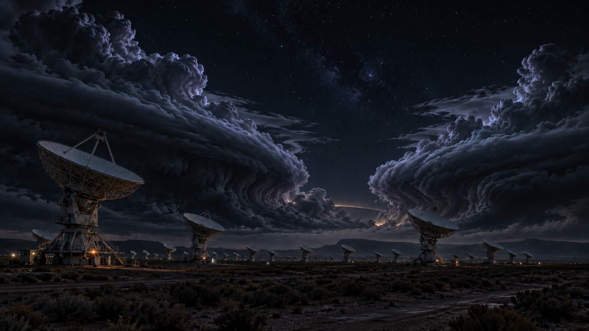
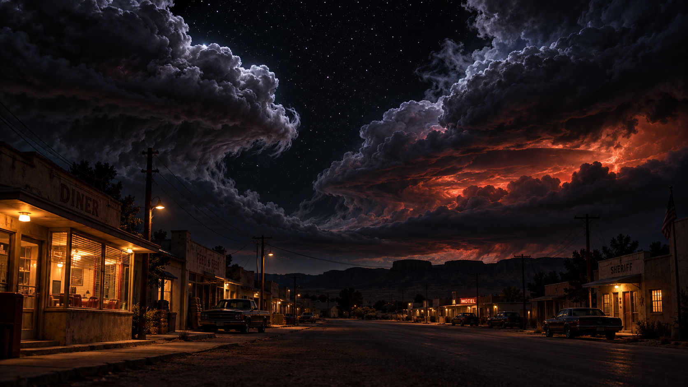
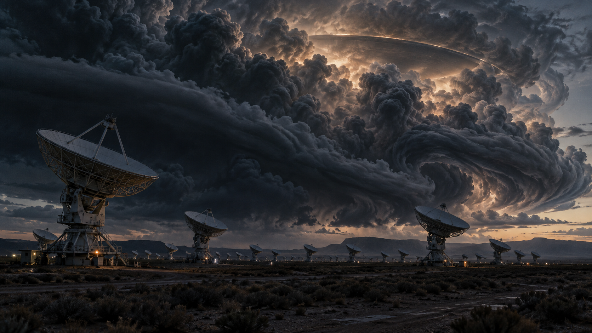

# Cloud tank-skyer over SARO og Caliche

Tre AI-genererte konseptbilder, laget 28. oktober 2026 med innebygd image_gen etter Toms bestilling. Bildene er visuell regi for [finaleideen og gjennomføringsoppskriften](../../FINALE_CLOUD_TANK_UFO.md). De er ikke bilder fra spillet, en bekreftelse på implementert effekt eller ytelsesbevis.

## Gjeldende retning: skyene velter fra hver sin side

Tom presiserte etter SARO v1 at skyene skal **velte fremover fra hver sin side**. To adskilte, tunge skybanker ruller frem mot betrakteren og inn over området. La en mørk himmelpassasje stå åpen mellom dem. Dette skal føles som maling i vann, med overhengende kanter som folder seg frem og under seg.

SARO v2 er gjeldende referanse for skyenes retning og oppdeling. Caliche-bildet prøver samme formspråk over byen, med rødoransje glød inne i skyene. SARO v1 bevares som første utforskning av volum, lys og UFO-skala.

## SARO v2: to separate skybanker

[Full oppløsning](SARO-cloud-tank-konsept-v2.png) | [Prompt](SARO-cloud-tank-konsept-v2-prompt.txt)

## Caliche v1: skyene over byen

[Full oppløsning](Caliche-cloud-tank-konsept-v1.png) | [Prompt](Caliche-cloud-tank-konsept-v1-prompt.txt)

## SARO v1: første volum- og lysstudie

[Full oppløsning](SARO-cloud-tank-konsept-v1.png) | [Prompt](SARO-cloud-tank-konsept-v1-prompt.txt)

## Bruk i produksjon

- Bruk skyform, bevegelsesretning, lys og størrelsesfølelse som visuelle mål.
- Bygninger, antenneantall, plasseringer, terreng og fartøyform i bildene er kunstneriske tolkninger. De erstatter ikke spillets faktiske modeller, koordinater eller kanon.
- Bybildet er en konseptvariant og flytter ikke automatisk hovedavsløringen til SC12. Anbefalingen om hovedavsløring i SC13 og en mulig svak antydning i SC12 står i designnotatet.
- Ingen Unreal-teksturer, modeller, materialer eller effekter er produsert av denne opplastingen. 60+ FPS og spillerpåvirkning er fortsatt UNVERIFIED.
- Filmstillbildene Tom brukte som stemningsreferanser er ikke tatt med. Mappen inneholder bare de tre genererte bildene og tilhørende dokumentasjon.

Alle bildene er bevart som opprinnelige PNG-filer på 1672 x 941 piksler. [Manifestet](manifest.json) har filstørrelse, SHA-256 og Git-blob-ID for hver fil.
