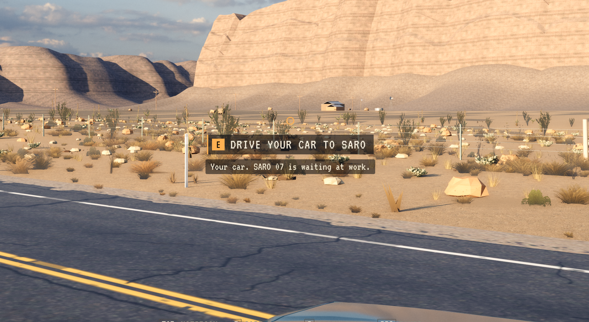
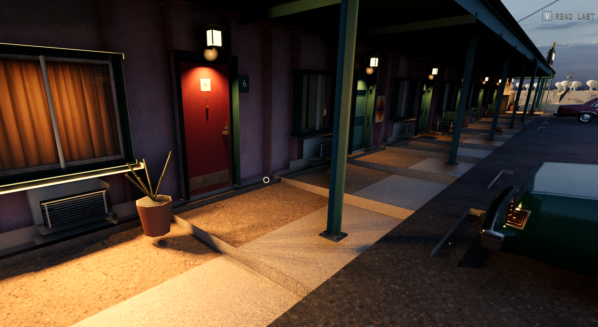
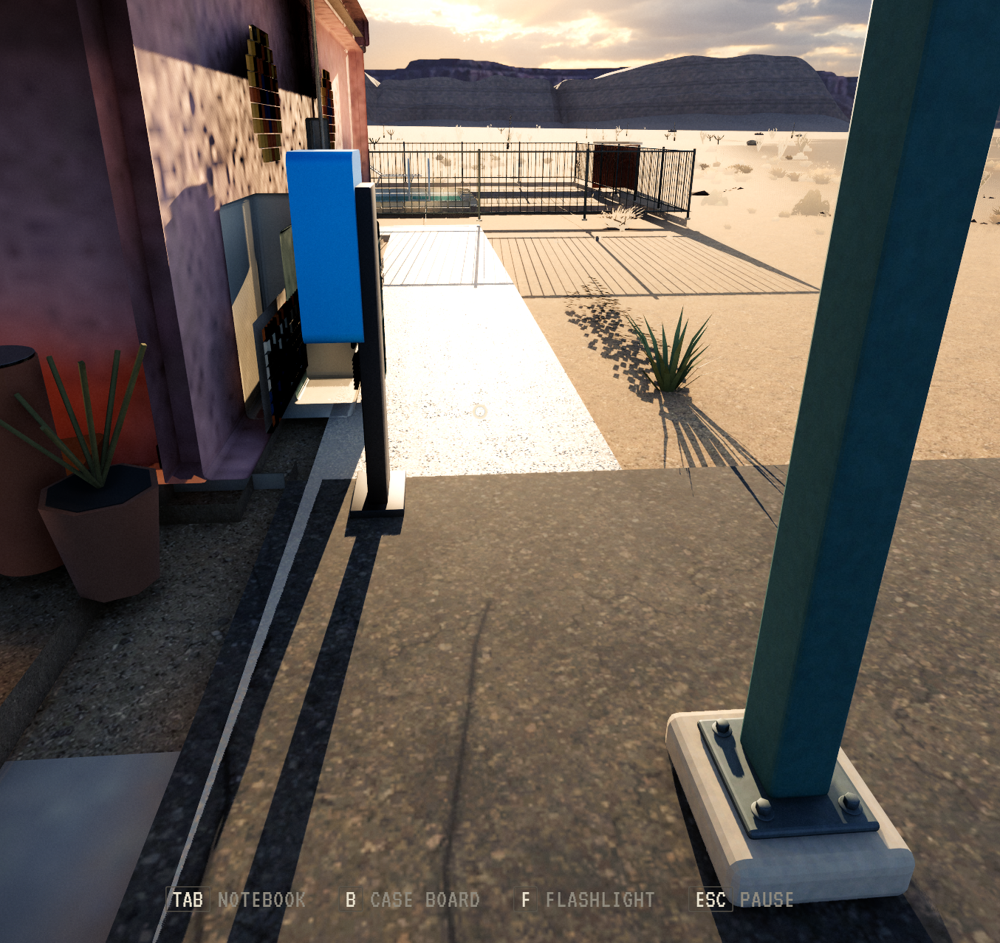
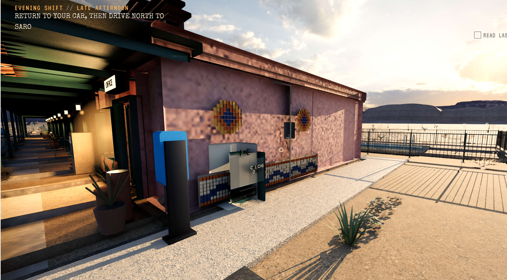
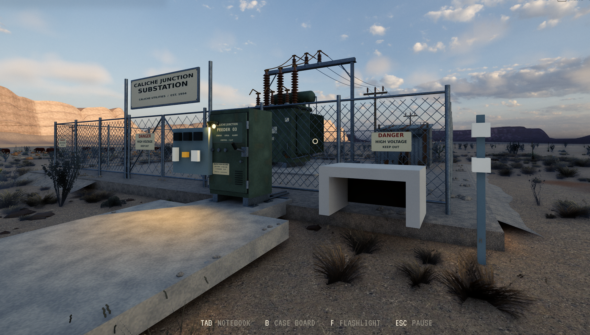

# Bilde- og krasjbevis fra Tom, 28. oktober 2026

[Arbeidsliste med alle ni punktene](../../PLAYTEST_TODO_2026-10-28.md). Bildene nedenfor er originale spillerbilder levert av Tom, uten beskjæring, retusjering eller generering. Opptaksversjon og opptakstid er ikke innebygget i de mottatte bildene. Nummereringen følger vedleggene i chatten, inkludert Toms henvisning til bilde 5.

| Bevis | Knytning | Det bildet faktisk viser |
| --- | --- | --- |
| E01 | Punkt 4 | Gårdsbygninger/vindmølle i landskapet overfor hovedveien. |
| E02 | Punkt 5 | Motellfasade, gangnivå, svevende potte og trinn ved dører. |
| E03 | Punkt 5 | Resepsjonens CRT og overlappende lampebaser/støtter. Stillbildet dokumenterer ikke filmbevegelse. |
| E04 | Punkt 5 | Gang-/terrengovergang mot basseng, telefonens side og bassenggjerde. |
| E05 | Punkt 5 | Telefon, motellvegg, dekor og overlappende ICE-/avis-/skiltdeler. |
| E06 | Punkt 7 | Trafostasjonens enkle gjenværende deler og kontakt mellom plattform, rampe og terreng. |

Ingen av vedleggene dokumenterer byfasadene, trafikksignalet eller SARO-dialogen. Musehopp, usynlig kollisjon, filmstans og flakkende gangvei er Toms rapporterte observasjoner; statiske bilder beviser ikke tidsforløpet.

## E01: farm og vei

## E02: motellets gangnivå og potte

## E03: resepsjonens TV og doble lamper

## E04: gangvei og bassengområde

## E05: telefon og feil ved motellveggen

## E06: svevende/enkle trafodeler og terrengkant

## Krasjvedlegg

[PID1692368 kl.16:30:37](crash-1692368-excerpt.txt) og [PID1710609 kl.16:53:16](crash-1710609-excerpt.txt) inneholder mottatt signal, installert kjørbar fil, tidspunkt og første rapporterte tråd. Begge viser Vulkan-bufferallokering og transient heap. Dette er utdrag, ikke full motorlogg eller komplett coredump, og de fastslår ikke samtidig editor eller eksakt rotårsak.

Begge komplette originale tekstvedlegg er bevart uten endring i `/home/tom/scratch-bm/Signal47-playtest-report-20261028/originals/`. Originalenes SHA256 og utdragenes SHA256 står i [manifest.json](manifest.json), sammen med alle bildekontrollsummene.
